# Kapı kolunu modelleme

Önceki eğitimdeki ([Orijini değiştirme: bir kapı](puerta.md)) kapıdan başlıyoruz: 0,90 × 0,10 × 2 metre ölçülerinde ve orijini menteşede. Ona iki parçalı bir kapı kolu yapacağız: kapıya yapışık bir **plaka** ve dönen bir **kol**.

Bu sırada şunları öğreneceksin:

- bir yüzü çoğaltıp ondan yeni bir parça oluşturmak;
- bir örgünün bir parçasını başka bir nesneye **ayırmak** (<kbd>P</kbd>) ve yeniden **birleştirmek** (<kbd>Ctrl</kbd> + <kbd>J</kbd>);
- bir örgünün her parçasına farklı bir **malzeme** vermek;
- kapı kolunun kapının iki tarafında da olması için **Ayna** değiştiricisini kullanmak;
- hiç görünmeyen yüzleri **X-Işını** ile görmek ve silmek;
- 3D imleçle **orijini** kolun döneceği yere koymak;
- birlikte hareket etmeleri için kolu kapıya **ebeveyn atama** ile bağlamak.

## 1. Plaka

1. Kapı seçiliyken **Düzenleme Modu**'na geç (<kbd>Tab</kbd>) ve **Köşe / Kenar / Yüz** düğmesinden **Yüz**'ü seç.
2. Kapının öndeki büyük yüzüne tıkla.
3. **Onu çoğalt:** <kbd>Shift</kbd> + <kbd>D</kbd>. Kopya fareye yapışık çıkar; sağ tık (ya da <kbd>Esc</kbd>) onu olduğu yerde, tam orijinalin üstünde bırakır.
4. Küçük bir kare olana kadar **küçült**. Göz kararı: <kbd>S</kbd> ve fareyi hareket ettir; ardından yalnızca yüksekliği ayarlamak için <kbd>S</kbd> <kbd>Z</kbd>. Sayılarla: <kbd>S</kbd> `0.15` <kbd>Enter</kbd> ve <kbd>S</kbd> <kbd>Z</kbd> `0.45` <kbd>Enter</kbd> 13,5 cm'lik bir kare bırakır.
5. Onu menteşenin karşı tarafına, kapı kolunun geleceği yere **taşı**: <kbd>G</kbd> <kbd>X</kbd> `-0.31` <kbd>Enter</kbd>.
6. Kalınlığı olsun diye onu biraz **ekstrüde et**: <kbd>E</kbd> `0.03` <kbd>Enter</kbd> (3 cm).

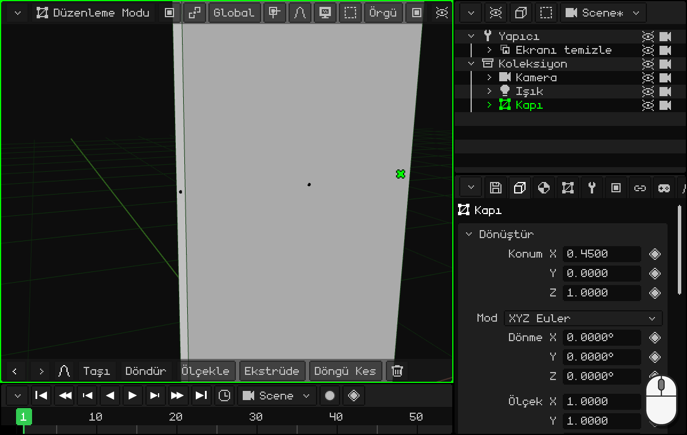

 Dokunmatik ekranda: yüze bir dokunuş ve **Örgü → Çoğalt** (kopya üstte kalır). Ardından araç çubuğunda **Ölçekle**, **Taşı** ve **Ekstrüde**; sayılar üstteki çubuğun klavyesiyle girilir, sonra onay işaretine dokunulur.

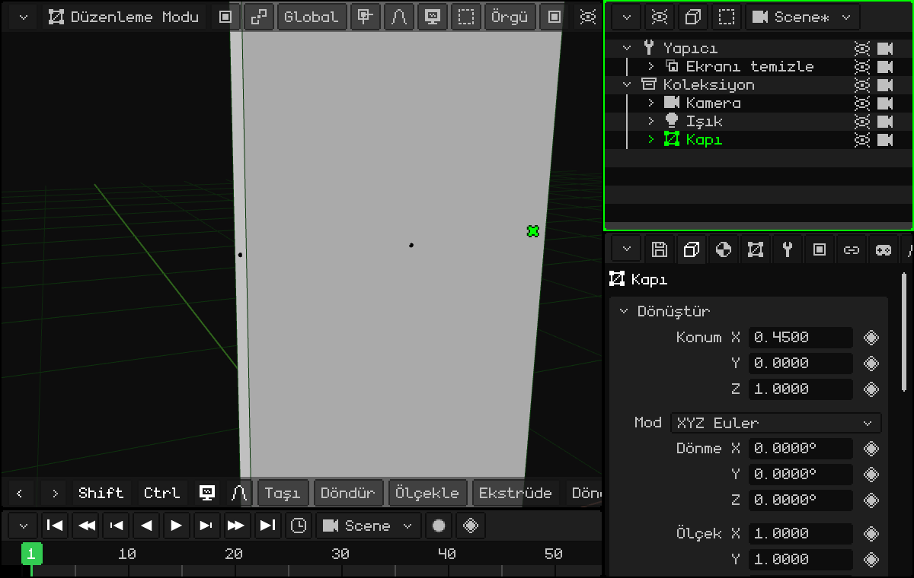

 Nokia N95'te: sol seçim tuşuyla **Örgü → Çoğalt**; ardından <kbd>3</kbd> (ölçekleme), <kbd>1</kbd> (taşıma) ve <kbd>7</kbd> (ekstrüzyon); sayılar için kalem tuşu basılı tutulur, sonra <kbd>OK</kbd>.

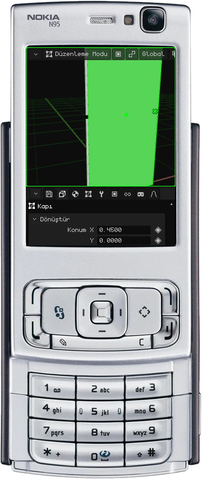

## 2. Plakayı ayırma

Plaka hâlâ kapının örgüsünün bir parçası. Onu kendi nesnesine taşıyoruz:

1. Plaka seçiliyken <kbd>L</kbd> (**Bağlantılıyı Seç**) parçanın tamamını seçer: kapı hariç, plakanın 6 yüzünü.
2. <kbd>P</kbd> (**Ayır**): plaka yeni bir nesne olur, **Kapı.001**. Onu Outliner'da görürsün.

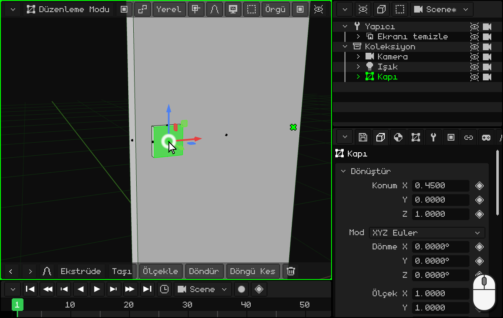

  Dokunmatik ekranda ve N95'te: **Seç → Bağlantılıyı Seç** ve plakaya bir dokunuş; ardından **Örgü → Ayır**.

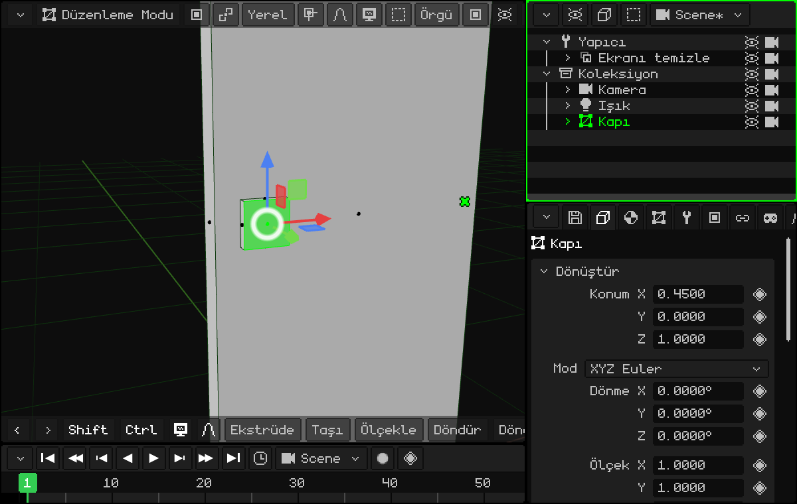

Ayırınca kapıda plakadan hiçbir şey kalmaz: ne yüzleri ne de çizgileri.

## 3. Malzemeler: ahşap ve metal

Artık her parçanın kendi malzemesi olabilir. **Özellikler**'de, **Malzeme** sekmesinde:

1. Kapıyı seç. **Malzemeyi Yeniden Adlandır** alanına `Ahşap` yaz ve **Renk**'ten bir kahverengi seç.
2. Plakayı seç (Kapı.001). Kapıdan çıktığı için onda da Ahşap var: **Yeni Malzeme**'ye dokun, adını `Metal` koy ve ona bir gri ver.

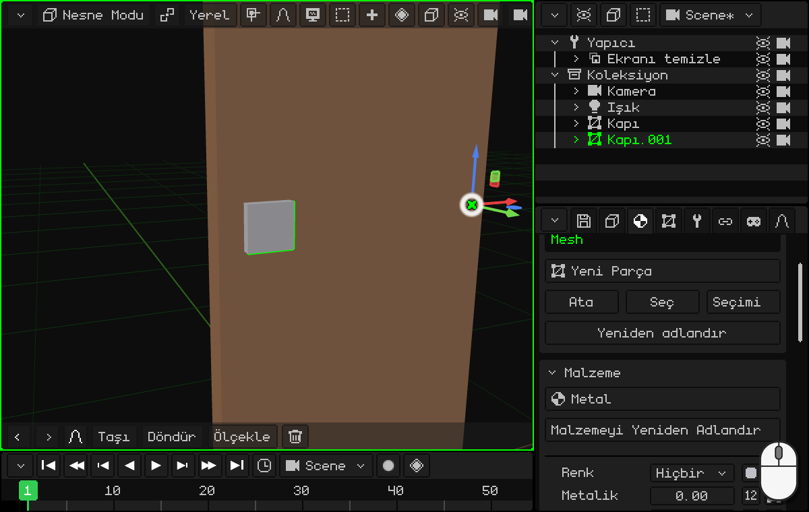

## 4. Kapının öbür tarafı: Ayna

Bir kapı kolu iki tarafta da olur. Başka bir plaka yapmak yerine **Ayna** değiştiricisini kullanıyoruz:

1. Plaka seçiliyken **Özellikler → Değiştiriciler**'de **Ayna** ekle.
2. **Ayna X**'i kapat ve **Ayna Y**'yi aç: kapının öbür tarafında diğer plaka belirir.

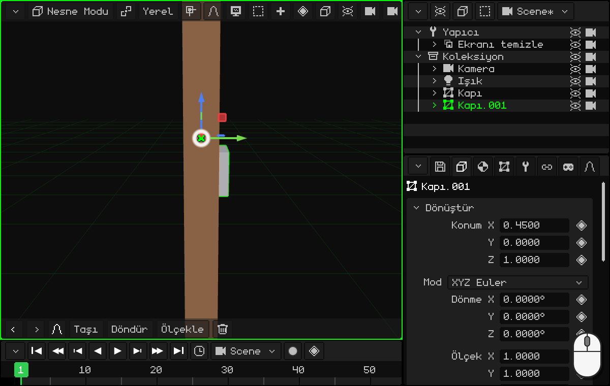

Aynalama nesnenin **orijinine** göre yapılır. Plaka kapıdan çıktı, bu yüzden orijini aynı: menteşe, tam kapının kalınlığının ortasında. Bu yüzden kopya tam olarak öbür tarafa gelir. [Ayna](../editor/modificador-espejo.md) sayfasına bak.

## 5. Kol

Kol, aynı numarayla plakadan çıkar:

1. Plaka seçiliyken sayısal tuş takımında <kbd>/</kbd> tuşuna bas (**Yerel görünüm**): yalnızca plaka görünür, üzerinde çalışmak daha kolay olur. **Düzenleme Modu**'na geç.
2. Plakanın ön yüzünü seç, onu **çoğalt** (<kbd>Shift</kbd> + <kbd>D</kbd> ve sağ tık) ve küçült: <kbd>S</kbd> `0.6` <kbd>Enter</kbd>.
3. Onu dışarı doğru **ekstrüde et**: <kbd>E</kbd> `0.08` <kbd>Enter</kbd>. Bu, kolun milidir.

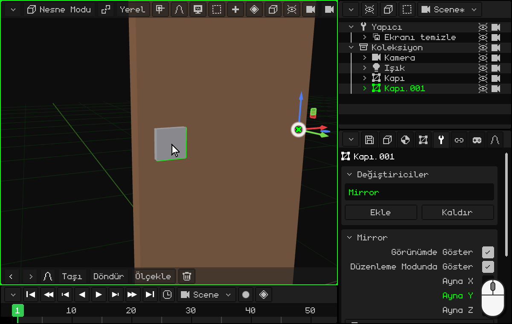
4. **Kenar**'a geç ve dıştaki, kapının ucuna bakan kenarı seç. Onu dışarı doğru taşı: <kbd>G</kbd> <kbd>Y</kbd> `0.05` <kbd>Enter</kbd>. Ön yüz eğik kalır.
5. **Yüz**'e geç ve o eğik yüzü seç. Onu normali yönünde değil, **X'te** ekstrüde et: <kbd>E</kbd>, <kbd>X</kbd>, `0.34` ve <kbd>Enter</kbd>. Kolun sapı çıkar.
6. Uç eğik kaldı. Düzeltmek için onu X'te sıfıra ölçekle: <kbd>S</kbd> <kbd>X</kbd> `0` <kbd>Enter</kbd>. Tüm köşeleri aynı X'te kalır: uç düz olur.

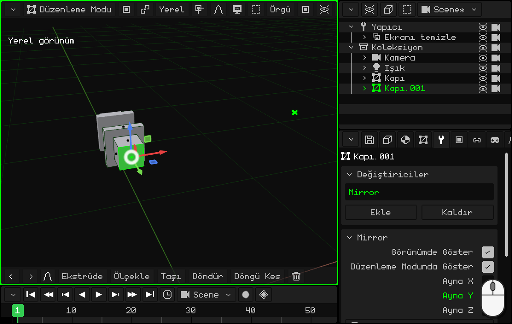
7. <kbd>L</kbd> kolun tamamını seçer, <kbd>P</kbd> de onu ayırır: **Kapı.002** olur. Ona bir ad ver: Outliner'da çift tıkla ve `Kol` yaz.

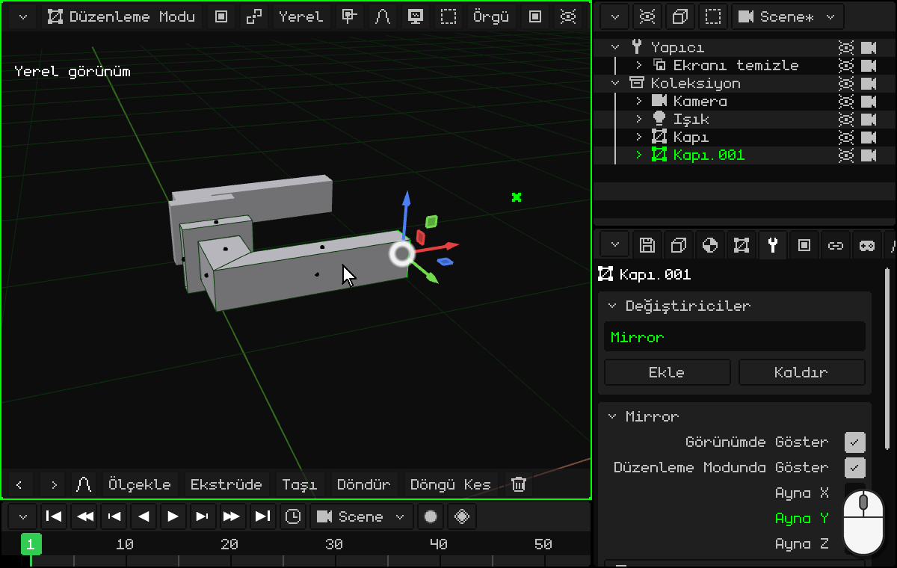

 Dokunmatik ekranda: yüze bir dokunuş, **Örgü → Çoğalt**, **Ölçekle** `0.6` ve **Ekstrüde** `0.08`; **Kenar**, dıştakine bir dokunuş ve **Taşı** **Y** `0.05`; **Yüz**, eğik olana bir dokunuş, **Ekstrüde** **X** `0.34` ve **Ölçekle** **X** `0`. Ayırmak için **Seç → Bağlantılıyı Seç** ve **Örgü → Ayır**.

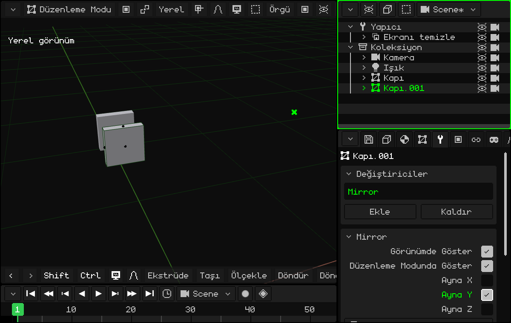

 Nokia N95'te: <kbd>3</kbd> ve `0.6`, <kbd>7</kbd> ve `0.08`; kenar (sanal fareyle), <kbd>1</kbd>, <kbd>2</kbd> (Y ekseni) ve `0.05`; eğik yüz, <kbd>7</kbd>, <kbd>1</kbd> (X ekseni) ve `0.34`; <kbd>3</kbd>, <kbd>1</kbd> ve `0`.

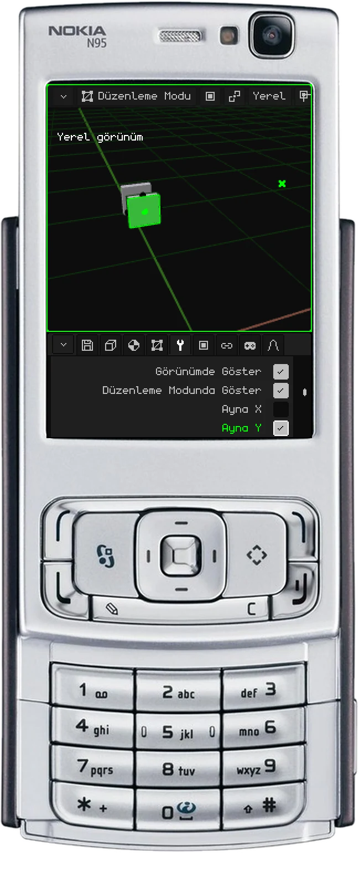

Kol plakadan çıktığı için onun malzemesini (Metal) ve Ayna değiştiricisini de taşır.

## 6. Plakayı kapıyla birleştirme

Plaka tek başına hareket etmez: kapının bir parçasıdır. Onu yeniden birleştiriyoruz:

1. Plakayı seç ve **Değiştiriciler**'de **Değiştiriciyi Uygula**'ya dokun: ayna gerçek geometriye dönüşür.
2. Plakayı seç, ardından <kbd>Shift</kbd> + tık ile kapıyı (kapı etkin olur) ve <kbd>Ctrl</kbd> + <kbd>J</kbd> (**Birleştir**). Artık iki malzemesiyle tek bir örgüdürler.

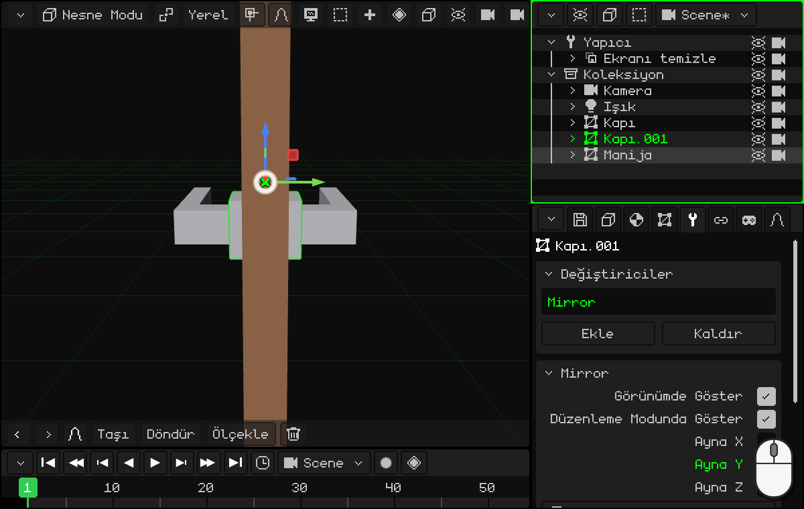

  Dokunmatik ekranda ve N95'te: **Nesne → Birleştir**.

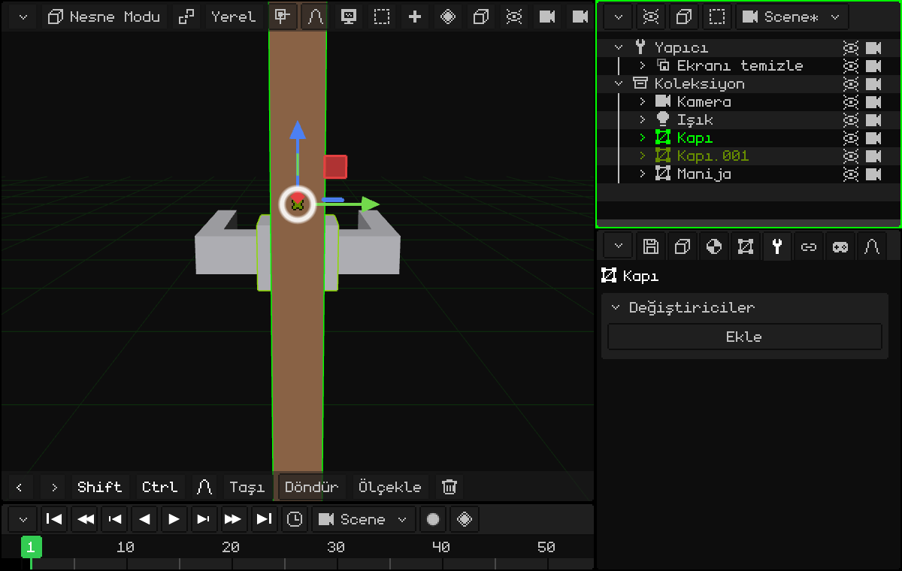

Bir örgünün parçaları böyle ayrılır ve birleştirilir: ayırmak için <kbd>P</kbd>, birleştirmek için <kbd>Ctrl</kbd> + <kbd>J</kbd>.

## 7. Hiç görünmeyen yüzler

Plaka kapıya dayalı. Her plakanın arka yüzü örtülü kalır: hiçbir zaman görünmez ama program onu yine de çizer. Onu görmek için:

1. Kapıyı seç ve **Düzenleme Modu**'na geç.
2. **Bindirmeler**'de **X-Işını**'nı aç: örgü saydamlaşır ve arka yüzler görünür.
3. Her plakanın arka yüzünü (kapıya değeni) seç ve sil: <kbd>X</kbd> → **Yüzler**.

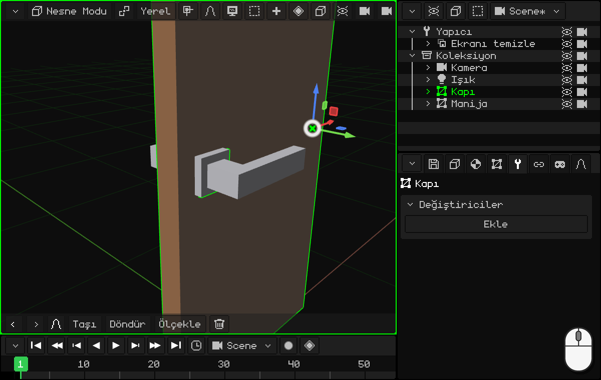

Görünmeyen geometriyi silmek iyi olur: boş yere çizilen yüzlerdir. Küçük bir modelde fark edilmez ama büyük bir sahnede ya da bir telefonda kazanılan performanstır.

## 8. Kolun döndüğü yer: orijin

Kol, kapının menteşesi etrafında değil, kendi ekseni etrafında dönmeli.

1. Kolu seç ve Ayna'sını uygula (**Değiştiriciler → Değiştiriciyi Uygula**).
2. **X-Işını** açıkken **Düzenleme Modu**'na geç. Kolun plakalara değen iki arka yüzünü seç (her taraftan bir tane).
3. <kbd>Shift</kbd> + <kbd>S</kbd> → **İmleç Seçilene**: 3D imleç ikisinin ortasına, tam kolun eksenine gelir.
4. Bu iki yüz de görünmez: onları sil (<kbd>X</kbd> → **Yüzler**).
5. **Nesne Modu**'na dön ve orijini imlece taşı: <kbd>W</kbd> (ya da sağ tık) → **Orijini Ayarla → Orijini 3D İmlece**.

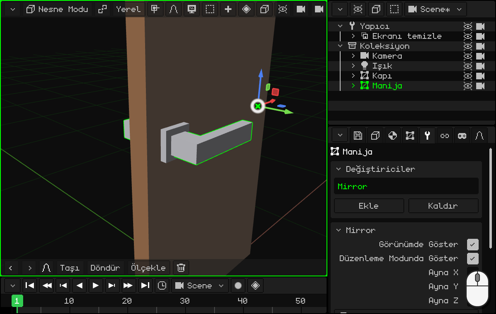

Bu, [Orijini değiştirme: bir kapı](puerta.md#orijini-menteşeye-taşıma) eğitiminde menteşeyle yaptığımızın aynısı.

## 9. Kolun kapıyla birlikte hareket etmesi

Kapıyı döndürmeyi dene: kol havada asılı kalır. İkisi birbirinden bağımsız iki nesne. Döndürmeyi geri al (<kbd>Ctrl</kbd> + <kbd>Z</kbd>).

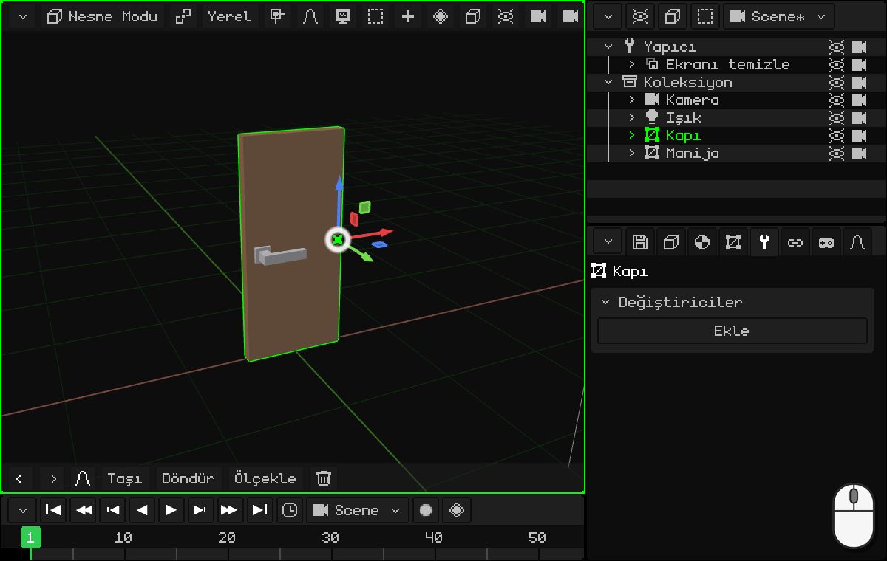

Kolun kapıyla birlikte hareket etmesi için ona **ebeveyn atamak** gerekir: kol, kapının **çocuğu** olur.

1. Kolu, ardından <kbd>Shift</kbd> + tık ile kapıyı seç (ebeveyn olan kapı etkin olur).
2. <kbd>Ctrl</kbd> + <kbd>P</kbd> → **Nesne (Dönüşümü Koru)**. Outliner'da kol kapının içine girer.

Yalnızca kapıyı seç (ona bir tık) ve yeniden döndür: artık kol onunla birlikte hareket ediyor. Kol da gerçek bir kapı kolu gibi kendi ekseni etrafında dönmeye devam eder. İkisi de seçiliyse yalnızca kapı döner, kol da onun çocuğu olduğu için onu takip eder.

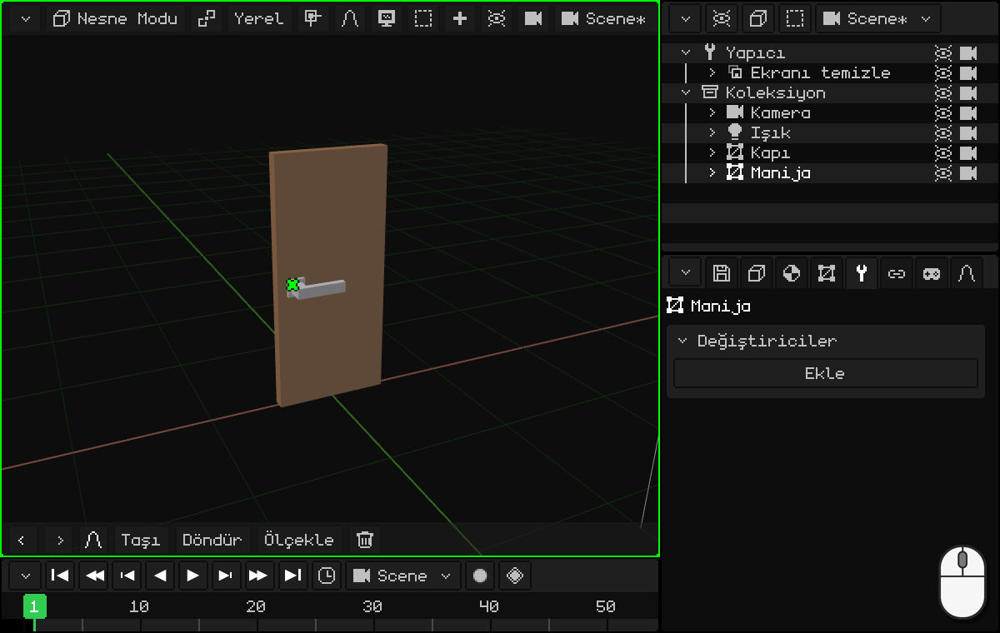

  Dokunmatik ekranda ve N95'te: **Nesne → Ebeveyn Ata → Nesne (Dönüşümü Koru)**.

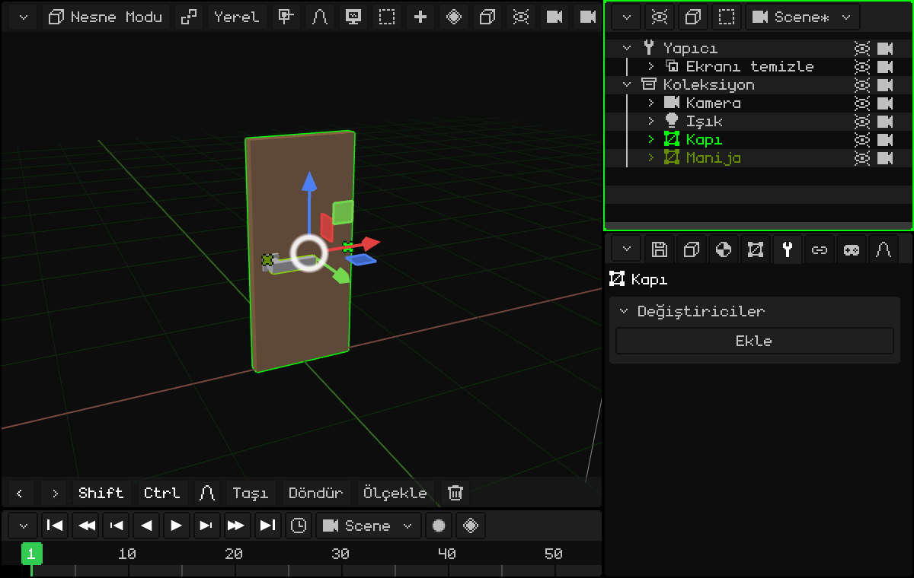

Sonraki eğitimde kapıyı canlandıracağız: [Kapıyı canlandırma](animar-puerta.md).
