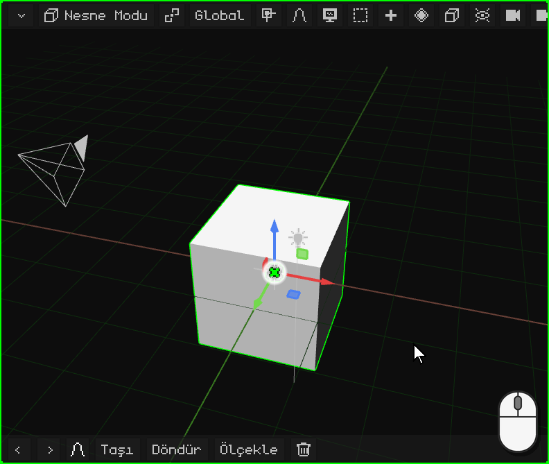
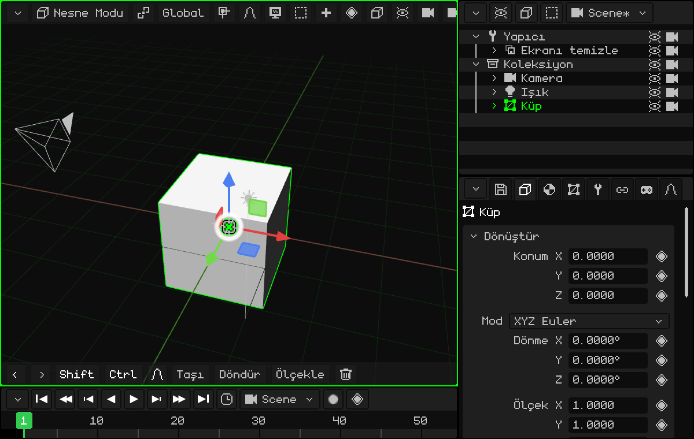
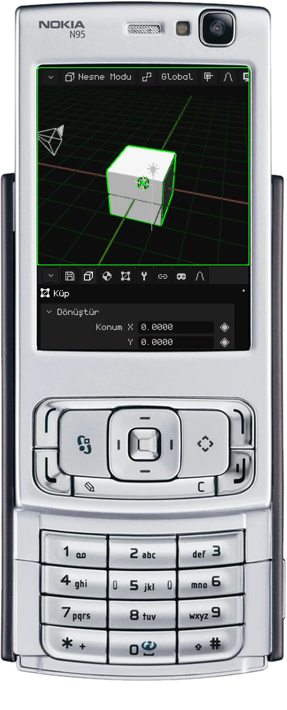
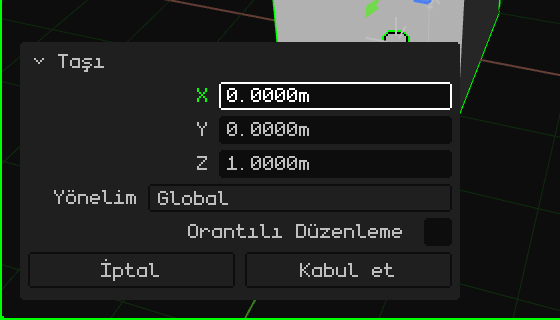
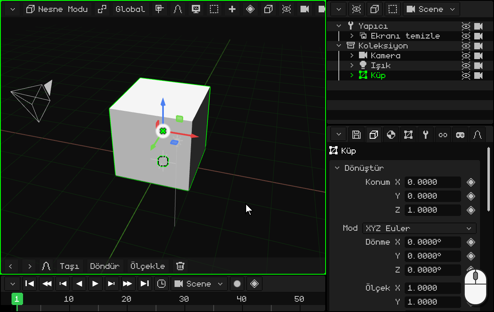
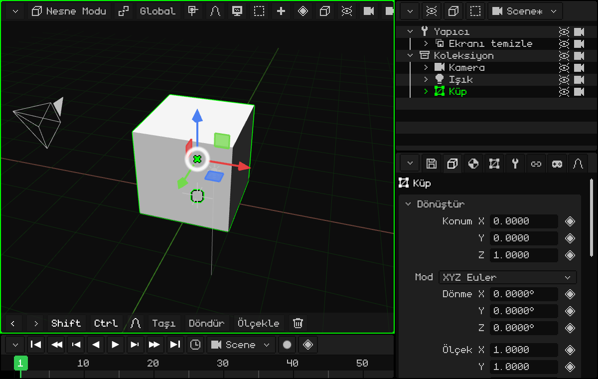
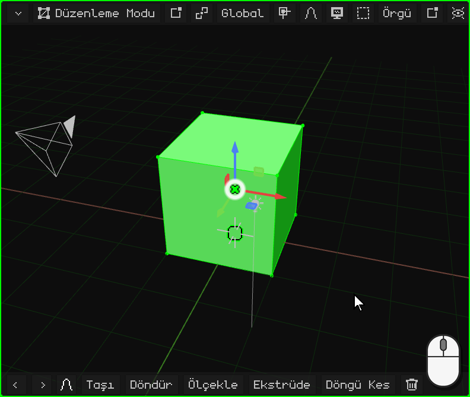
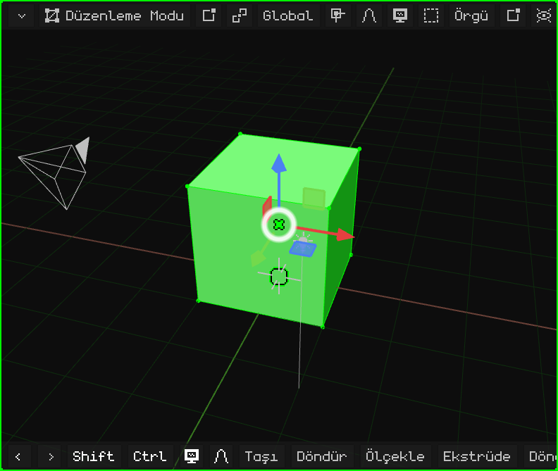
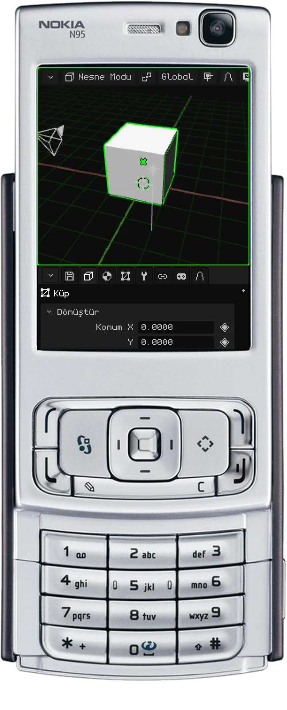
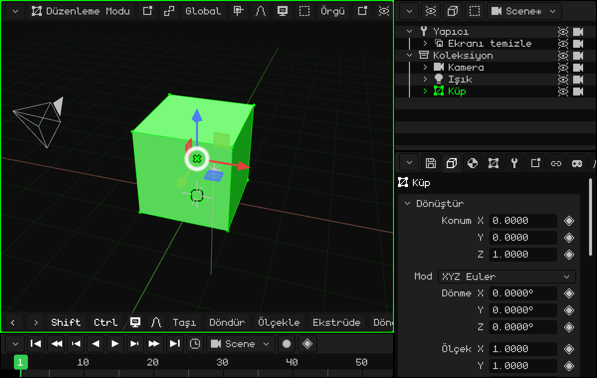

# Bir kapı modelleme

İlk basit modelimizi yapacağız: bir kapı! Başlamak için sahnede hazır gelen küp işimizi görür; küp 2 × 2 × 2 metredir.

Ben (Dante) mekân oluştururken kapıları çok kullanırım: bunu inşaat okurken öğrendim. Kapılar neredeyse her zaman 2 metre yüksekliğindedir ve bir insan (normalde) bir kapıdan kısadır. Sahnede bir kapı olunca geri kalan her şeyin ölçeğini hemen görürsün.

## Zemine oturtma

Küpün merkezi zeminde, bu yüzden yarısı zeminin altında kalıyor. Zemine oturması için onu Z ekseninde 1 metre yukarı kaldırıyoruz. Küp seçiliyken:

 <kbd>G</kbd> tuşuna bas: küp fareyi takip eder. Ardından <kbd>Z</kbd>: Z eksenine bağlanır (mavi çizgi belirir). `1` yaz ve <kbd>Enter</kbd> tuşuna bas.

 Araç çubuğunda **Taşı**'ya, ardından **Z**'ye dokun; sayısal klavye için üstteki çubuğa bir dokunuş, `1`, **OK** ve yeşil onay işareti.

 <kbd>1</kbd> (taşıma), <kbd>3</kbd> (Z ekseni), **kalem** tuşu basılıyken <kbd>1</kbd>, ardından <kbd>OK</kbd>.

Her cihazda sayıların nasıl yazıldığı [Kesin sayılarla](modo-objeto.md#kesin-sayılarla) bölümünde anlatılıyor.

### Son işlemi düzeltme

Taşıma, döndürme ya da ölçeklemeden sonra sol altta, araç çubuğunun yerine küçük bir panel belirir: **Son işlemi ayarla**. Kapalıyken yalnızca ne yaptığını gösterir (örneğin **Taşı**); başlığına bir dokunuş ya da tık onu açar:

Her değer düzeltilebilir: 1 metre yerine 1,2 istediysen Z'ye dokunur, `1.2` yazarsın ve işlem yeni değerle yeniden yapılır. **Kabul et** paneli kapatır ve araç çubuğu geri gelir; **İptal** işlemi geri alır.

## Şekil verme

Kapıyı modellemenin iki yolu var.

### En kolayı, ama önermediğim: nesneyi ölçeklemek

Nesne Modu'nda küpü, kapı şeklini alana kadar X ve Y eksenlerinde ölçekle. Örneğin <kbd>S</kbd> <kbd>X</kbd> `0.45` <kbd>Enter</kbd> (90 cm genişlik) ve <kbd>S</kbd> <kbd>Y</kbd> `0.05` <kbd>Enter</kbd> (10 cm kalınlık).

Önermiyorum, çünkü nesnenin her ekseninde farklı bir ölçek kalır (0,45, 0,05 ve 1); idealde üç ekseninde de ölçeği **1** olmalıdır ([Ölçeği 1'de tutmak daha iyi](modo-objeto.md#ölçeği-1de-tutmak-daha-iyi) bölümüne bak). Bu yolla yaparsan **dönüşümü her zaman uygula**: <kbd>Ctrl</kbd> + <kbd>A</kbd> → **Ölçekle** (ya da Nesne → Uygula → Ölçekle). Şekil değişmez ve ölçek 1'e döner.

 Dokunmatik ekranda: **Ölçekle**, **X**, üstteki çubuk, `0.45` ve OK; aynısını **Y** ve `0.05` ile yap. Ardından **Nesne → Uygula → Ölçekle**.

### Önerdiğim: Düzenleme Modu

Küp seçiliyken Düzenleme Modu'na geç: <kbd>Tab</kbd> tuşuna bas ya da 3D Görünüm'ün mod düğmesinden **Düzenleme Modu**'nu seç. Girdiğinde tüm köşeler seçili olur.

Düzenleme Modu'nda **köşeler**, **kenarlar** ve **yüzler** seçilir: temel olan budur. Nesne Modu'nda olduğu gibi bunlar da taşınabilir, döndürülebilir ve ölçeklenebilir ([Düzenleme Modu](../editor/modo-edicion.md) sayfasına bak).

Her şey seçiliyken kapı istediğin gibi olana kadar X ve Y'de küçült. Z'de gerek yok, çünkü zaten 2 metre! Değişen nesne değil örgü olduğu için ölçek 1'de kalır.

**Göz kararı, gizmoyla:** gizmonun ortasına bir tık (ya da dokunuş) onu Döndür'e, bir tane daha **Ölçekle**'ye geçirir. Kırmızı ucu (X) tut ve istediğin genişliğe gelene kadar ortaya doğru sürükle; ardından yeşil ucu (Y), kapı gibi incelene kadar.

**Sayılarla:** <kbd>S</kbd>, <kbd>X</kbd>, `0.45`, <kbd>Enter</kbd> ve <kbd>S</kbd>, <kbd>Y</kbd>, `0.05`, <kbd>Enter</kbd>.

 Dokunmatik ekranda: mod düğmesi → **Düzenleme Modu**; ardından **Ölçekle**, **X**, üstteki çubuğa bir dokunuş, `0.45`, **OK** ve onay işareti; aynısını **Y** ve `0.05` ile yap.

 Nokia N95'te: <kbd>OK</kbd> Düzenleme Modu'na geçirir. <kbd>3</kbd> (ölçekleme), <kbd>1</kbd> (X ekseni), kalem tuşu basılıyken `0` <kbd>*</kbd> `45` (<kbd>*</kbd> ondalık noktadır) ve <kbd>OK</kbd>. Aynısını <kbd>2</kbd> (Y ekseni) ve `0.05` ile yap.

## Kesin ölçülerle

Göz kararı yerine, örneğin tam **90 cm genişliğinde** bir kapı istiyorsan: **Köşe / Kenar / Yüz** düğmesinden **Yüz**'ü seç ve yan yüzlerden birine tıkla. Küpün 2 metre olduğunu biliyoruz, yani 0,9'a inmesi için fazlasını çıkarmamız gerekiyor: o yan yüzü **1,1 metre** kaydırmak gerekir. <kbd>G</kbd> <kbd>X</kbd> `-1.1` <kbd>Enter</kbd>.

Taşırken **X** ekseni hareketi tek bir eksene kilitler, böylece küp bozulmaz:

-  <kbd>X</kbd> tuşuyla.
-  Araç çubuğunda **X**'e bir dokunuşla. `-1.1`, üstteki çubuğa dokununca açılan sayısal klavyeyle yazılır.
-  Taşırken <kbd>1</kbd> ile. Sayı kalem tuşu basılıyken yazılır: <kbd>#</kbd> işaretini değiştirir, <kbd>*</kbd> ondalık noktadır. Yüz sanal fareyle seçilir (sağ seçim tuşu, ok tuşları ve <kbd>OK</kbd>).

Kalınlık için, her şey seçiliyken, önceki gibi <kbd>S</kbd> <kbd>Y</kbd> `0.05` <kbd>Enter</kbd>.

İşte ilk 3D modelimiz hazır! Tebrikler.

Sonraki eğitimde kapının menteşesinden açılmasını sağlayacağız: [Orijini değiştirme: bir kapı](puerta.md).
