# Nesne Modu

**Nesne Modu**'nda nesnelerin bütünüyle çalışılır: seçilir, taşınır, döndürülür, ölçeklenir, eklenir, silinir ve birbirlerinin içine konur. Whisk3D bu modda açılır; 3D Görünüm'ün sol üstündeki düğme de bunu gösterir. Bir örgünün şeklini (köşelerini, kenarlarını ve yüzlerini) değiştirmek için, kendi eğitimi olan Düzenleme Modu vardır.

## Nesne nedir

Sahnedeki her şey bir **nesnedir**: bir projenin başladığı küp, kamera, ışık, bir karakter. Her nesnede şunlar bulunur:

- Outliner'da görünen bir **ad**;
- **dönüşümü**: nerede olduğu (konum), nasıl döndüğü (dönme) ve ne büyüklükte olduğu (ölçek);
- türüne bağlı **özellikler**: bir ışığın rengi ve şiddeti, bir kameranın merceği, bir örgünün malzemesi vardır.

Pek çok türde nesne vardır, ama hepsi aynı şekilde seçilir, taşınır, döndürülür ve ölçeklenir.

## Bir nesneyi seçme

| | Nasıl seçilir |
|---|---|
|  PC | Nesneye bir tık. <kbd>Shift</kbd> + tık bir başkasını ekler ya da çıkarır. Boş bir yere tık hiçbir şeyi seçili bırakmaz. |
|  Dokunmatik ekran | Nesneye bir dokunuş. 3D Görünüm'ün araç çubuğunda **Shift** açıkken her dokunuş bir başkasını ekler ya da çıkarır. |
|  Nokia N95 | **Kalem** tuşu bir nesneden sonrakine geçer. Kalem ve ok tuşlarıyla eklenir, çıkarılır, hepsi seçilir ya da hiçbiri seçilmez. |

Seçili olan bir dış çizgiyle görünür; son seçtiğin de **etkin nesnedir**: Özellikler'in gösterdiği nesne.

### Kutuyla birden fazla nesne seçme

 Birincil tuşa basılı tutarak fareyi 3D Görünüm'ün üzerinde, arka plandan başlayarak sürükle: bir **kutu** çizilir ve bıraktığında kutunun yakaladığı nesneler seçili olur. Kutu <kbd>B</kbd> ile de açılır.

 Dokunmatik ekranda parmak sürüklemek görünümü yörüngede döndürür: kutu **Seç → Kutu Seçimi** menüsünden istenir, ardından parmak sürüklenir.

Sürükleme yönü neyin seçileceğini değiştirir, kutu da bunu rengiyle belirtir:

| Sürükleme | Kutunun rengi | Neyi seçer |
|---|---|---|
| Soldan sağa | Yeşil | Yalnızca kutunun **tamamen içinde** kalanları. |
| Sağdan sola | Mavi | Kutunun azıcık da olsa **değdiği** her şeyi. |

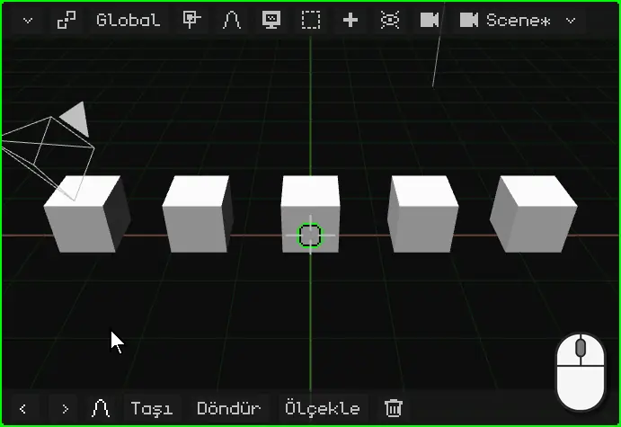

## Bağlam menüsü

Her programda olduğu gibi **bağlam menüsü**, seçili olanla yapılabilecekleri el altında tutar. Nesne Modu'nda bu, işaretçinin olduğu yerde açılan **Nesne** menüsüdür:

| | Nasıl açılır |
|---|---|
|  PC | 3D Görünüm'e sağ tık |
|  Dokunmatik ekran | Bir parmağı 3D Görünüm'ün üzerinde yarım saniye hareketsiz tutmak |
|  Nokia N95 | Sol seçim tuşu menü çubuğunu açar; oradan Nesne menüsü |

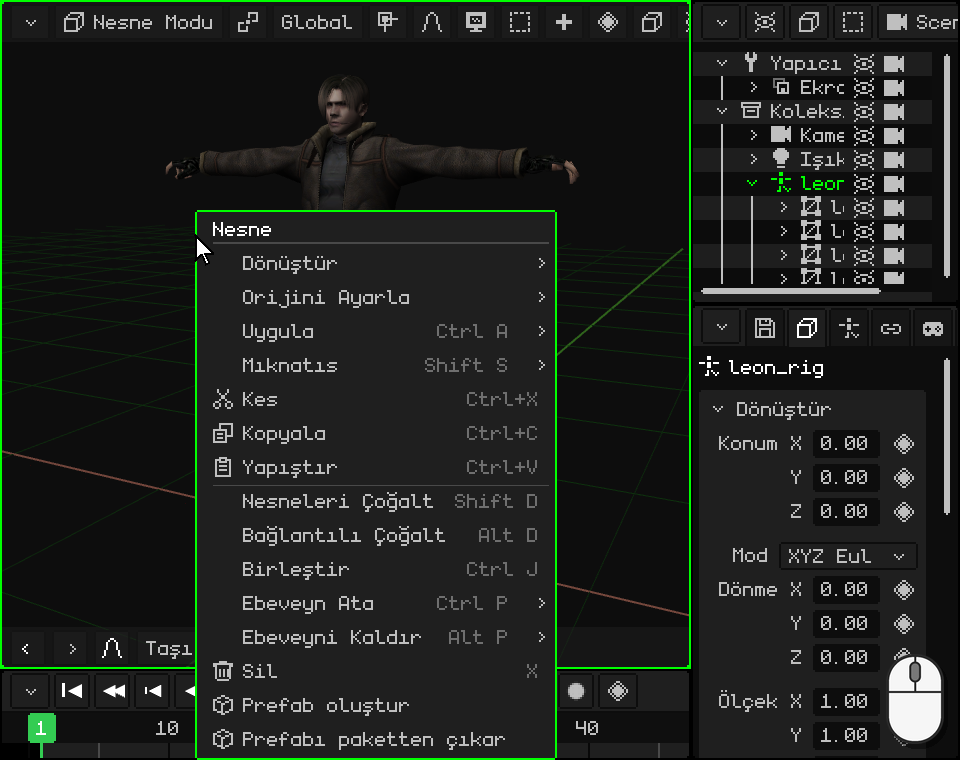

 Leon seçiliyken parmak 3D Görünüm'ün üzerinde hareketsiz: yarım saniye sonra telefon titrer ve menü açılır. Parmağı kaldırınca hiçbir şey seçilmez: seçeneğe sonra dokunulur.

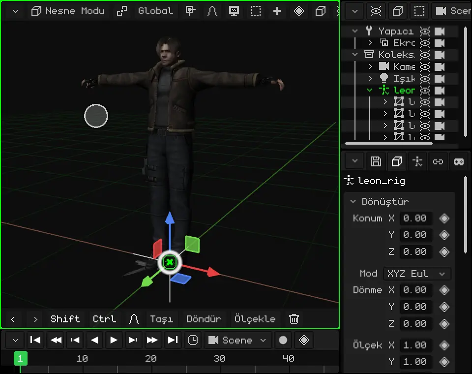

| Seçenek | Ne yapar |  Kısayol |
|---|---|---|
| **Kes** | Seçili olanı sonra yapıştırmak üzere saklar ve sahneden çıkarır. | <kbd>Ctrl</kbd> + <kbd>X</kbd> |
| **Kopyala** | Seçili olanın, çocuklarıyla birlikte bir kopyasını sonra yapıştırmak üzere saklar: bu sahneye, başka bir projeye ya da açık başka bir Whisk3D penceresine. | <kbd>Ctrl</kbd> + <kbd>C</kbd> |
| **Yapıştır** | En son kopyalanan ya da kesilen şeyi sahneye, aynı yere koyar ve seçili bırakır. | <kbd>Ctrl</kbd> + <kbd>V</kbd> |
| **Nesneleri Çoğalt** | Seçili olanın orijinalden bağımsız bir kopyasını yapar ve taşıman için onu tutulu bırakır: bir tık (ya da <kbd>OK</kbd>) onu olduğu yere bırakır. | <kbd>Shift</kbd> + <kbd>D</kbd> |
| **Bağlantılı Çoğalt** | Çoğalt gibi, ama kopya **örgüyü** orijinalle **paylaşır**: birinin şeklini değiştirirsen ikisi de değişir. Konum, dönme ve ölçek her birinin kendinedir. Bir ormandaki ağaçlar ya da bir salondaki sandalyeler gibi birbirinin aynı birçok şey için işe yarar: hepsi tek seferde düzenlenir ve daha az bellek kaplar. | <kbd>Alt</kbd> + <kbd>D</kbd> |
| **Sil** | Seçili olanı siler. Onay ister. | <kbd>X</kbd> ya da <kbd>Delete</kbd> |

Menünün diğer seçenekleri bu eğitimde anlatılıyor: Dönüştür (taşıma, döndürme ve ölçekleme), [Orijini Ayarla ve Mıknatıs](#neye-göre-taşınır-döndürülür-ve-ölçeklenir), [Uygula](#ölçeği-1de-tutmak-daha-iyi), [Ebeveyn Ata ve Ebeveyni Kaldır](#outliner-sahnedeki-nesneler). **Birleştir** birkaç örgüyü tek bir örgüde toplar; **prefab**'ların (yeniden kullanmak için hazırlanmış nesneler) ise kendi eğitimi var.

## Taşıma, döndürme ve ölçekleme

Bir nesnenin üç temel işlemi **taşıma**, **döndürme** ve **ölçeklemedir**. Her biri gizmoyla, klavyeyle ya da dokunmatik ekranda araç çubuğundaki komutlarla yapılabilir. Bir şey ters giderse **Geri Al** (PC'de <kbd>Ctrl</kbd> + <kbd>Z</kbd>) onu geri alır.

### Gizmo

**Gizmo**, seçili nesnenin üzerinde beliren renkli oklardır. Her renk bir eksendir: **kırmızı** X, **yeşil** Y, **mavi** de yukarıyı gösteren Z.

Gizmonun her işlem için bir tane olmak üzere üç modu vardır. **Gizmoya sürüklemeden bir tık, sonraki moda geçirir**: Taşı'dan Döndür'e, Döndür'den Ölçekle'ye, Ölçekle'den yeniden Taşı'ya.

 Gizmoya fareyle bir tık modu değiştirir.

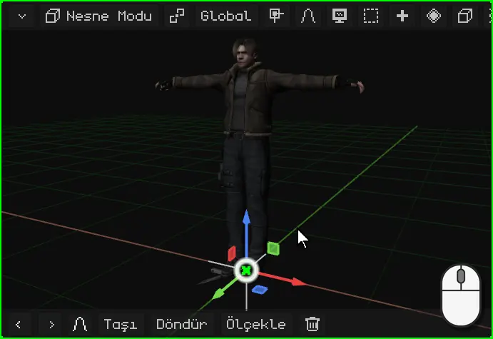

 Gizmoya bir dokunuş modu değiştirir.

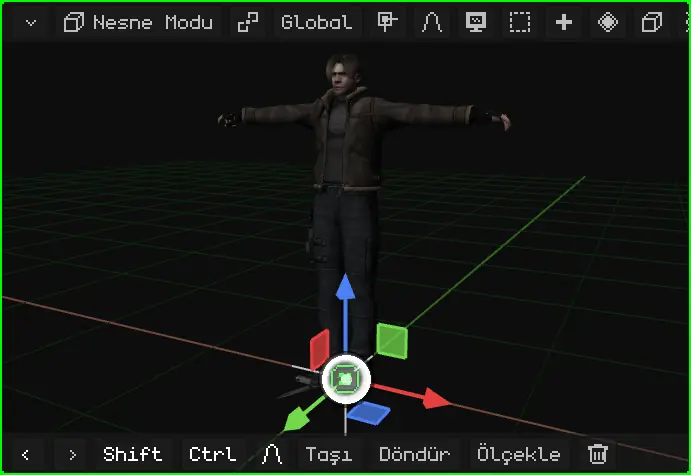

Kullanmak için gizmonun bir parçası tutulur ve sürüklenir. Bırakınca işlem tamamlanır.

| Mod | Ne tutulur | Ne yapar |
|---|---|---|
| Taşı | Bir ok | Yalnızca o eksende taşır. |
| Taşı | Küçük bir kare | Bir düzlemde taşır: mavi küçük kare yüksekliği değiştirmeden X ve Y'de taşır. |
| Taşı | Ortadaki daire | İşaretçiyi takip ederek serbestçe taşır. |
| Döndür | Renkli bir yarım daire | O eksen etrafında döndürür. |
| Döndür | Beyaz halka | Görüş doğrultusu etrafında döndürür. |
| Ölçekle | Kare bir uç | O eksende uzatır ya da kısaltır. |
| Ölçekle | Ortadaki daire | Üç eksende eşit olarak büyütür ya da küçültür. |

 Fareyle: gizmonun bir parçasına tıkla ve sürükle.

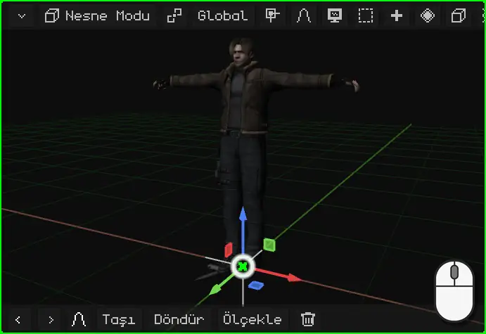

 Parmakla: parmağını gizmonun bir parçasına koy ve sürükle. Arka plana koyarsan görünümü yörüngede döndürürsün.

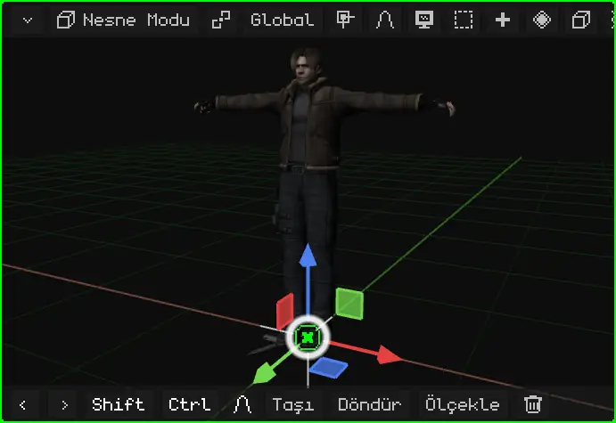

 Nokia N95'te gizmo kapalı gelir: aşağıda anlatıldığı gibi taşıma, döndürme ve ölçekleme tuşlarla yapılır. Bluetooth fareyle kullanmak için Bindirmeler → Gizmo'dan açılabilir.

### Klavyeyle ya da komutlarla

Klavyeyle hiçbir şeye nişan almak gerekmez: tuşa basılır ve sen onaylayana kadar nesne fareyi (telefonda ok tuşlarını) takip eder.

| | Taşıma | Döndürme | Ölçekleme | Yalnızca bir eksende | Onaylama | İptal |
|---|---|---|---|---|---|---|
|  PC | <kbd>G</kbd> | <kbd>R</kbd> | <kbd>S</kbd> | <kbd>X</kbd> / <kbd>Y</kbd> / <kbd>Z</kbd> | Tık ya da <kbd>Enter</kbd> | <kbd>Esc</kbd> ya da sağ tık |
|  Nokia N95 | <kbd>1</kbd> | <kbd>2</kbd> | <kbd>3</kbd> | <kbd>1</kbd> / <kbd>2</kbd> / <kbd>3</kbd> | <kbd>OK</kbd> (yön tuşunun ortası) | <kbd>C</kbd> |

 <kbd>G</kbd> tuşuna basıp fareyi hareket ettirirsin: nesne onu takip eder. <kbd>X</kbd>'e basarsan yalnızca X'te hareket eder; ikinci bir <kbd>X</kbd> Global'den Yerel'e geçirir. Döndürürken de aynısı: <kbd>R</kbd> ve ardından <kbd>Z</kbd>, dikey eksen olan Z etrafında döndürür; eksen seçmezsen görüş doğrultusu etrafında döner. Bir sayı da yazabilirsin: <kbd>G</kbd>, <kbd>X</kbd>, <kbd>2</kbd> ve <kbd>Enter</kbd> onu X'te 2 metre kaydırır.

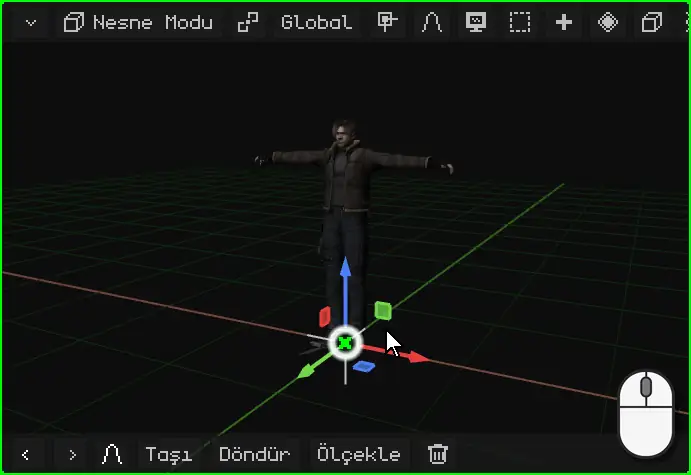

 Nokia N95'te: taşımak için <kbd>1</kbd>, döndürmek için <kbd>2</kbd>, ölçeklemek için <kbd>3</kbd>; hareketi de **ok tuşları** yapar. İşlem sürerken <kbd>1</kbd>, <kbd>2</kbd> ve <kbd>3</kbd> artık işlemi değiştirmez: X, Y ya da Z eksenini seçer. Örneğin <kbd>2</kbd> ve ardından <kbd>3</kbd>, dikey eksen olan Z etrafında döndürür. <kbd>OK</kbd> onaylar, <kbd>C</kbd> iptal eder.

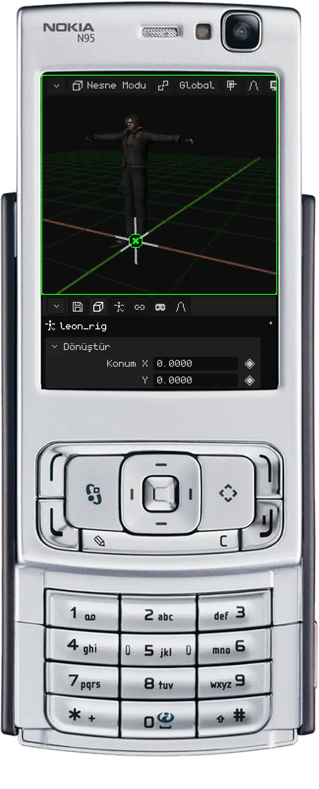

 **Dokunmatik ekranda**, klavye olmadan, yukarıda görüldüğü gibi gizmo ya da 3D Görünüm'ün araç çubuğundaki **komutlar** kullanılabilir. **Taşı**, **Döndür** ya da **Ölçekle**'ye dokunur ve parmağını görünümün herhangi bir yerinde sürüklersin: nesne parmağı takip eder. Çubuk değişir: **yeşil onay işareti** onaylar, **kırmızı çarpı** iptal eder, **X**, **Y** ve **Z** düğmeleri de hareketi o eksenlerle sınırlar.

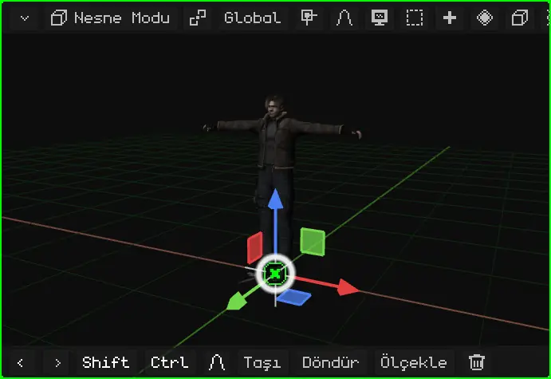

### Kesin sayılarla

Hassas çalışmak için hareket bir sayıyla yazılır: bir şeyi tam 90° döndürmek, `0.5` ile yarıya ya da `2` ile tam iki katına ölçeklemek veya 1,5 metre taşımak. **Whisk3D'de bir birim bir metredir.**

İşlem sürerken 3D Görünüm'ün menü çubuğu yapılan işlemi ve değeri gösterir.

 **Klavyeyle:** <kbd>G</kbd>, <kbd>R</kbd> ya da <kbd>S</kbd>'den sonra sayıyı yaz ve <kbd>Enter</kbd> tuşuna bas. <kbd>R</kbd> <kbd>Z</kbd> <kbd>9</kbd> <kbd>0</kbd> <kbd>Enter</kbd> onu dikey eksen etrafında 90° döndürür; <kbd>S</kbd> <kbd>0</kbd> <kbd>.</kbd> <kbd>5</kbd> <kbd>Enter</kbd> yarıya, <kbd>S</kbd> <kbd>2</kbd> <kbd>Enter</kbd> iki katına getirir; <kbd>G</kbd> <kbd>X</kbd> <kbd>1</kbd> <kbd>.</kbd> <kbd>5</kbd> <kbd>Enter</kbd> onu X'te 1,5 metre kaydırır.

 **Dokunmatik ekranda:** işlemi araç çubuğundaki **Taşı**, **Döndür** ya da **Ölçekle** ile başlat ve üstteki, değeri gösteren çubuğa dokun: Whisk3D'nin sayısal klavyesi açılır. Sayıyı yaz ve **OK**'e dokun; yeşil onay işareti işlemi tamamlar. Klavye `90/2` gibi hesaplar da yapar.

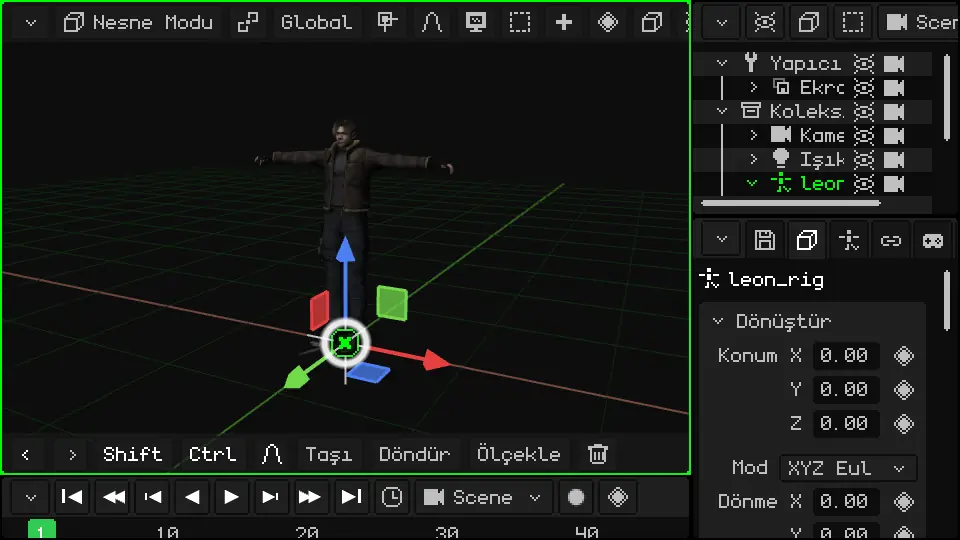

Nesne Modu'nun tüm kısayolları kılavuzda: [Taşıma, döndürme ve ölçekleme](../editor/transformar.md) ve [Nesne Modu](../editor/modo-objeto.md).

### Araç çubuğu: son komutlar

  3D Görünüm'ün **araç çubuğunda** (alttaki) Geri Al ve Yinele (oklar), ardından en sonuncusu başta olmak üzere **son kullandığın komutlar** bulunur. Başlangıçta bunlar Taşı, Döndür, Ölçekle ve Sil'dir. Bir nesneyi ölçeklersen Ölçekle başa geçer: en çok kullandığın şey hep el altında kalır.

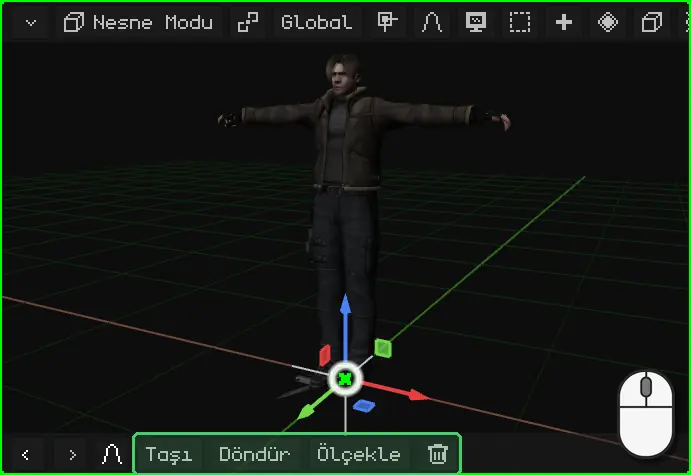

 Nokia N95'te ekran sahneye kalsın diye araç çubuğu gizli gelir: taşıma, döndürme ve ölçekleme telefonun tuşlarıyla yapılır. Çubuk belirdiğinde (örneğin dönüştürme sırasında orantılı düzenleme çubuğu), düğmeleri **sanal fareyle** kullanılır: sanal fare sağ seçim tuşuyla açılır, ok tuşları onu hareket ettirir ve <kbd>OK</kbd> tıklar.

## Neye göre taşınır, döndürülür ve ölçeklenir

### Orijin

Her nesnenin bir **orijini** vardır: gizmonun çıktığı nokta. Dönüşümün yapıldığı noktadır: nesne orijini etrafında döner, ondan başlayarak büyür ya da küçülür. Özellikler'in gösterdiği **konum** da orijinin konumudur.

İlkel nesnelerde orijin merkezdedir. İçe aktarılmış bir modelde ise onu yapan programın bıraktığı yerdedir: Leon'da ayaklarının dibinde.

### 3D imleç

**3D imleç**, 3D Görünüm'deki artı işaretli dairedir. Başlangıçta dünyanın merkezindedir.

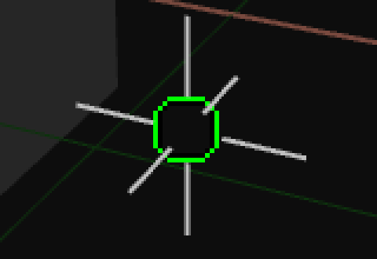
 İki işe yarar:

- **Ekle** ile eklenen her şey orada belirir;
- [Pivot noktası](#pivot-noktası) bölümünde görüldüğü gibi döndürme ve ölçeklemenin merkezi olabilir.

3D imleç, nesneleri de imlece götüren **Mıknatıs** menüsüyle taşınır:

| | Mıknatıs menüsü nasıl açılır |
|---|---|
|  PC | <kbd>Shift</kbd> + <kbd>S</kbd> |
| Menü | Nesne → Mıknatıs (Düzenleme Modu'nda Örgü → Mıknatıs) |

| Seçenek | Ne yapar |
|---|---|
| İmleç Seçilene | 3D imleci seçili olanın merkezine taşır. Düzenleme Modu'nda seçili köşelerin, kenarların ya da yüzlerin merkezine. |
| İmleç Etkine | 3D imleci etkin nesnenin orijinine taşır. |
| İmleç Dünya Orijinine | Onu dünyanın merkezine geri getirir. |
| İmleç Izgaraya | Onu ızgaranın en yakın noktasına taşır. |
| Seçimi İmlece | Seçili olanı 3D imlece taşır. |
| Seçimi İmlece (Ofseti Koru) | Aynısı, ama birden fazla nesnede aralarındaki mesafeyi korur: grup bütün hâlinde gelir. |
| Seçimi Etkine | Seçili olanı etkin nesneye taşır. |
| Seçimi Izgaraya | Her seçili nesneyi ızgaranın en yakın noktasına yapıştırır. |

Örneğin birinin eline bir kutu koymak ya da bir nesneyi tam başka birinin olduğu yere koymak için: hedef nesneyi seçersin, **İmleç Seçilene**; ardından taşımak istediğini seçersin ve **Seçimi İmlece**.

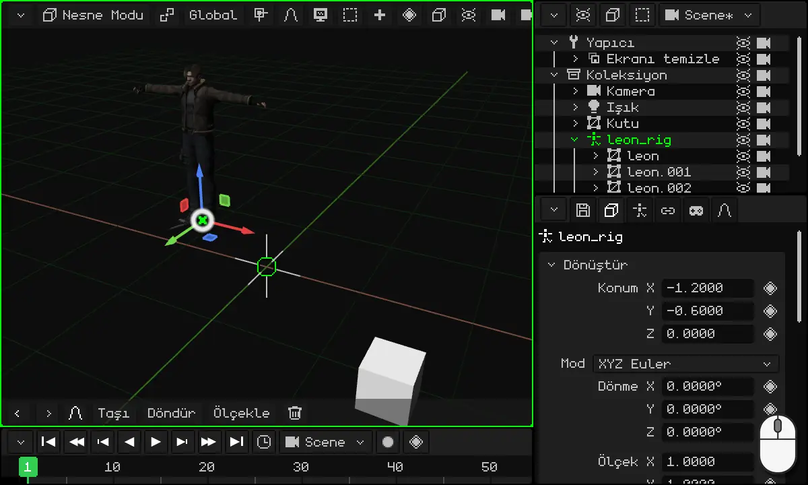

### Pivot noktası

**Pivot noktası**, seçili olanın döndürüldüğü ve ölçeklendiği merkezdir. 3D Görünüm'ün çubuğunda **Global**'in solundaki pivot düğmesiyle seçilir (simgesi seçilen pivota göre değişir):

| Pivot | Nereden döndürür ve ölçekler |
|---|---|
| **Orta Nokta** | Seçili olan her şeyin merkezinden. Varsayılan budur. Tek bir nesnede bu, nesnenin orijinidir. |
| **Etkin öğe** | Etkin nesnenin (son seçtiğinin) orijininden: diğerleri onun etrafında döner. |
| **Ayrı Orijinler** | Her nesne kendi orijininden: hepsi aynı anda, her biri kendi yerinde döner. |
| **3D İmleç** | 3D imleçten. |

**3D İmleç** ile her şey herhangi bir noktanın etrafında döndürülebilir: imleci oraya koyarsın (Mıknatıs menüsüyle) ve döndürürsün. Sandalyeleri bir masanın etrafına dizmek, bir saatin akrep ve yelkovanı ya da bir şeyin etrafında dönmesi gereken her şey için işe yarar.

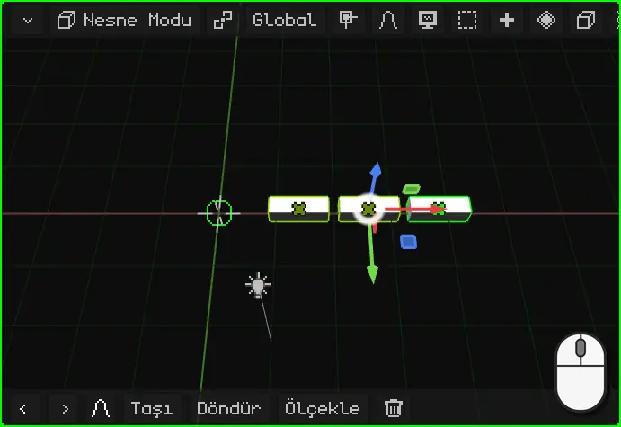

### Global ve Yerel

Bir eksende taşıdığında, döndürdüğünde ya da ölçeklediğinde, o eksen **dünyanın** ya da **nesnenin** ekseni olabilir. 3D Görünüm'ün çubuğundaki **Global** düğmesiyle seçilir:

| Yönelim | Eksenler |
|---|---|
| **Global** | Dünyanınkiler: her zaman aynı, Z yukarı doğru. Varsayılan budur. |
| **Yerel** | Nesnenin kendisininkiler; nesneyle birlikte dönerler. |
| **Görünüm** | Ekranınkiler: X yana, Y yukarı doğru. |
| **Normal** | Düzenleme Modu'nda, seçili yüzün baktığı yön. |

Fark, nesne döndürülmüşken görülür. Örneğin 40° döndürülmüş Leon: **Global**'de Y ekseni dünyanınkidir ve Leon baktığı yöne göre çapraz hareket eder; **Yerel**'de Y ekseni onunla birlikte döner ve Leon dümdüz ileri yürür. Bir köşeyi dönmüş bir araba da öyle: ilerlemesi için kendi Yerel ekseninde taşınır.

 Klavyeyle eksen harfine ikinci kez basmak Global'den Yerel'e geçirir: <kbd>G</kbd> <kbd>Y</kbd> dünyanın Y'sinde, <kbd>G</kbd> <kbd>Y</kbd> <kbd>Y</kbd> nesnenin Y'sinde taşır. Nokia N95'te de taşırken <kbd>2</kbd> <kbd>2</kbd> ile aynısı yapılır.

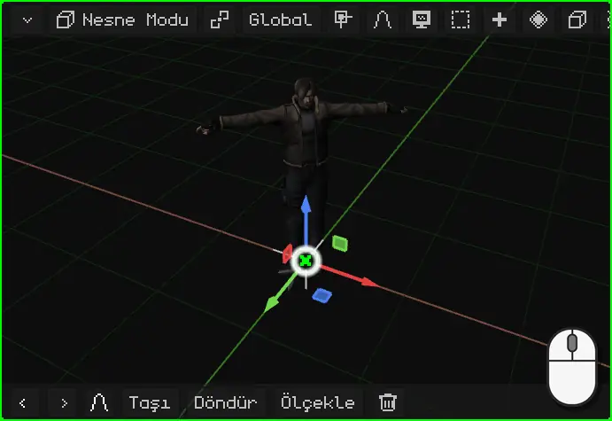

### Orijini değiştirme

Bir 3D örgünün orijini, örgüyü hareket ettirmeden **Nesne → Orijini Ayarla** ile başka bir yere taşınabilir. Nasıl yapıldığı, menteşesinden açılması gereken bir kapı örneğiyle, [Orijini değiştirme: bir kapı](puerta.md) eğitiminde anlatılıyor.

## Özellikler

Etkin nesnenin **özellikleri** Özellikler viewport'undadır. **Nesne** sekmesi (küplü olan) tüm nesnelerde aynıdır: en üstte konum, dönme ve ölçekle birlikte **Dönüştür** kartı vardır. Sayılar elle yazılabilir: sayıya bir tık (ya da dokunuş) ve yazılır. Nesneyi 3D Görünüm'de taşımak bu sayıları değiştirir, sayıları değiştirmek de nesneyi taşır.

Diğer sekmeler nesnenin türüne bağlıdır: bir ışığın ışık sekmesi, bir örgünün malzeme ve değiştirici sekmeleri vardır.

### Eşkenar dörtgen: canlandırılabilenler

Birçok özelliğin yanında bir **eşkenar dörtgen** vardır. Eşkenar dörtgen, o özelliğin **canlandırılabildiği** anlamına gelir: ona bir tık, değeri o anki karede kaydeder (bir *keyframe*), yeşil eşkenar dörtgene bir tık daha onu kaldırır. Birkaç keyframe olunca özellik zamanla kendiliğinden değişir.

Eşkenar dörtgenin rengi özelliğin durumunu söyler: **gri**, henüz canlandırılmamış; parlak **yeşil**, canlandırılmış ve bu karede bir keyframe'i var; **soluk yeşil**, canlandırılmış ama bu karede keyframe'i yok.

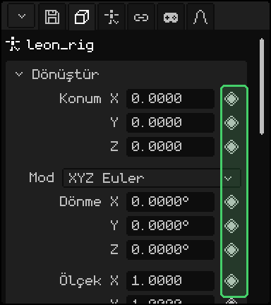

Animasyonun ileride kendi eğitimi var.

### Ölçeği 1'de tutmak daha iyi

Bir öneri: **nesnelerin ölçeğini 1'de bırak**. Bir nesneyi Ölçekle ile büyütmek ya da küçültmek rahattır, ama ölçeklenmiş bir nesne sonradan sorun çıkarabilir: çocuklar ölçeği devralır ve döndürülünce biçimleri bozulur; fizik, çarpışmalar ve bazı değiştiriciler de yanlış hesaplayabilir.

Bir nesneyi ölçeklediysen **ölçeği uygula**: sahip olduğu boyut gerçek boyutu olur ve görünen hiçbir şey değişmeden ölçek 1'e döner.

| | Ölçek nasıl uygulanır |
|---|---|
|  PC | <kbd>Ctrl</kbd> + <kbd>A</kbd> → Ölçekle |
| Menü | Nesne → Uygula → Ölçekle |

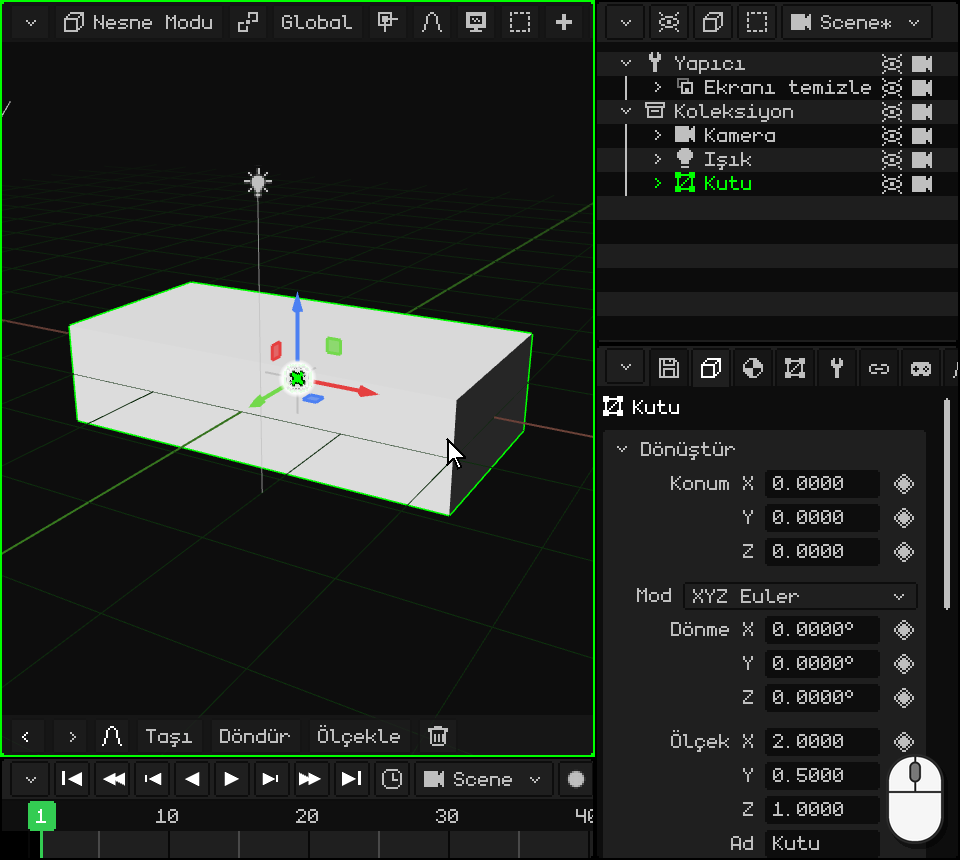

Aynı menüde **Konum** ve **Dönme** aynısını konum ve dönmeyle yapar, **Tüm Dönüşümler** de üçünü birden uygular.

## Outliner: sahnedeki nesneler

**Outliner**, sahnedeki tüm nesnelerin listesidir. Bir satıra bir tık (ya da dokunuş), tıpkı 3D Görünüm'deki gibi o nesneyi seçer. PC'de sağ üsttedir.

Bir nesne **başka birinin içinde** olabilir: daha sağa kaymış, ona bağlı olarak görünür. Dıştaki **ebeveyn**, içteki **çocuktur**. Çocuk ebeveynin **dönüşümlerini devralır**: ebeveyni taşır, döndürür ya da ölçeklersen çocuk da onunla birlikte hareket eder. Çocuk yine tek başına taşınabilir, ama her zaman ebeveynine göre.

Leon buna bir örnek: örgüleri, yani görünen dört parçası, iskeleti `leon_rig`'in çocuklarıdır. İskeleti taşımak Leon'u bütünüyle taşır.

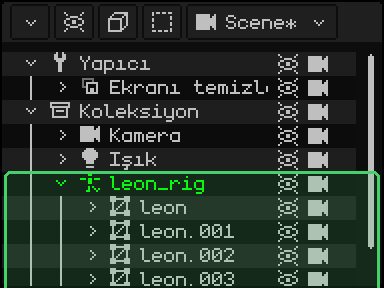

Bir nesneyi başka birinin içine koymaya **ebeveyn atama** denir:

| | Nasıl ebeveyn atanır |
|---|---|
|  PC | Outliner'da çocuğun satırını sürükleyip ebeveynin satırının üzerine bırakmak. Ya da çocuğu, ardından ebeveyni (<kbd>Shift</kbd> ile) seçip <kbd>Ctrl</kbd> + <kbd>P</kbd>. |
|  Dokunmatik ekran | Çocuğu seçmek; araç çubuğunda **Shift**'i açıp ebeveyne dokunmak; ardından Nesne menüsü → Ebeveyn Ata. |
|  Nokia N95 | Outliner etkin ve çocuk seçiliyken: <kbd>1</kbd>; **sağ** ok tuşu onu üstündekinin içine koyar, **sol** ok tuşu dışarı çıkarır; yeniden <kbd>1</kbd> onaylar. |
| Menü | Nesne → Ebeveyn Ata; çıkarmak için Nesne → Ebeveyni Kaldır |

 Videoda Outliner'da bir kutu `leon_rig`'e sürükleniyor: onun çocuğu oluyor ve Leon taşınınca kutu da onunla birlikte hareket ediyor.

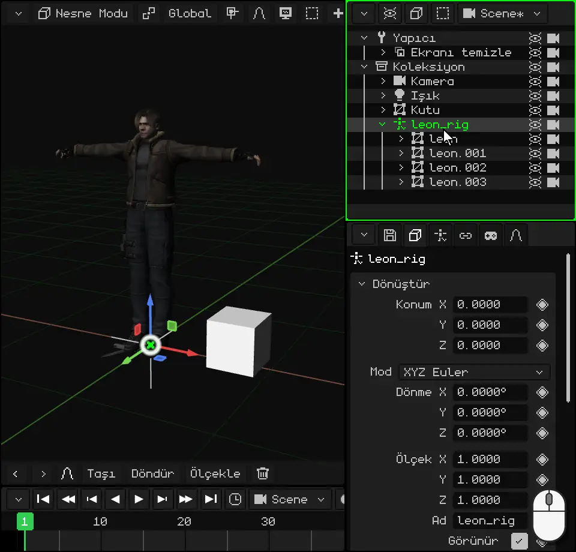

## Nesne türleri

Tüm nesneler **Ekle** menüsünden eklenir (3D Görünüm'ün çubuğundaki **+** düğmesi ya da PC'de <kbd>Shift</kbd> + <kbd>A</kbd>). Yeni nesne 3D imleçte belirir ve seçili kalır.

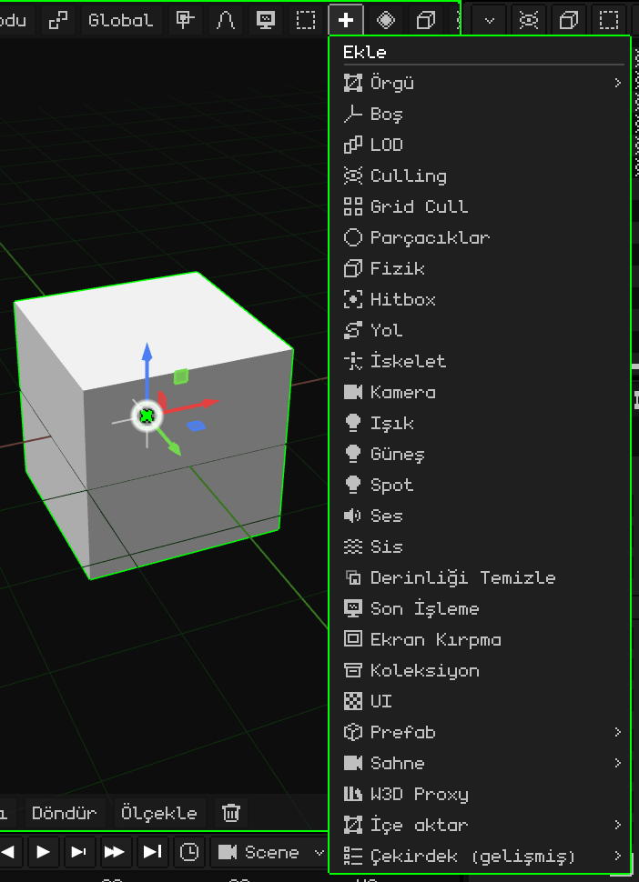

Temel olanlar şunlar:

| Nesne | Nedir |
|---|---|
| [3D Örgü](../editor/objeto-malla.md) | Bir 3D model: bir karakter, bir ev, bir taş. Köşelerden, kenarlardan ve yüzlerden oluşur ve malzemesi ve dokularıyla görünür. Ekle → Örgü'deki ilkel nesneler (küp, küre, silindir...) modellemeye başlamak için örgülerdir. |
| [Kamera](../editor/objeto-camara.md) | Oyunun ve render'ların bakış açısı. Etkin kameranın gördüğü, oynarken görülen ve bir görüntüde ya da videoda çıkan şeydir. |
| [Işık](../editor/objeto-luz.md) | Sahneyi aydınlatır. Üç türü vardır: Nokta (bir ampul), Güneş (paralel ışınlı gün ışığı) ve Spot (el feneri gibi bir koni). |
| [İskelet](../editor/objeto-esqueleto.md) | Karakterleri canlandırmak için bir örgüyü hareket ettiren kemik zinciri. Leon'un bir tane var: iskelet yürüdüğünde örgü onu takip eder. |
| [Ses](../editor/objeto-sonido.md) | Sahneye konmuş bir ses. Müzik gibi arka planda ya da nesnenin bulunduğu yerden çalabilir. |
| Boş | Şekli olmayan bir nesne: sahnede bir nokta. Başkalarını gruplamak için ebeveyn ya da referans olarak işe yarar. |
| Koleksiyon | Outliner'da nesneleri düzenlemek için bir klasör. |

Daha fazlası da var: yollar, sis, parçacıklar, çarpışmalar için hitbox'lar, oyunlar için 2D arayüzler ve optimizasyon nesneleri. İleride daha pek çoğu eklenecek. Bu eğitim nesnelerden genel olarak bahsediyor; her birinin, özelliklerinin tek tek anlatıldığı kendi makalesi var.

## Tüm nesnelerde olanlar

Dönüşümünün ve özelliklerinin yanı sıra her nesnede şunlar olabilir:

- Oyunda ona davranış kazandıran Lua **script'leri**: kendi kendine hareket etmesi, tuşlara tepki vermesi, çarpışması. İleride anlatılacak.
- **Animasyonlar**: eşkenar dörtgeni olan her özellik canlandırılabilir. Kendi eğitimleri var.
- **Kısıtlamalar**: onu başka bir nesneye bağlayan kurallar, örneğin onun konumunu kopyalamak ya da her zaman kameraya bakmak. [Kısıtlamalar](../editor/restricciones.md) sayfasında anlatılıyor.

Bazı türlerin ayrıca kendilerine özgü şeyleri vardır. Örneğin 3D örgülerin, şekli kalıcı olarak bozmadan değiştiren **değiştiricileri** vardır: şekli aynadaki gibi yansıtmak, tekrarlamak, yumuşatmak. [3D Örgü](../editor/objeto-malla.md) sayfasında anlatılıyorlar.

## 3D modelleri içe aktarma

Whisk3D'de modellemenin yanı sıra başka programlarda yapılmış modeller de getirilebilir. Desteklenen biçimler şunlar:

| Biçim | Neyi getirir |
|---|---|
| **GLB** ve **glTF** | Örgü, malzemeler ve dokular, iskelet ve animasyonlar. En eksiksiz biçimdir: Leon bir .glb dosyasında gelir. |
| **OBJ** | Örgü, malzemeler ve dokular (.mtl dosyasıyla). İskelet ve animasyon yok. |
| **FBX** | Örgü, malzemeler, iskelet ve animasyonlar. |
| **STL** | Yalnızca şekil: malzemesiz ve renksiz üçgenler. 3D baskının ve CAD programlarının biçimidir. |

**Ekle → İçe aktar** ile, önce biçim, ardından dosya seçilerek içe aktarılır.

 PC'de dosya klasörden sürüklenip 3D Görünüm'ün üzerine de bırakılabilir.

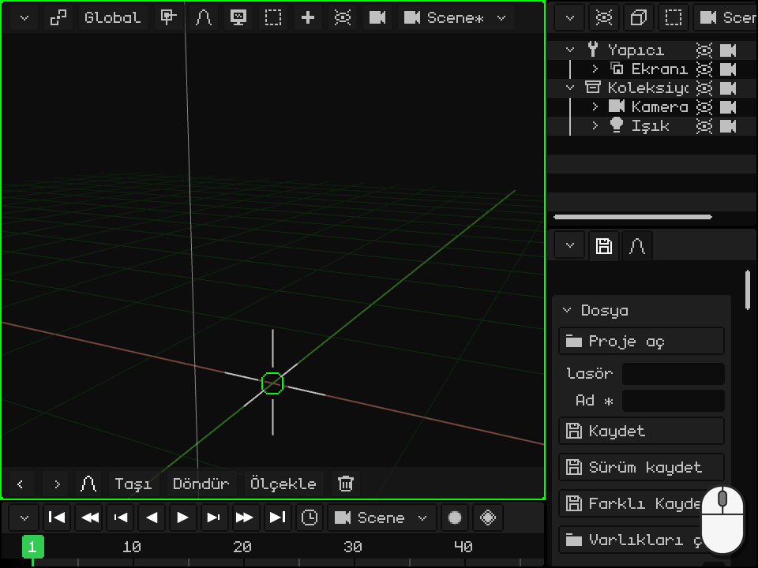

İskeletli bir model **içinde örgüleri olan bir iskelet** olarak gelir: [Outliner](#outliner-sahnedeki-nesneler) bölümünde görüldüğü gibi iskelet ebeveyn, örgüler de onun çocuklarıdır. Animasyonlar kullanıma hazır hâlde iskelette saklanır.

Bir modeli başka bir programa ya da 3D yazıcıya götürmek için ters yol var: Özellikler → disket sekmesi → **Dışa Aktar**; OBJ, glTF, GLB ya da STL ile.
