# 3D Viewport'ta gezinme

> [!NOTE]
> Nokia N95 fare ve klavyeyi (Bluetooth ile) destekler. Bu eğitimin Nokia ile ilgili kısımları, onu fare ve klavye olmadan, yalnızca telefonun tuşlarıyla nasıl kullanacağını anlatır.

Bu eğitimde 3D Viewport'ta nasıl gezineceğin anlatılıyor. Gezinmek, bakış açını hareket ettirmektir: sahnenin etrafında dönmek, yana kaymak, yaklaşmak ya da uzaklaşmak.

Gezinmeyi bilmek önemlidir: 3D modelleri ve animasyonları rahat ve hızlı yapmak için sahnede dolaşmayı ve çalışmak için rahat bir konuma geçmeyi bilmen gerekir.

[Önceki eğitimde](viewports.md#etkin-viewport) anlatıldığı gibi, aşağıdaki komutları kullanmak için 3D Viewport'un etkin viewport, yani yeşil kenarlıklı olan olması gerekir.

En çok kullanacağın üç şey **yörüngede döndürme**, **kaydırma** ve **yakınlaştırma**. Her biri fareyle, dokunmatik ekranda parmaklarla ya da Nokia N95'in tuş takımıyla yapılabilir. PC videolarında sağ alttaki fare, o an basılan tuşu yeşille gösterir.

## Yörüngede döndürme

Yörüngede döndürme, görünümü sahnenin etrafında döndürmektir; tıpkı üstündekileri her yönden görmek için bir masanın etrafında yürümek gibi.

**Fareyle:** **orta tuşu** (tekerleği aşağı bastırarak basılır) basılı tut ve sürükle. Trackpad'de ya da orta tuşu olmayan bir farede <kbd>Alt</kbd> tuşunu basılı tut ve **birincil tuşla** (sol tuşla) sürükle.

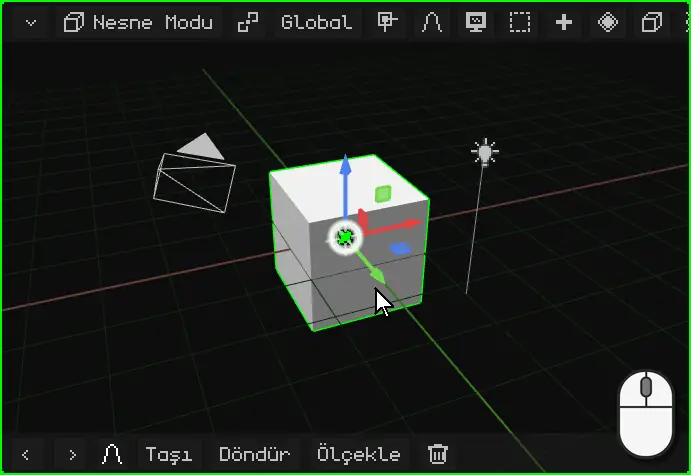

**Parmakla:** 3D Viewport'un üzerinde bir parmağını sürükle. Arka plandan başla: parmağını gizmonun (nesnenin renkli okları) üzerine koyarsan onu hareket ettirirsin.

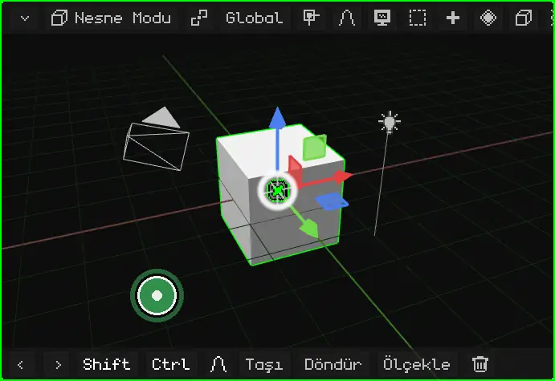

**Nokia N95'te:** bir **ok tuşunu** basılı tut. Basılı tuttuğun sürece görünüm o yöne döner.

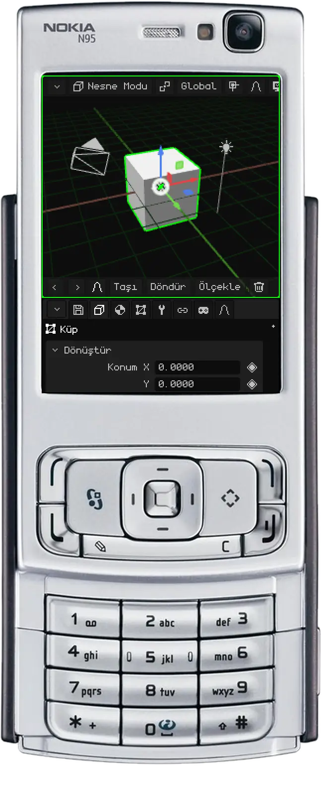

## Kaydırma

Kaydırma (ya da *pan*), görünümü döndürmeden yana, yukarı ya da aşağı kaydırır.

**Fareyle:** <kbd>Shift</kbd> tuşunu basılı tut ve **orta tuşla** sürükle. Trackpad'de: <kbd>Alt</kbd> + <kbd>Shift</kbd> ve birincil tuşla sürükle.

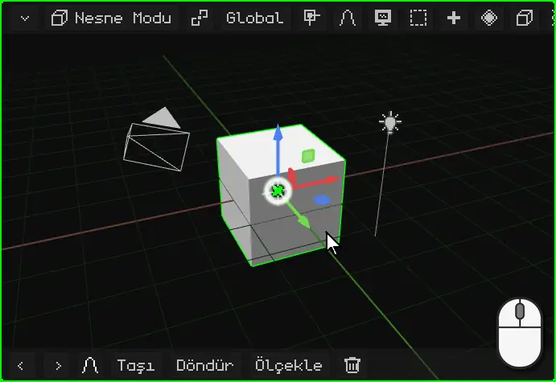

**Parmaklarla:** **iki parmağını** ekrana koy ve onları birlikte aynı yöne hareket ettir.

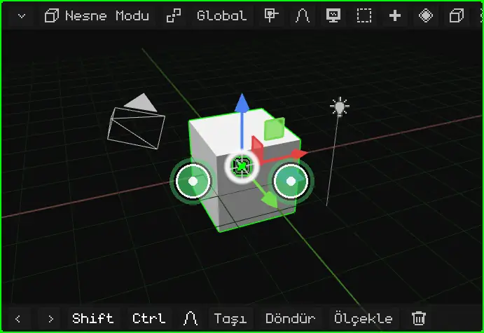

**Nokia N95'te:** <kbd>\*</kbd> tuşunu basılı tut ve ok tuşlarını kullan.

## Yakınlaştırma

Yakınlaştırma seni yaklaştırır ya da uzaklaştırır. Adım mesafeye göre ayarlanır: küçük bir şeyin yakınında yavaş, uzaktan hızlı ilerler. Bu yüzden tüm sahneye bakmak için de, tek bir köşeye bakmak için de aynı şekilde işe yarar.

**Fareyle:** **tekerleği** çevir. İleri yaklaştırır, geri uzaklaştırır. Trackpad'de iki parmağını yukarı ya da aşağı kaydır.

**Parmaklarla:** sıkıştırma hareketi yap. Parmakları birbirinden ayırmak yaklaştırır, birleştirmek uzaklaştırır.

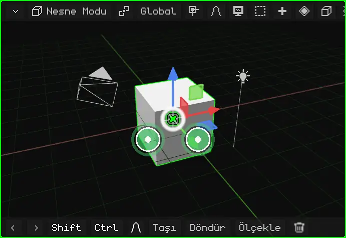

**Nokia N95'te:** <kbd>0</kbd> tuşunu basılı tut; yaklaştırmak için **yukarı**, uzaklaştırmak için **aşağı** ok tuşunu kullan.

## Seçileni kadraja alma

Sahnede kaybolduysan ya da belirli bir şey üzerinde çalışmak istiyorsan, onu **kadraja al**: görünüm seçili olana ortalanır ve yakınlaştırma, seçili olan tam sığacak şekilde ayarlanır. Bundan sonra yörüngede döndürme onun etrafında yapılır.

| | Nasıl kadraja alınır |
|---|---|
| PC | <kbd>Num .</kbd> (sayısal tuş takımındaki nokta) |
| Nokia N95 | <kbd>0</kbd> tuşuna tek basış, ok tuşu olmadan (bir ok tuşuyla birlikte basılı tutulursa yakınlaştırma olur) |
| Dokunmatik ekran | İki parmakla çift dokunma |
| Menü | View → Frame Selected |

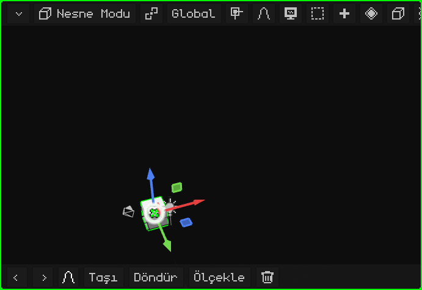

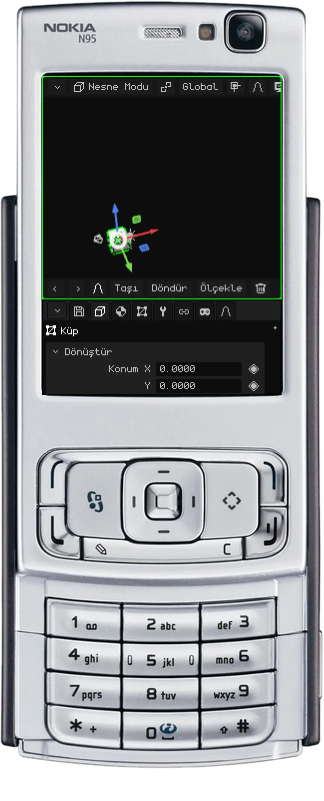

### Edit Mode'da

[Edit Mode'da](../editor/modo-edicion.md) mesh'in seçili kısmı kadraja alınır: nesnenin tamamı değil, seçtiğin köşeler, kenarlar ya da yüzler. Büyük bir modelin bir ayrıntısı üzerinde çalışmak için işe yarar: onu seçer, kadraja alır ve etrafında yörüngede döndürürsün.

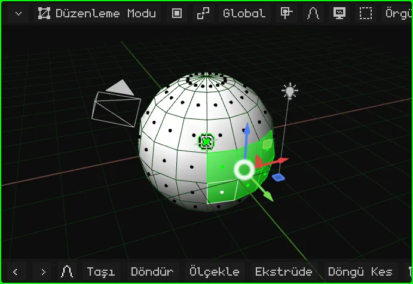

## Yerel görünüm

Sahnede çok şey olduğunda tek bir şey üzerinde çalışmak zahmetlidir: öndekiler görüşü kapatır, yörüngede döndürürken de araya girer. **Yerel görünüm** yalnızca seçili olanı (bir ya da birkaç nesne) görünür bırakır ve onu kadraja alır. Geri kalanı sahneden silinmez ya da gizlenmez: yalnızca bu viewport'ta görünmez olur. Sol üstte "Local View" yazısı belirir.

Geri dönmek için aynı şey tekrarlanır: her şey yeniden görünür ve görünüm daha önceki haline döner.

| | Nasıl girilir ve çıkılır |
|---|---|
| PC | <kbd>/</kbd> |
| Nokia N95 ve dokunmatik ekran | View menüsü → Local View |

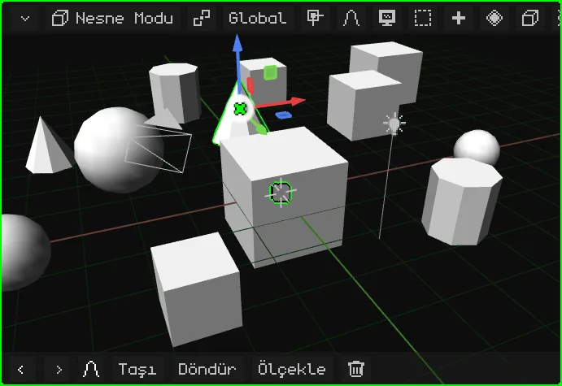

## Önden, yandan ve üstten görünümler

Sahneye bir yönden dümdüz bakmak için, yörüngeyi elle ayarlamadan:

| Görünüm | PC | Menü |
|---|---|---|
| Ön / Arka | <kbd>Num 1</kbd> / <kbd>Ctrl</kbd> + <kbd>Num 1</kbd> | View → Viewpoint → Front / Back |
| Sağ / Sol | <kbd>Num 3</kbd> / <kbd>Ctrl</kbd> + <kbd>Num 3</kbd> | View → Viewpoint → Right / Left |
| Üst / Alt | <kbd>Num 7</kbd> / <kbd>Ctrl</kbd> + <kbd>Num 7</kbd> | View → Viewpoint → Top / Bottom |

<kbd>Ctrl</kbd> ile her tuş karşıt görünümü verir.

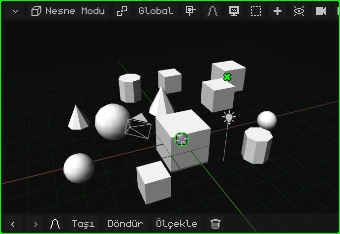

**Nokia N95'te:** <kbd>#</kbd> tuşunu basılı tut ve bir ok tuşuna bas. Sol ve sağ, görünümü sahnenin etrafında 90°'lik adımlarla döndürür. Yukarı, üstten görünüme geçer; aşağı yandan görünüme döner, bir kez daha aşağı ise alttan görünüme geçer. Daha önce serbestçe döndürdüysen, ilk ok tuşu görünümü yalnızca en yakın görünüme düzeltir.

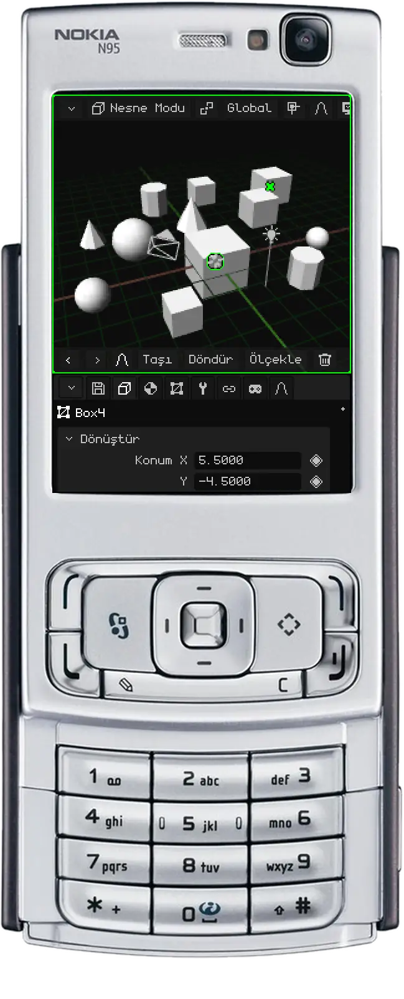

## Perspektif ve ortografik görünüm

3D Viewport'un sahneyi göstermenin iki yolu vardır:

- **Perspektif:** gözün ya da bir kameranın gördüğü gibi. Uzaktaki şeyler daha küçük görünür, paralel çizgiler (bir yolun kenarları, videodaki kutu sıraları) ufka doğru birleşir. Gerçekte de böyle görünür, derinlikle.
- **Ortografik:** perspektifsiz. Yakında da olsa uzakta da olsa her şey boyutunu korur, paralel çizgiler paralel kalır. Bir mimari plan ya da teknik çizim gibidir.

Ortografik görünüm hassas modelleme için işe yarar: nesneleri hizalamak, boyutları karşılaştırmak ve mesafeye aldanmadan ölçmek için. Önden, yandan ve üstten görünümlerle birlikte kullanınca bir plan üzerinde çalışmak gibidir. Perspektif ise sonucun nasıl görüneceğini görmeye yarar.

| | Nasıl değiştirilir |
|---|---|
| PC | <kbd>Num 5</kbd> |
| Nokia N95 | <kbd>#</kbd> tuşuna tek basış, ok tuşu olmadan |
| Menü | View → Perspective/Ortho |

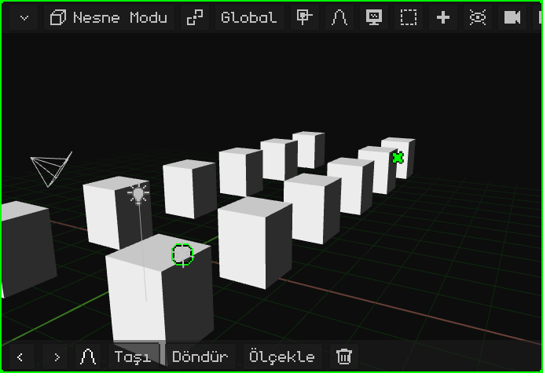

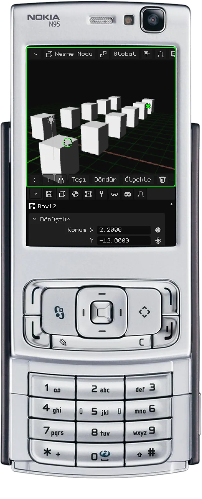

## Etkin kamera

Sahnede birden fazla kamera olabilir, ama **etkin kamera** yalnızca bir tanedir: oyunda ve render'larda kullanılan kamera. Bu kameranın gördüğü şey, oynarken görülen ve bir görüntünün ya da videonun render'ını aldığında ortaya çıkan şeydir. Gezindiğin görünüm yalnızca çalışmak içindir: ne oyunda ne de render'larda görünür.

Etkin kameradan bakmak için:

| | Nasıl girilir ve çıkılır |
|---|---|
| PC | <kbd>Num 0</kbd> |
| Nokia N95 | <kbd>8</kbd> (Edit Mode dışında: orada 8, Loop Cut'tır) |
| Menü | View → Cameras → Active Camera |

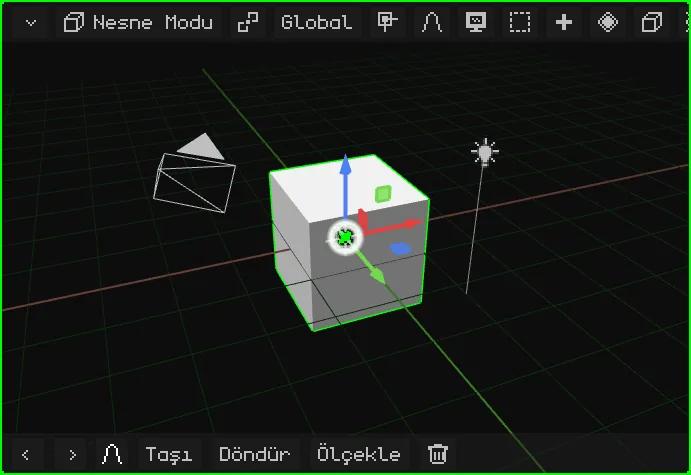

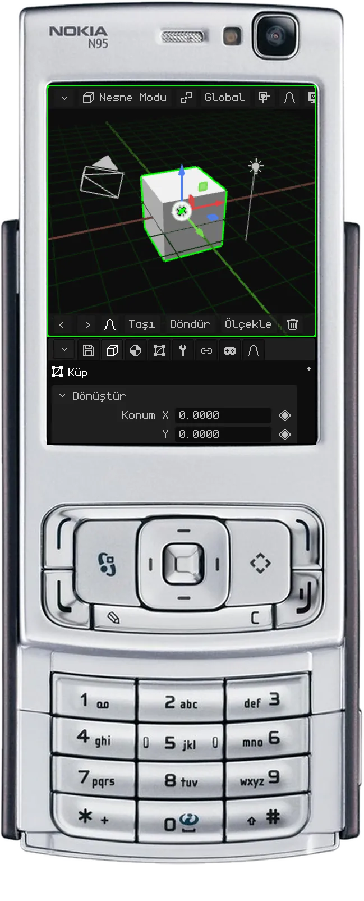

Dikdörtgen kadrajdır: içinde kalan, render'da çıkan şeydir. Alt ortada bir **kilit** vardır:

- **Açık** (başlangıçtaki hali): yakınlaştırma ve kaydırma, kameraya dokunmadan, yalnızca kadrajı incelemen için seni yaklaştırır. Yörüngede döndürme seni kamera görünümünden çıkarır ve kameranın bulunduğu yerden gezinmeye devam edersin.
- **Kapalı:** yörüngede döndürme, kaydırma ve yakınlaştırma **kamerayı** hareket ettirir. Çekim böyle ayarlanır.

Kilit, üzerine dokunarak ya da tıklayarak açılıp kapanır.

Başka bir kamerayı etkin yapmak için onu seç ve <kbd>Ctrl</kbd> + <kbd>Num 0</kbd> tuşlarına bas (ya da View → Cameras → Set Active Object as Camera).

## Diğer görünüm seçenekleri

| Seçenek | Ne yapar | PC | Nokia N95 |
|---|---|---|---|
| Görünümü döndürme | Görünümü kendi ekseni etrafında 15° döndürür; başını yana eğmek gibi. | <kbd>Num 4</kbd> / <kbd>Num 6</kbd> | — |
| Lock Orbit | Görünüm dönmeyi bırakır: yörüngede döndürme yerine kaydırma yapılır, 2D bir tahtadaki gibi. | View → Lock Orbit | <kbd>9</kbd> |

Editörün tüm kısayolları [Klavye kısayolları](../editor/atajos.md) sayfasında; kılavuzun [Gezinme](../editor/navegacion.md) sayfası da bunları tablolar hâlinde özetler.
