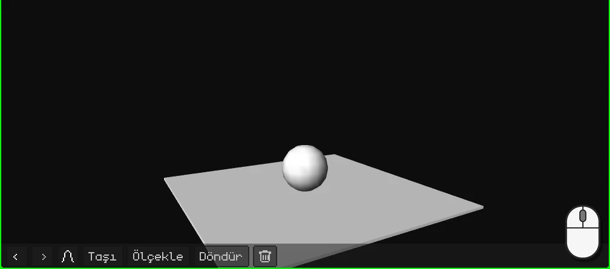
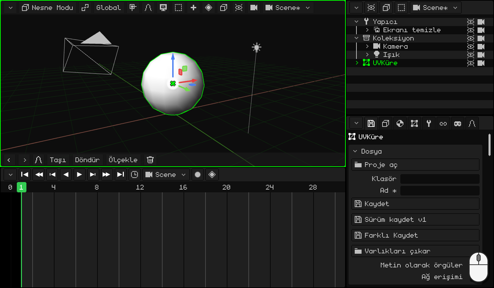
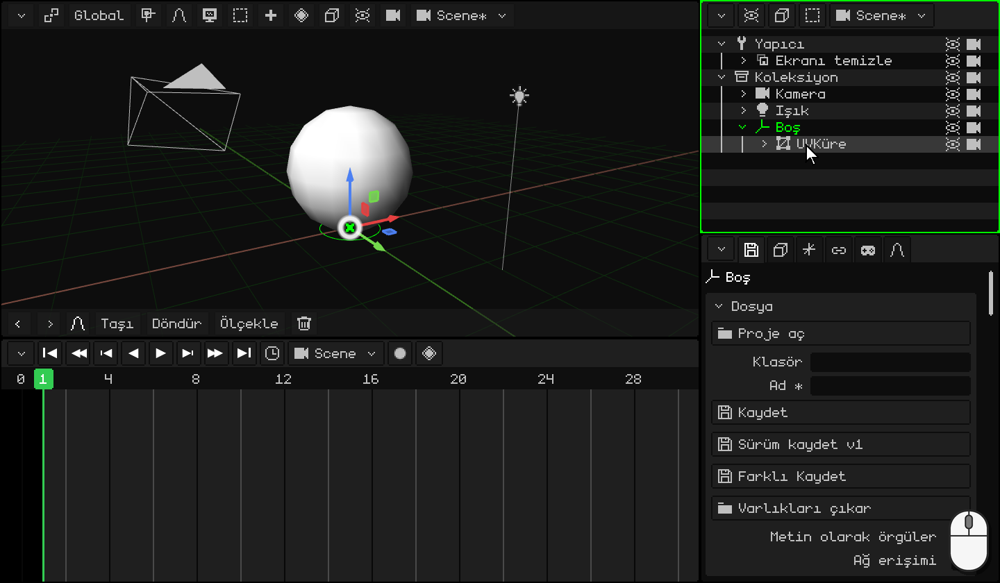
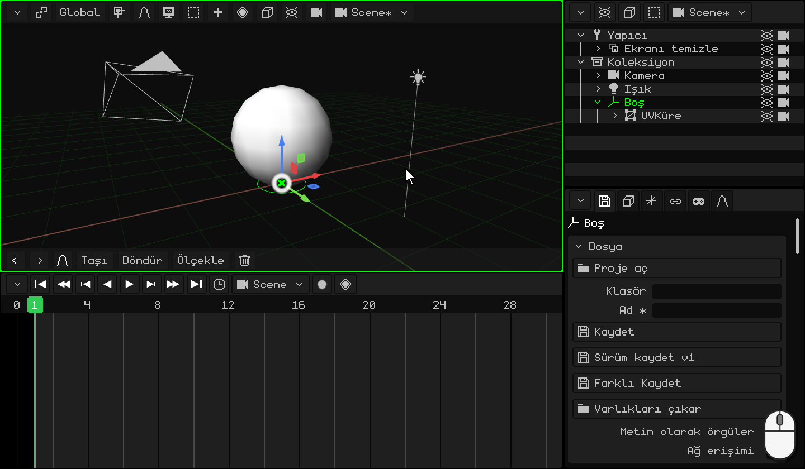
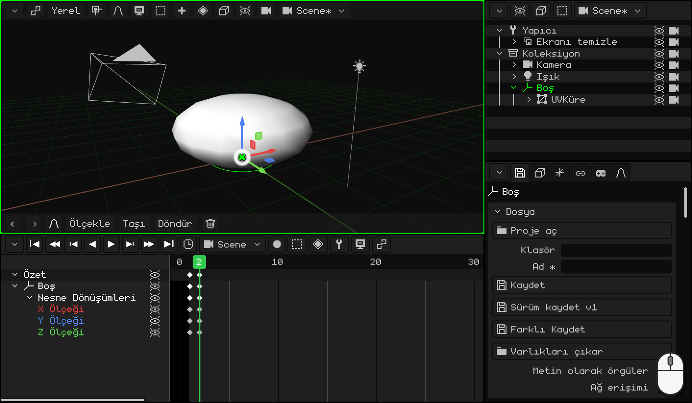
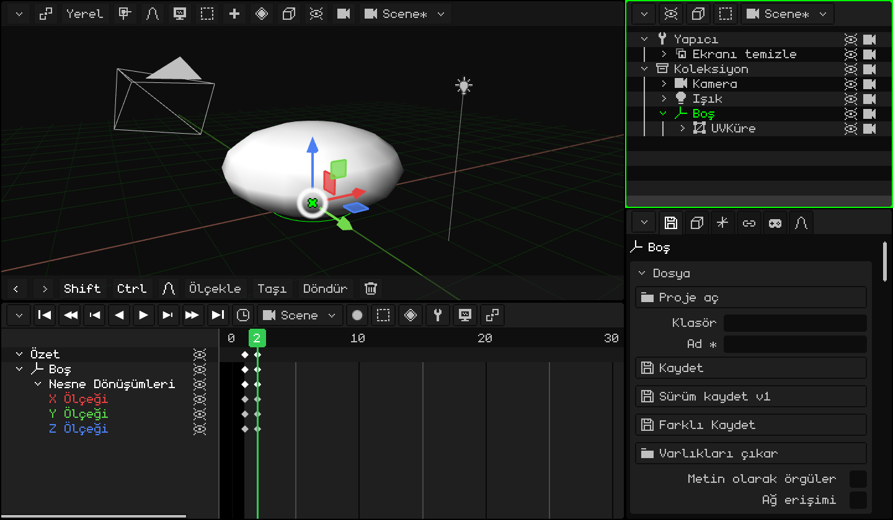
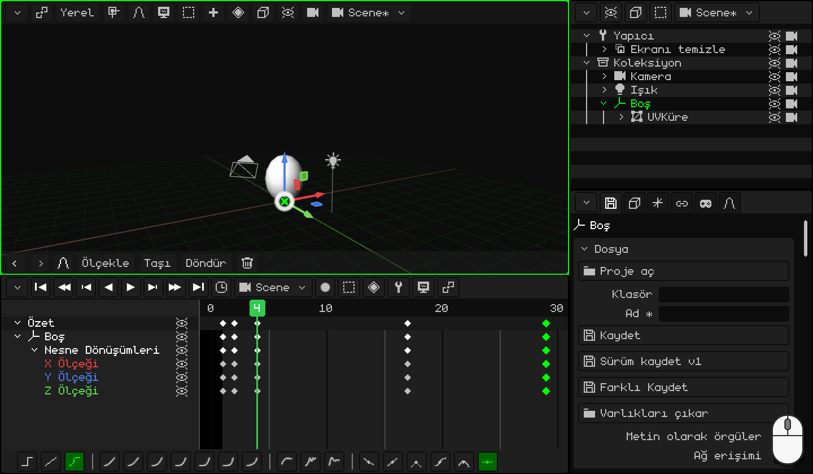
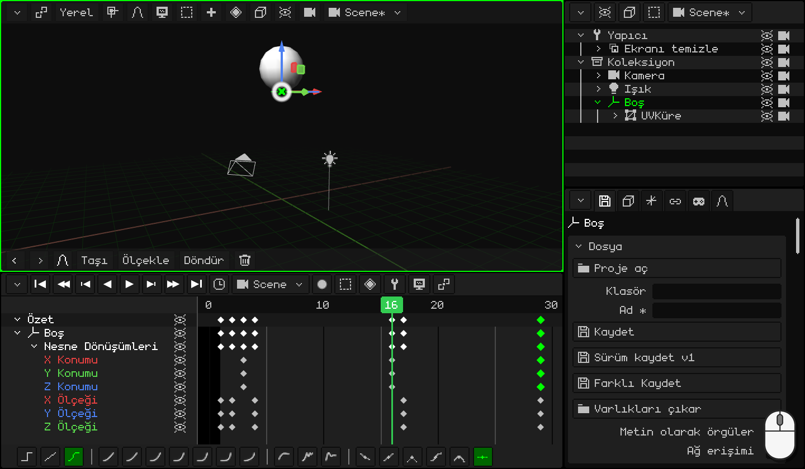
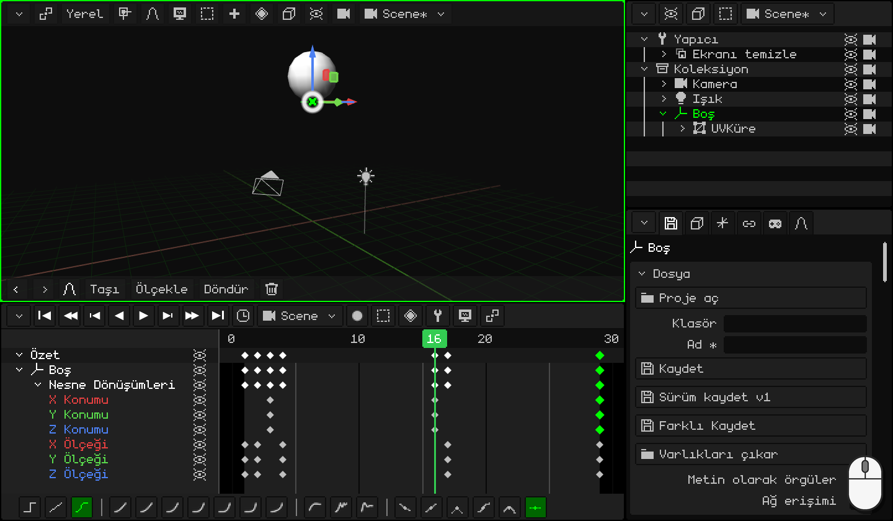

# Bir topu zıplatma

Durmadan zıplayan bir top: her animatörün başladığı alıştırmadır. Kolay görünür, ama iyi görünmesi için animasyonun en önemli ilkelerinden ikisi gerekir:

- **esnetme ve ezme**: top zemine çarpınca ezilir, kalkarken esner. Bu ona ağırlık ve esneklik verir;
- **hızlanma ve yavaşlama**: yerçekiminde olduğu gibi top yükselirken gittikçe yavaşlar, düşerken gittikçe hızlanır.

Bu sırada şunları öğreneceksin:

- topu kendi merkezine doğru değil, zemine doğru ezmek için zemine bir **Boş** nesne koymak;
- elindeki bir poza geri dönmek için keyframe'leri **çoğaltmak**;
- bir **döngü** yapmak: kesintisi fark edilmeden tekrarlanan bir animasyon;
- topun ağırlığı olsun diye **eğrileri** kullanmak.

Henüz hiçbir şey canlandırmadıysan [Kapıyı canlandırma](animar-puerta.md) ile başla: keyframe'ler, Zaman Çizelgesi ve eğriler orada anlatılıyor.

## 1. Top ve Boş nesnesi

1. Küpü sil ve bir küre ekle: <kbd>Shift</kbd> + <kbd>A</kbd> → **Örgü → UV Küre**. 2 metre yüksekliğindedir ve merkezi zeminde oluşur: zemine oturması için onu yukarı kaldır, <kbd>G</kbd> <kbd>Z</kbd> `1` <kbd>Enter</kbd>.
2. **Düzenleme Modu**'na geç (<kbd>Tab</kbd>) ve **Köşe / Kenar / Yüz** düğmesinden **Köşe**'yi seç. En alttaki köşe kürenin arkasında kalır: onu kürenin içinden görmek için **Bindirmeler → X-Işını**'nı aç ve ona tıkla.
3. <kbd>Shift</kbd> + <kbd>S</kbd> → **İmleç Seçilene**: 3D imleç topun en alt noktasına, zemine gider.
4. **Nesne Modu**'na dön (<kbd>Tab</kbd>) ve **X-Işını**'nı kapat.
5. <kbd>Shift</kbd> + <kbd>A</kbd> → **Boş**. 3D imlecin olduğu yerde oluşur: zeminde, tam topun altında.
6. Boş nesneyi topun **ebeveyni yap**. **Outliner**'da **UVKüre**'ye tıkla ve **Boş**'a <kbd>Ctrl</kbd> + tık (en son seçtiğin ebeveyn olur). Fare 3D Görünüm'ün üzerindeyken <kbd>Ctrl</kbd> + <kbd>P</kbd> → **Nesne (Dönüşümü Koru)**. Outliner'da küre Boş nesnenin içine girer.

### Boş nesne ne işe yarar?

Ölçekleme, **orijinden** başlayarak küçültür ya da büyütür. Kürenin orijini merkezinde: onu ezersen merkezine doğru küçülür ve havada kalır. Boş nesne zeminde: onu ezersen top, zıplarken olduğu gibi **zemine doğru** ezilir.

Bundan sonra küre değil, her zaman **Boş nesne** canlandırılır.

  Dokunmatik ekranda ve N95'te: köşe bir dokunuşla (ya da sanal fareyle); imleç **Örgü → Mıknatıs → İmleç Seçilene** ile; Boş nesne **Ekle → Boş** ile; ebeveyn atamak için de küre ve Boş nesne seçiliyken (Boş nesne etkin) **Nesne → Ebeveyn Ata → Nesne (Dönüşümü Koru)**.

## 2. Ezme

Top zemine değdiğinde **ezilir**: daha basık ve daha geniş olur. Küçülüyormuş gibi görünmemesi için yükseklikten kaybettiğini genişlikte kazanır.

1. **Boş** nesneyi seç. **1**. karede top yuvarlak ve zemine değiyor: <kbd>I</kbd> → **Yalnızca Ölçek**.
2. <kbd>→</kbd> (sağ ok tuşu) **2**. kareye geçer. Topu ez: <kbd>S</kbd> <kbd>Z</kbd> `0.75` <kbd>Enter</kbd> onu basıklaştırır, <kbd>S</kbd> <kbd>Shift</kbd> + <kbd>Z</kbd> `1.6` <kbd>Enter</kbd> de genişletir. <kbd>Shift</kbd> + <kbd>Z</kbd>, *Z dışındaki tüm eksenler* demektir: X ve Y birlikte.
3. <kbd>I</kbd> → **Yalnızca Ölçek**.

 Dokunmatik ekranda: keyframe, 3D Görünüm'ün menü çubuğundaki eşkenar dörtgen düğmesiyle konur, **Animasyon → Anahtar Kare Ekle → Yalnızca Ölçek**; kare de Zaman Çizelgesi'nin sayılarına bir dokunuşla değiştirilir. Topu ezmek için **Ölçekle** **Z** `0.75`, **Ölçekle** **X** `1.6` ve **Ölçekle** **Y** `1.6`; sayılar üstteki çubuğun klavyesiyle girilir.

 Nokia N95'te: <kbd>3</kbd>, <kbd>3</kbd> (Z ekseni), kalem + `0.75` ve <kbd>OK</kbd>; ardından <kbd>3</kbd>, <kbd>1</kbd> (X) ve `1.6`, sonra <kbd>3</kbd>, <kbd>2</kbd> (Y) ve `1.6`. Keyframe ise **Animasyon → Anahtar Kare Ekle → Yalnızca Ölçek** ile konur.

## 3. Esnetme

Zeminden kalkarken top gittiği yöne doğru **esner**: daha uzun ve daha ince olur. Yukarı vardığında da yeniden yuvarlaklaşır.

1. Yuvarlak top zaten elinde, 1. karedeki keyframe'de: onu çoğalt. Zaman Çizelgesi'nde **1**. karedeki eşkenar dörtgene tıkla, <kbd>Shift</kbd> + <kbd>D</kbd>, kopyayı **4**. kareye götür ve tıkla. İşaretçiye değil, kopyanın eşkenar dörtgenine bak: farenin bir kare sağında çıkar.
2. Aynısını **17**. ve **29**. kareler için yap: orada top yeniden yuvarlaktır.
3. **4**. kareye git (Zaman Çizelgesi'nin sayılarına bir tık). Topu esnet: <kbd>S</kbd> <kbd>Z</kbd> `1.1` <kbd>Enter</kbd> ve <kbd>S</kbd> <kbd>Shift</kbd> + <kbd>Z</kbd> `0.9` <kbd>Enter</kbd>.
4. <kbd>I</kbd> → **Yalnızca Ölçek**.

  Dokunmatik ekranda ve N95'te (sanal fareyle) çoğaltmak yerine kopyalayıp yapıştırılır: 1. karedeki keyframe'e bir dokunuş ve Zaman Çizelgesi'nin **Anahtar** menüsünde (eşkenar dörtgen düğmesi) **Kopyala**; 4. kareye gitmek için sayılara bir dokunuş ve **Anahtar → Yapıştır**. 17 ve 29 için de aynısı. Topu esnetmek için **Ölçekle** **Z** `1.1`, **Ölçekle** **X** `0.9` ve **Ölçekle** **Y** `0.9`.

## 4. Sıçrama

1. **3**. kareye git: top hâlâ zeminde, kalktığı an bu. <kbd>I</kbd> → **Yalnızca Konum**.
2. **16**. kareye git ve topu yükselt: <kbd>G</kbd> <kbd>Z</kbd> `5` <kbd>Enter</kbd> (5 metre). <kbd>I</kbd> → **Yalnızca Konum**.
3. Zemine dönmesi için **3**. karedeki keyframe'i **29**'a çoğalt.

Animasyonu **oynat** (<kbd>Space</kbd>): top zıplıyor. Ama bir şey doğru değil: sanki süzülüyormuş gibi zemine değmeden önce yavaşlıyor. Bunu 6. bölümde eğriler düzeltecek.

 Dokunmatik ekranda: **Taşı** **Z** `5` ve **Animasyon → Anahtar Kare Ekle → Yalnızca Konum**. 3'teki keyframe, 3. bölümdeki gibi **Anahtar → Kopyala** ve **Anahtar → Yapıştır** ile 29'a taşınır.

 Nokia N95'te: <kbd>1</kbd>, <kbd>3</kbd> (Z ekseni), kalem + `5` ve <kbd>OK</kbd>; ardından **Animasyon → Anahtar Kare Ekle → Yalnızca Konum**.

## 5. Döngü

**29**. kare **1**. kareyle aynı: top yuvarlak ve zemine değiyor. Animasyon 29'a kadar gitseydi art arda iki aynı kare görülür ve top bir an hareketsiz kalırdı: kesinti fark edilirdi. Bu yüzden **28**'de biter: 28'den sonra, 29'la aynı olan 1 gelir.

Zaman Çizelgesi'nin **saatine** tıkla ve **Son** alanına `28` yazıp <kbd>Enter</kbd> tuşuna bas.

Aynı saatte bu animasyonun **FPS**'i de var. Top 30'da gidiyor: her zıplama 28 kare, yani yaklaşık bir saniye sürer. Sinema havasında olsun istiyorsan 24'e ayarla, ama canlandırmadan **önce**: aynı karelerle 24'te daha yavaş giderdi. Hangi durumda hangi FPS'in uygun olduğu [Kapıyı canlandırma](animar-puerta.md) eğitiminin zamanlama bölümünde anlatılıyor.

## 6. Eğriler: yerçekimi

**Yalnızca Konum** üç ekseni de kaydetti, ama top yalnızca Z'de hareket ediyor: **X Konumu** ve **Y Konumu** satırları düz çizgiler. Onları sil: her birine tıkla ve <kbd>X</kbd>.

Şimdi eğri düzenleyicisine geç (**Görünüm → Eğriler**). Z eğrisi sıçramadır: çıkar ve iner. Gerçek bir topu düşün:

- **Yükselirken** zeminden son hızla çıkar ve yukarıda durana kadar yavaşlar: **hızlı çıkıp yavaşlar**. **3**. karedeki keyframe'i seç ve Zaman Çizelgesi'nin araç çubuğunda **Kübik** ve **Çıkışta**.
- **İnerken** yavaş başlar ve zemine çarpana kadar gittikçe hızlanarak düşer: **hızlanıp birden durur**. **16**. karedeki keyframe'i seç: **Kübik** ve **Girişte**.

(Klavyeyle: **Enterpolasyon Modu** için <kbd>E</kbd>, **Yumuşatma Türü** için <kbd>Ctrl</kbd> + <kbd>E</kbd>.)

Eğri gerçek bir topun yayları gibi olur: yukarıda yuvarlak, aşağıda, zemine çarptığı yerde sivri. Animasyonu **oynat**: artık topun ağırlığı var.

Daha yükseğe ya da daha alçağa zıplamasını mı istiyorsun? Eğri düzenleyicisinde üstteki keyframe'i (16. karedekini) tut ve taşı.

## 7. İzle

Izgara ve Boş nesne olmadan görmek için **Bindirmeler → Bindirmeleri Göster**'i kapat ve animasyonu **oynat**.

Aşağıdaki üç top aynı sürede zıplıyor. Birincisinin eğrileri doğrusal: bir makine gibi hep aynı hızla çıkıp iniyor. İkincisinde yerçekimi eğrileri var: yukarıda yavaşlıyor ve zemine çarpıyor. Üçüncüsü ayrıca esniyor ve eziliyor: bu eğitimdeki top.

