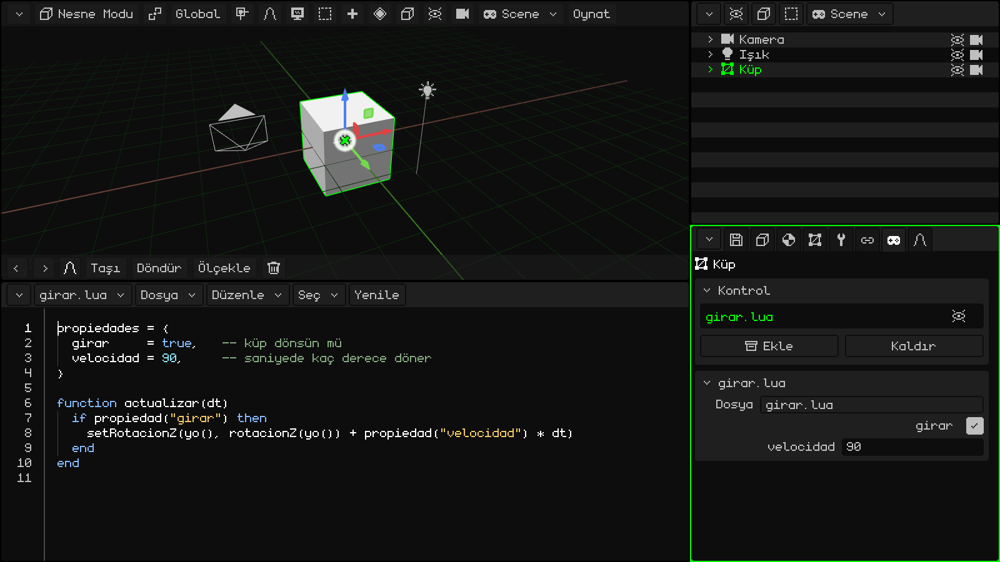
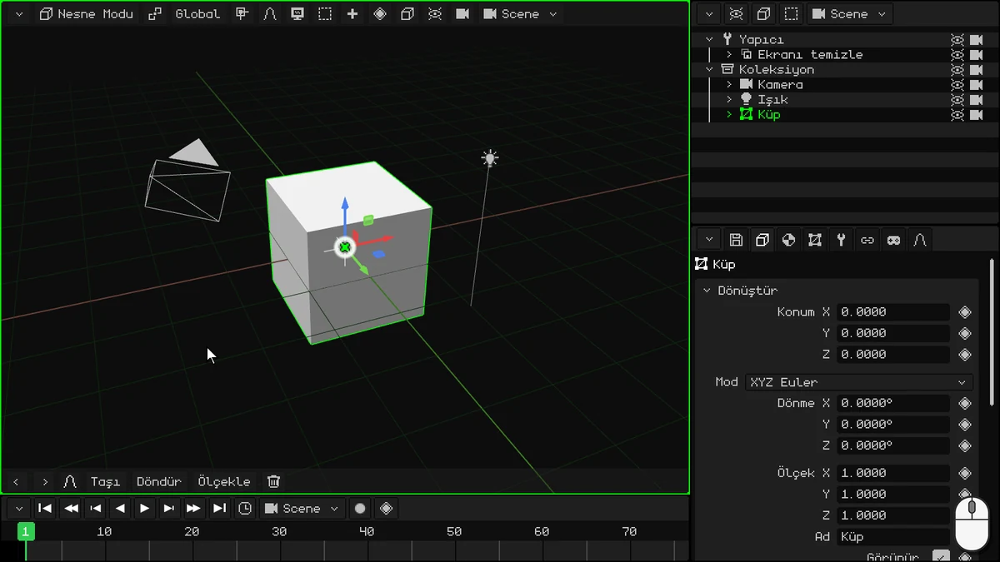
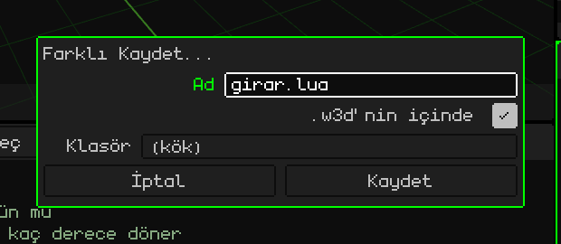
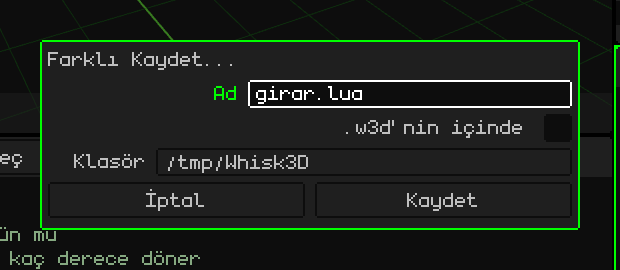
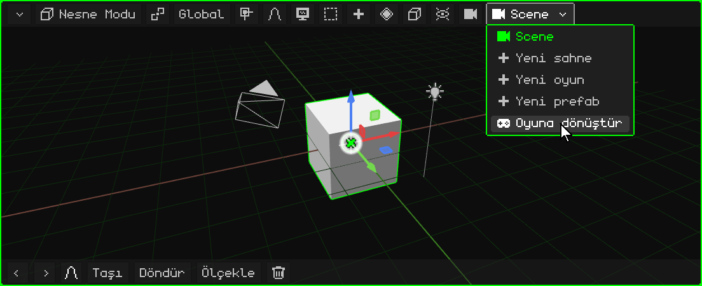
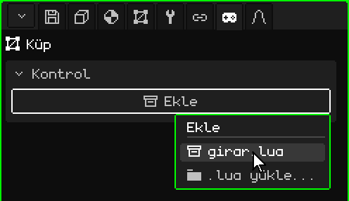
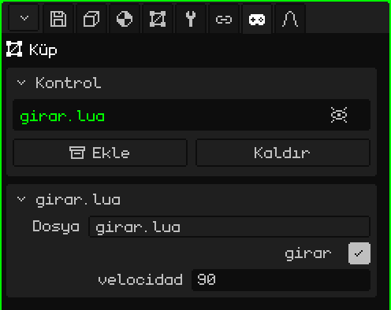
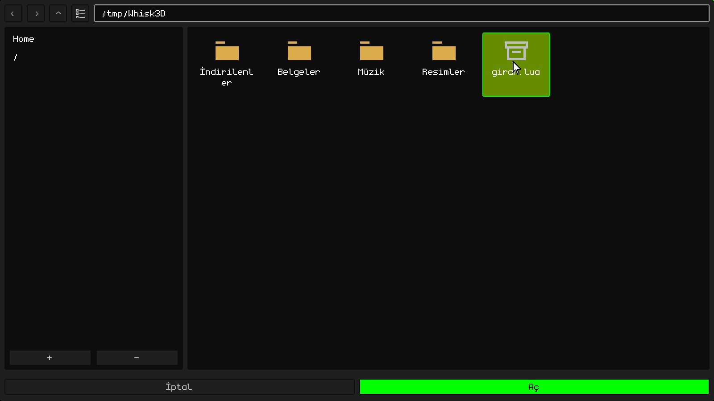
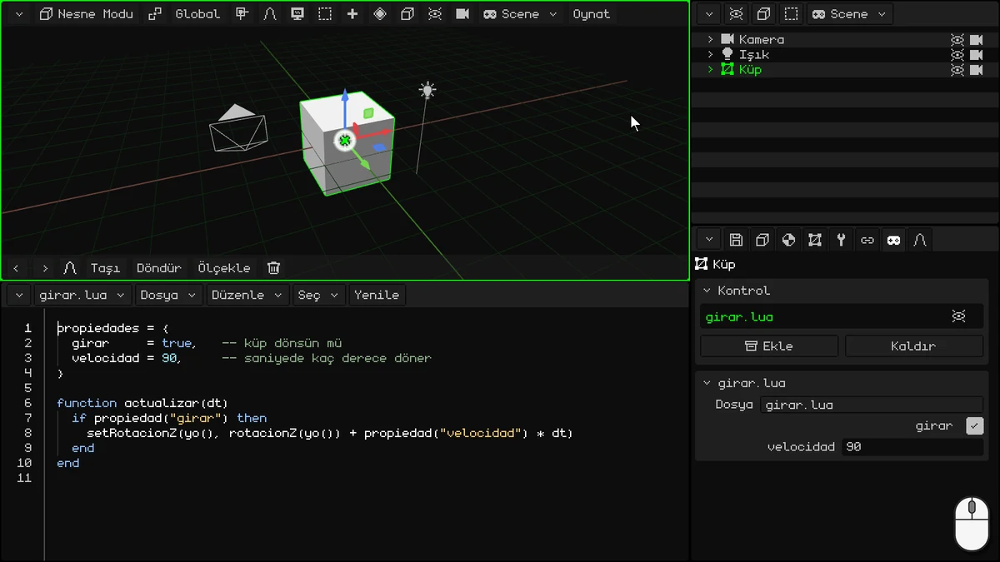

# İlk script'in: dönen bir küp

Bu eğitimde ilk **Lua** script'ini yazacaksın: küpü döndüren bir script.



## 1. IDE

Bu eğitimde Zaman Çizelgesi'ni kullanmayacaksın: onu IDE'ye, yani script editörüne dönüştür. Zaman Çizelgesi'nin köşe düğmesine (sol üstte) dokun ve **IDE**'yi seç.

IDE boş açılır. Daha rahat yazmak için onu büyüt: aynı köşe düğmesini yukarı sürükle.



> [!NOTE]
> Başka editörler ya da harici IDE'ler kullanıp script'leri yüklemek de mümkün. Script'ler W3D projelerinin dışında da içinde de olabilir.

## 2. Script'i yaz

Script'in iki bölümü var: üstte **özellikler**, altta da küpü döndüren **fonksiyon**.

### Özellikler

```lua
propiedades = {
  girar     = true,   -- küp dönsün mü
  velocidad = 90,     -- saniyede kaç derece döner
}
```

- **`propiedades`**, script'in Özellikler panelinden değiştirilebilen değerleridir, her satırda bir tane. `girar = true` bir **boolean** değerdir (doğru ya da yanlış: `true` ya da `false`) ve panelde bir onay kutusu olarak görünür. `velocidad = 90` bir sayıdır ve bir sayı alanı olarak görünür. Burada yazdığın, **varsayılan** değerdir: script'i kullanan her nesnenin kendi değeri olabilir.
- `--` işaretinden sonra gelen şey bir **yorumdur**: Lua onu okumaz, senin içindir.

### Fonksiyon

```lua
function actualizar(dt)
  if propiedad("girar") then
    setRotacionZ(yo(), rotacionZ(yo()) + propiedad("velocidad") * dt)
  end
end
```

**Fonksiyon**, adı olan bir kod bloğudur: `function ad()` ile başlar ve `end` ile biter. İçindekiler, onu yazdığın anda değil, biri fonksiyonu her **çağırdığında** yapılır.

Whisk3D'nin **ayrılmış fonksiyonları** vardır: script'inde bu adlardan birine sahip bir fonksiyon varsa, motor onu tam zamanında kendisi çağırır. Örneğin:

- **`inicio()`**: yalnızca bir kez, Oynat'a bastığında. Her şeyi hazırlamak için kullanılır.
- **`actualizar(dt)`**: oyun çalıştığı sürece **her karede**.

Bir nesne başka bir nesneye çarptığında haber verenler gibi başkaları da var. Hepsi Lua kılavuzunda: [Motor script'ini ne zaman çağırır](../lua/ciclo-del-script.md).

`actualizar` bir video oyunu için idealdir. Bir oyun ekranı saniyede birçok kez çizer ve bu görüntülerin her biri bir **karedir**: hareket eden her şey, her karede birazcık hareket eder. Burada küp her karede biraz daha döner.

- Nesne **görünür** olduğu sürece çalışır: nesneyi gizlersen, script'i nesne yeniden görünene kadar çalışmayı bırakır.
- `dt`, önceki kareden bu yana geçen saniyedir. Hızı `dt` ile çarpmak, oyun ister saniyede 30 ister 60 karede çalışsın, küpün **saniyede** 90 derece dönmesini sağlar.

İçinde yaptığı şey:

**`if propiedad("girar") then` … `end`** bir **koşuldur**. Bir `if` («eğer»), içindeki kodu yalnızca `if` ile `then` arasındaki şey doğruysa çalıştırır. Başka bir koşulu deneyen bir `elseif` («değilse, şu doğruysa bunu yap…») ve hiçbiri sağlanmadığında çalışan bir `else` («değilse») içerebilir; ikisi de isteğe bağlıdır. Her zaman `end` ile biter. Örneğin:

```lua
if puan >= 100 then
  madalya = "altın"
elseif puan >= 50 then
  madalya = "gümüş"
else
  madalya = "yok"
end
```

120 puanla madalya altın; 70'le gümüş, 10'la da yok. Yalnızca koşulu sağlanan ilk bölüm çalışır. (Lua'da `elseif` bitişik yazılır.)

Script'teki `if`'te ne `elseif` ne de `else` var: **girar** doğruysa (onay kutusu işaretliyse) küp döner; yanlışsa hiçbir şey olmaz ve fonksiyon biter. `propiedad("girar")`, o nesnenin paneldeki değerini okur. Değer her karede okunduğu için, oyun çalışırken onu değiştirirsen script bunu o anda fark eder.

- **`yo()`**, script'in sahibi olan nesnedir: küp. **`rotacionZ(yo())`** onun Z etrafındaki dönüşünü derece olarak verir (dikey eksen, Özellikler panelinde gördüğün Z'nin ta kendisi); **`setRotacionZ`** de ona yeni bir dönüş verir: aynısını, biraz fazlasıyla. Böylece küp bir topaç gibi döner.

`propiedad`, `yo`, `rotacionZ` ve `setRotacionZ` de fonksiyondur, ama tersi: onları Whisk3D sağlar, sen çağırırsın. Hepsi [Lua kılavuzunda](../lua/README.md).

### Script'in tamamı

IDE'nin içine dokun ve hepsini birlikte yaz:

```lua
propiedades = {
  girar     = true,   -- küp dönsün mü
  velocidad = 90,     -- saniyede kaç derece döner
}

function actualizar(dt)
  if propiedad("girar") then
    setRotacionZ(yo(), rotacionZ(yo()) + propiedad("velocidad") * dt)
  end
end
```

## 3. Kaydet

Henüz kaydetmediysen önce projeyi kaydet: script ancak proje kaydedilmişse projenin içine kaydedilebilir. Özellikler'de **disket** sekmesinde (**Dosya** kartı) bir **Ad** yaz, örneğin `girar-cubo`, ve **Kaydet**'e dokun. Proje, kartın gösterdiği **Klasör**'e kaydedilir.

Ardından IDE'nin menü çubuğunda **Dosya → Farklı Kaydet...**:

1. **Ad** alanına `girar.lua` yaz.
2. **.w3d'nin içinde**'yi işaretle: script projenin içine, aynı `.w3d` dosyasına kaydedilir. **Klasör** artık projenin içindeki klasörlerden biri olur: **(kök)** ana klasördür.
3. **Kaydet**'e dokun.



**.w3d'nin içinde**'yi işaretlemezsen script, projenin dışında, seçtiğin **Klasör**'de ayrı bir dosya olarak kaydedilir. Bu, örneğin onu başka bir programla düzenlemek için işe yarar.



## 4. Sahneyi oyuna dönüştür

**Sahne** modelleme ve animasyon içindir; script'ler bir **oyunda** çalışır. Oyunun kendi animasyonları yoktur: animasyonlar bir sahnede ya da iskeletli bir 3D modelde yapılır ve orada kullanılmak üzere oyuna aktarılır. 3D Görünüm'ün (ya da Outliner'ın) menü çubuğunda, sahnenin adını gösteren sahne düğmesine dokun ve **Oyuna dönüştür**'ü seç.



**Oyuna dönüştür** sahneni değiştirmez: her şeyin Zaman Çizelgesi'nin geçerli karesinde göründüğü gibi olduğu bir kopya yapar; bu kopya bir oyundur. Sahnenin animasyonları oyuna geçmez: o kare, oyunun başlangıç konumu ve durumu olarak kaydedilir. Asıl sahne animasyonlarıyla birlikte olduğu gibi kalır; onu sahne düğmesinin menüsünde yeniden bulursun.

Artık oyundasın: sahne düğmesinde bir joystick görünür ve 3D Görünüm'ün menü çubuğunda **Oynat** belirir.

## 5. Küpe ekle

1. Oyundaki **Küp**'ü seç (Outliner'da ya da 3D Görünüm'de).
2. Özellikler'de **joystick** sekmesine git.
3. **Kontrol** kartında **Ekle**'ye dokun: projedeki script'leri içeren bir menü açılır. `girar.lua`'yı seç.



Script, Kontrol kartının listesinde görünür ve altına, yazdığın özellikleri içeren kendi kartı **girar.lua** eklenir: **girar** onay kutusu (işaretli) ve **velocidad** (90).

Listede script'in sağında bir **göz** var: ona dokunduğunda script kapanır (motor onu kullanmaz), ama nesneden kaldırılmaz ve nesne de gizlenmez. Bir dokunuş daha onu açar.



### Dışarıdan bir script

Script'i başka bir editörle yazdıysan ya da `.w3d`'nin dışına kaydettiysen **Ekle → .lua yükle...**'ye dokun. Dosya gezgini, **Betik yükle** açılır: dosyayı seç ve **Aç**'a dokun.



## 6. Oynat'a bas

**Oynat**'a dokun: küp döner. Oyun çalışırken 3D Görünüm'ün menü çubuğunda **Durdur** ve **Duraklat** görünür.

Oyun çalışırken **girar.lua** kartındaki özellikleri değiştirmeyi dene:

- **velocidad**'ı 360 yap: dört kat daha hızlı döner;
- **girar**'ın işaretini kaldır: küp durur. Yeniden işaretle, dönmeye devam eder.

Bitirmek için **Durdur**'a dokun: küp, Oynat'a basmadan önceki hâline döner.



> [!NOTE]
> Oyun çalışırken olan her şey **Durdur**'a dokununca kaybolur: küp yerine döner, **girar** ve **velocidad** da Oynat'a basmadan önceki değerlerine döner. Onları gerçekten değiştirmek için oyun dururken değiştir.

## Devam etmek için

- [Whisk3D'de Lua](../lua/README.md): tüm fonksiyonlarıyla Lua kılavuzu.
- [Script, bir nesnenin bileşenidir](../lua/scripts-y-objetos.md): özellikler (listeler, metinler ve sahne nesneleri de).
- [Motor script'ini ne zaman çağırır](../lua/ciclo-del-script.md): `actualizar`, `inicio` ve diğerleri.

## Örneği indir

İşte bitmiş proje; dene ya da kendininkiyle karşılaştır: **[girar-cubo.w3d](ejemplos/girar-cubo.w3d)**. Whisk3D'de aç ve **Oynat**'a bas. Script `.w3d`'nin içindedir ve IDE'de görünür.
