# Özellikler

> [!NOTE]
>  Nokia N95 fare ve klavyeyi (Bluetooth ile) destekler. Bu sayfanın Nokia ile ilgili kısımları, onu fare ve klavye olmadan, yalnızca telefonun tuşlarıyla nasıl kullanacağını anlatır.

**Özellikler**, **etkin nesnenin**, yani en son seçtiğin nesnenin verilerini gösteren viewport'tur: konumu, adı, malzemesi, bir ışığın rengi, bir örgünün değiştiricileri. **Sekmeler** hâlinde düzenlenmiştir ve her sekmede değer satırlarından oluşan **kartlar** bulunur. Burada değiştirdiğin hemen her şey 3D Görünüm'de anında görünür.

[Viewport'lar](viewports.md#etkin-viewport) eğitiminde anlatıldığı gibi tuşlar etkin viewport'a, yani yeşil kenarlıklı olana gider.

 Nokia N95'te Özellikler, 3D Görünüm'ün sağındadır: yeşil **arama tuşu**  onu etkin viewport yapar. Geri döndüğünde, onu bıraktığın satırda kalmış olur.

## Sekmeler

Sekmeler, Özellikler'in menü çubuğundaki simgelerdir. Her biri bir grup kart gösterir.

Sekmeler **etkin nesneye göre değişir**: her nesne türü yalnızca işine yarayanları gösterir. Bir örgüde Malzeme, 3D Örgü ve Değiştiriciler vardır; bir ışıkta malzemenin yerinde Işık sekmesi, bir kamerada da Kamera sekmesi bulunur.

| Sekme | Ne zaman görünür |
|---|---|
| Dosya / Render (disket) | Her zaman, hiçbir şey seçili olmasa bile. |
| Nesne | Herhangi bir 3D nesneyle: konum, dönme, ölçek, ad ve görünürlük. |
| Nesne türünün sekmesi | Örgüde Malzeme, ışıkta Işık, kamerada Kamera; her tür için böyle. Simgesi türe göre değişir. |
| 3D Örgü ve Değiştiriciler | Yalnızca bir örgüyle. |
| Dönüştür | Yalnızca Düzenleme Modu'ndaki bir örgüyle. |
| Kısıtlamalar | Herhangi bir 3D nesneyle. |
| Betikler | Herhangi bir nesneyle. |
| Animasyon | Her zaman. |

Türün sekmesi yerinde kalır: bir örgünün malzemesindeyken bir ışık seçersen Işık sekmesine geçersin. Bulunduğun sekme yeni nesnede yoksa (bir ışık seçtiğinde Değiştiriciler), Özellikler Nesne sekmesine döner.

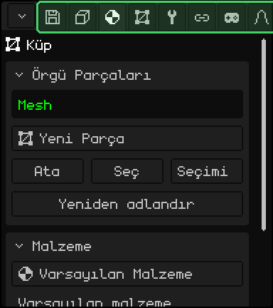

| | Sekme nasıl değiştirilir |
|---|---|
|  PC | Sekmeye bir tık. Hepsi sığmıyorsa çubuğun üzerinde tekerleği çevir. |
|  Dokunmatik ekran | Sekmeye bir dokunuş. Hepsi sığmıyorsa çubuğu yana doğru sürükle. |
|  Nokia N95 | **Yukarı** ok tuşuyla ilk kartın başlığına kadar çık ve bir kez daha bas: geçerli sekme yeşil olur. **Sol** ve **sağ** sekmeyi değiştirir, **aşağı** da kartlara döner. İlk sekmedeyken sol, köşe düğmesinin menüsünü açar. |

## Kartlar

**Kartlar**, her sekmedeki kutulardır: bir başlık ve satırları. Başlıktaki ok, kartın açık mı yoksa katlanmış mı olduğunu söyler. Kullanmadıklarını katlamak, kullandıklarını el altında tutar.

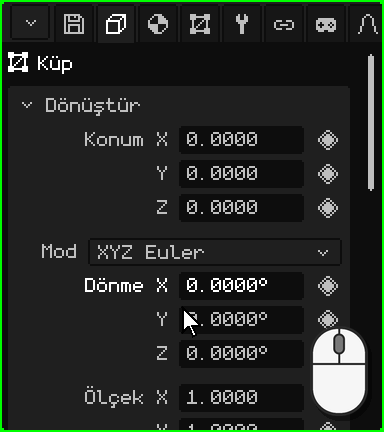

| | Nasıl katlanır ve açılır |
|---|---|
|  PC | Başlığa bir tık. |
|  Dokunmatik ekran | Başlığa bir dokunuş. |
|  Nokia N95 | Başlığın üzerinde <kbd>OK</kbd>. **Sol** ok tuşu kartı satırlarından herhangi birindeyken katlar, başlığın üzerinde **sağ** ok tuşu da açar. |

Kartlar viewport'a sığmazsa panel kayar: PC'de fare tekerleğiyle, dokunmatik ekranda parmağı yukarı ya da aşağı sürükleyerek. Nokia'da panel seçili satırı kendiliğinden takip eder.

### Tuşlarla gezinme

 Nokia N95'te bir **seçili satır** vardır: adı yeşil, değeri de beyaz bir kenarlıkla görünür. **Yukarı** ve **aşağı** bir satırdan ötekine ve bir karttan sonrakine geçer, <kbd>OK</kbd> de satırı kullanır: sayıyı düzenler, onay kutusunu işaretler, açılır listeyi açar. Düzenleme sırasında kenarlık yeşil olur.

 PC'de, fare Özellikler'in üzerindeyken ok tuşları ve <kbd>Enter</kbd> aynı şeyi yapar, <kbd>Esc</kbd> de düzenlemekte olduğunu iptal eder.

## Sayılar

Satırların çoğu **sayıdır**: solda ad, sağda değer; Dönüştür kartındaki Konum, Dönme ve Ölçek gibi. Bir sayı **yazılabilir** ya da **sürüklenebilir**. Her birinin kendi hızı vardır, bazılarının da sınırı vardır: bir ışığın GL Işığı 0'dan 7'ye gider.

### Sayı yazma

 Fareyi kıpırdatmadan sayıya bir tık: değer işaretlenir ve yazdığın şey onun yerine geçer. <kbd>Enter</kbd> onu uygular, <kbd>Esc</kbd> olduğu gibi bırakır. Başka herhangi bir yere tık da onu uygular.

 Sayıya bir dokunuş, altta Whisk3D'nin **sayısal klavyesini** satırın adı ve değeriyle birlikte açar. Klavyede rakamlar, nokta, silmek için **DEL** ve imleci hareket ettirmek için oklar vardır. **OK** değeri uygular, **X** iptal eder; klavyenin dışına dokunmak da değeri uygular.

 Sayısal klavye **hesap** da yapar: <kbd>+</kbd>, <kbd>-</kbd>, <kbd>\*</kbd>, <kbd>/</kbd> ve parantezlerle `2*3` ya da `1.5+0.25` yazabilirsin; OK'ye dokununca sonuç kalır. <kbd>-</kbd> negatif bir sayı yazmaya da yarar.

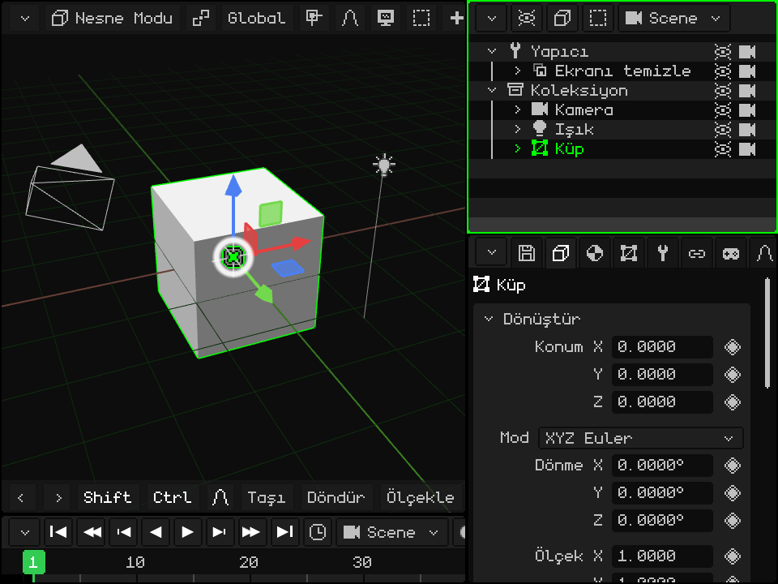

 Ok tuşlarıyla satıra gel ve <kbd>OK</kbd>'ye bas: değer işaretlenir ve telefonun tuşları rakam yazar (Özellikler'in çubuğu **123** gösterir). Yazdığın ilk rakam eski değerin yerine geçer. <kbd>\*</kbd> ondalık noktadır, <kbd>C</kbd> siler, **sol** ve **sağ** imleci hareket ettirir, <kbd>OK</kbd> değeri uygular ve **sol seçim tuşu** iptal eder.

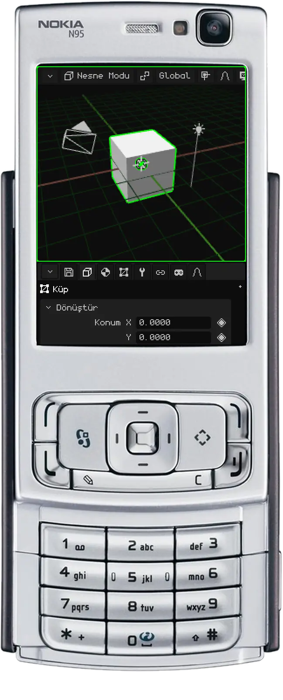

### Sayıyı sürükleme

 Fare tuşunu sayının üzerinde basılı tut ve fareyi yana hareket ettir: sağa doğru değer artar, sola doğru azalır. İşaretçi viewport'un kenarına ulaşırsa öbür taraftan çıkar ve sürüklemeye devam edebilirsin. Bıraktığında değer kalır.

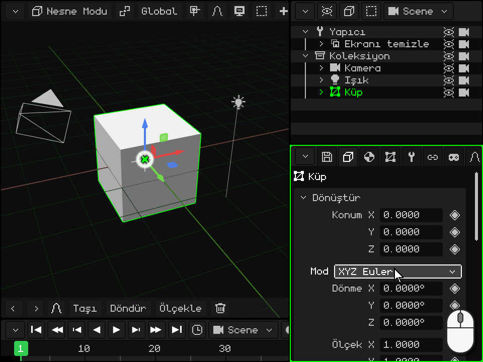

 Parmağını sayının üzerine (adının değil) koy ve yana doğru sürükle. Yukarı ya da aşağı sürüklersen değer değişmez, panel kayar.

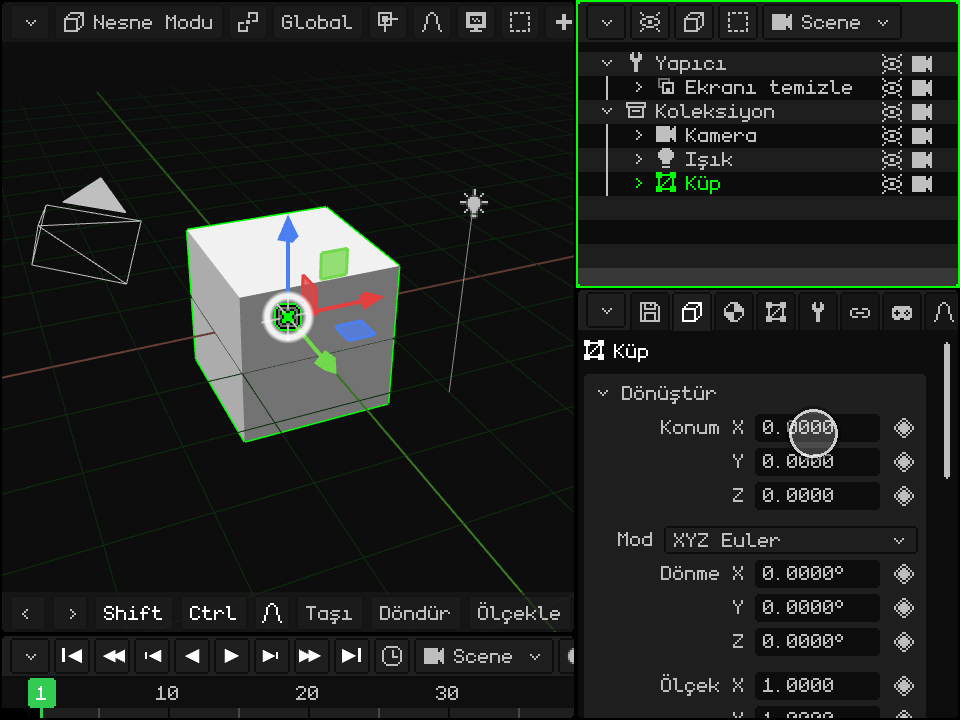

## Açılır listeler

**Açılır liste**, seçili seçeneği gösteren bir düğmedir; bir ışığın **Tür**'ü (Nokta, Güneş ya da Spot) ya da dönmenin **Mod**'u gibi. Etkinleştirildiğinde seçenek listesi açılır, geçerli olan yeşildir; başka birini seçince liste kapanır.

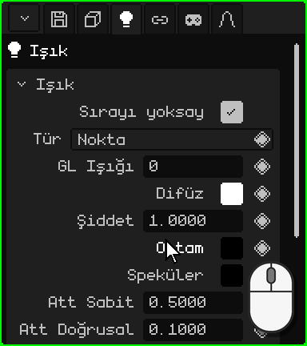

| | Nasıl açılır ve seçilir |
|---|---|
|  PC | Düğmeye bir tık, seçeneğe bir tık daha. |
|  Dokunmatik ekran | Düğmeye bir dokunuş, seçeneğe bir dokunuş daha. |
|  Nokia N95 | <kbd>OK</kbd> onu açar, **yukarı** ve **aşağı** seçeneklerde dolaşır, <kbd>OK</kbd> seçer. <kbd>C</kbd> hiçbir şeyi değiştirmeden kapatır. |

## Onay kutuları

**Onay kutusu** açılır ya da kapanır: işaretliyse evet, boşsa hayır. Satırın sağında durur; malzemedeki **Aydınlatma** gibi: kapalıyken nesne ışıklardan etkilenmez ve kendi renginde, düz görünür. Satıra (kutuya ya da adına) bir tık ya da dokunuş onu değiştirir, Nokia'da da <kbd>OK</kbd>.

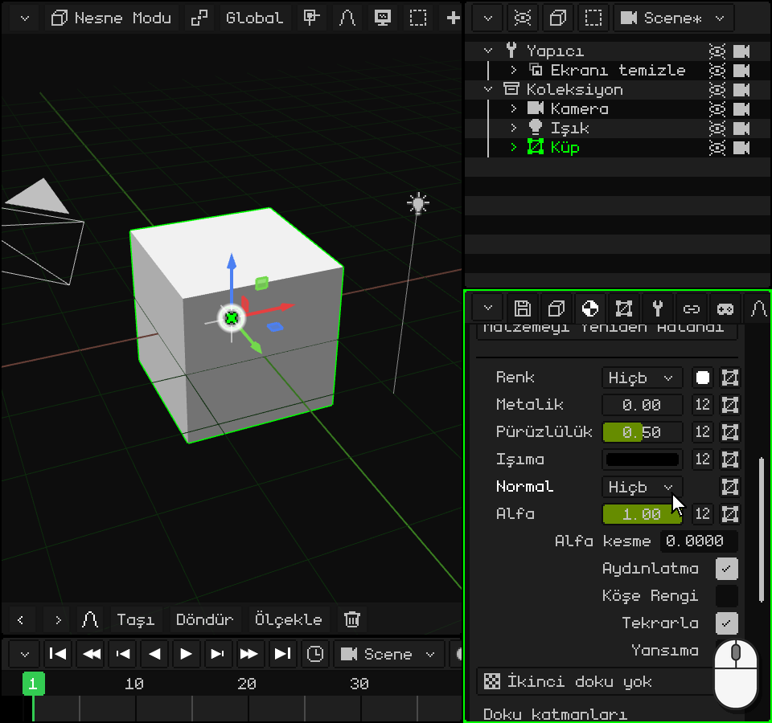

## Metinler

**Metin alanı** bir ad ya da yol tutar; Dönüştür kartının sonundaki nesnenin **Ad**'ı gibi. Etkinleştirildiğinde imleç metnin sonunda belirir. Yeni ad Outliner'da da görünür.

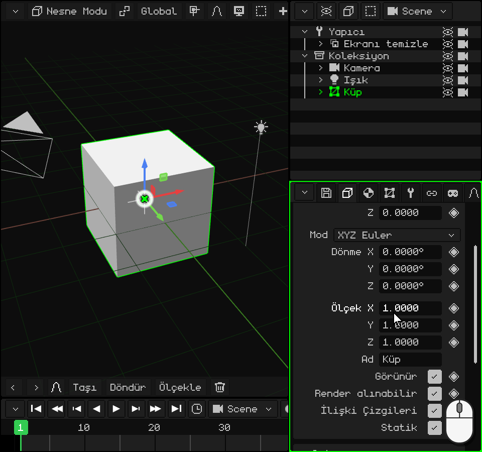

-  **PC'de:** alana bir tık ve yaz. <kbd>Enter</kbd> (ya da başka bir yere tık) onaylar, <kbd>Esc</kbd> önceki metne döner.
-  **Dokunmatik ekranda:** bir dokunuş, ñ harfi de olan Whisk3D klavyesini açar. **Aa** büyük harflere, **123** rakamlara ve sembollere geçer, **DEL** siler ve **OK** onaylar. Web sürümünde telefonun klavyesi açılır.
-  **Nokia N95'te:** <kbd>OK</kbd>'ye bas ve telefonun tuş takımıyla, bir kısa mesaj yazar gibi yaz: her tuş, birkaç kez basıldıkça kendi harflerini verir. <kbd>#</kbd> Abc, abc ve ABC arasında geçiş yapar, basılı tutulunca 123'e geçer (Özellikler'in çubuğu modu gösterir). <kbd>0</kbd> boşluktur, <kbd>1</kbd> noktalama işaretleridir, <kbd>\*</kbd> de daha fazla sembol açar. <kbd>C</kbd> siler, **sol** ve **sağ** imleci hareket ettirir, <kbd>OK</kbd> onaylar ve **sol seçim tuşu** iptal eder.

## Renkler

Bir **renk** satırı, sağda rengi gösteren küçük bir kare gösterir; bir ışığın kartındaki **Difüz**, **Ortam** ve **Speküler** gibi. Etkinleştirildiğinde **renk seçici** açılır:

- **daire** tonu ve doygunluğu, yanındaki çubuk da değeri (ne kadar açık olduğunu) seçer;
- **RGB**, **HSV** ve **Hex** sekmeleri rengi sayılarla gösterir: Kırmızı, Yeşil ve Mavi; Ton, Doygunluk ve Değer; ya da Kopyala ve Yapıştır ile birlikte onaltılık kod (`#FF8800`);
- **Alfa** saydamlıktır;
- **Tamam** rengi bırakır, **İptal** öncekine döner.

Renk sen onu hareket ettirirken değişir; böylece onaylamadan önce sahnede görünür. Seçicinin dışına bir tık ya da dokunuş da onu kapatır ve rengi bırakır.

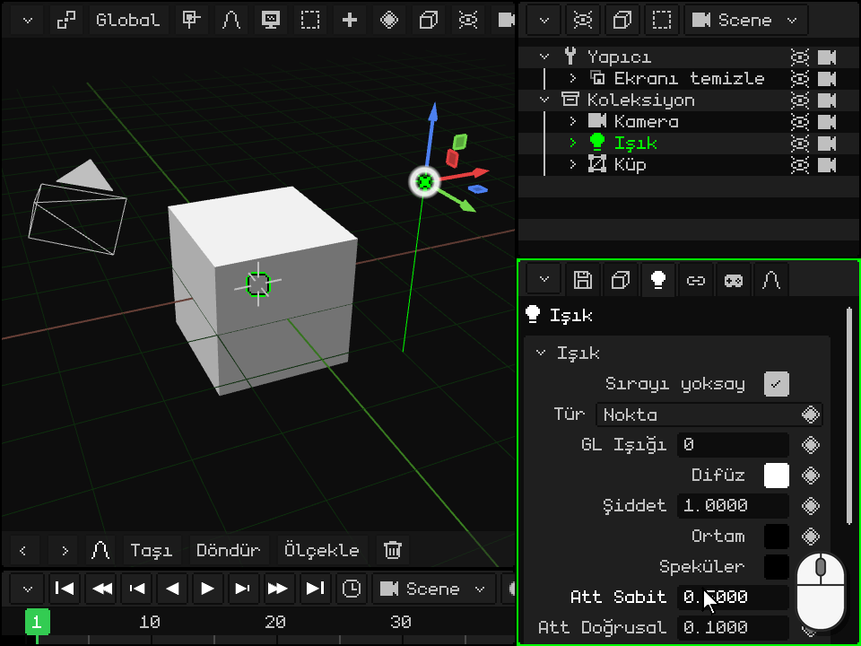

  Fareyle ya da parmakla dairenin ve çubuğun içinde sürüklenir; sayılar da Özellikler'de olduğu gibi yana doğru sürüklenir.

 Nokia N95'te **yukarı** ve **aşağı**; daire, çubuk, sekmeler, sayı satırları ve Tamam / İptal arasında dolaşır. Bir sayı satırında **sol** ve **sağ** onu değiştirir (basılı tutulunca giderek hızlanır). Dairenin üzerinde <kbd>OK</kbd> onu düzenlemeye girer: **sol** ve **sağ** tonu döndürür, **yukarı** ve **aşağı** doygunluğu değiştirir, <kbd>OK</kbd> de çıkar. Çubuk da aynı şekilde, yukarı ve aşağı ile düzenlenir. <kbd>C</kbd> seçiciyi kapatır ve önceki renge döner.

## Listeler

Bazı kartlarda bir **liste** bulunur: bir örgünün değiştiricileri, parçaları, UV haritaları. Seçili olan işaretlenir; altındakiler onun verilerini gösterir ya da onun üzerinde çalışır. Listenin altında **düğme** satırları vardır.

**Yukarı taşı** ve **Aşağı taşı** seçili olanın yerini değiştirir. Sıra önemlidir: değiştiriciler yukarıdan aşağıya uygulanır, bir örgünün parçaları da o sırayla çizilir. Bu iki düğme, listede iki ya da daha fazla öğe olduğunda görünür.

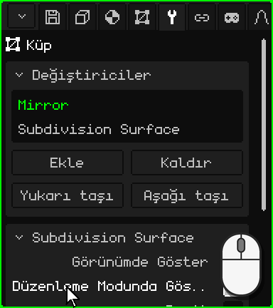

| | Liste nasıl kullanılır |
|---|---|
|  PC | Bir tık seçer. Hepsi sığmıyorsa listenin üzerinde tekerleği çevir. |
|  Dokunmatik ekran | Bir dokunuş seçer. Hepsi sığmıyorsa parmağını listenin üzerinde yukarı ya da aşağı sürükle. |
|  Nokia N95 | Listenin üzerinde <kbd>OK</kbd>; **yukarı** ve **aşağı** seçer, <kbd>OK</kbd> çıkar. Bir düğme satırında **sol** ve **sağ** bir düğmeden ötekine geçer (kenarlık hangisi olduğunu gösterir), <kbd>OK</kbd> de ona basar. |

## Eşkenar dörtgen: bir özelliği canlandırma

Canlandırılabilen özelliklerin sağında bir **eşkenar dörtgen** bulunur; onu taşımayanlar canlandırılamaz. Eşkenar dörtgene bir tık ya da dokunuş bir **keyframe** koyar: o özelliğin değerini Zaman Çizelgesi'nin geçerli karesine kaydeder. Farklı karelerde keyframe'ler varsa, animasyon oynatılınca özellik kendiliğinden değişir.

Eşkenar dörtgenin rengi, özelliğin **geçerli karedeki** durumunu söyler:

| Eşkenar dörtgen | Ne anlama gelir | Bir tık ne yapar |
|---|---|---|
| Gri | Özellik canlandırılmamış. | Şimdiki değerle ilk keyframe'i koyar. |
| Soluk yeşil | Canlandırılmış, ama bu karede keyframe'i yok. | Şimdiki değerle bir keyframe koyar. |
| Yeşil | Bu karede bir keyframe'i var. | Onu kaldırır. |

Bir değeri değiştirmek eşkenar dörtgenin rengini değiştirmez: yeni değer, keyframe'i koyana kadar animasyona girmez ve ondan önce kare değiştirirsen özellik, animasyonun söylediği değere döner. Zaten keyframe'i olan bir karede (yeşil eşkenar dörtgen) yeni bir değer iki tıkla kaydedilir: ilki keyframe'i kaldırır, ikincisi onu şimdiki değerle yeniden koyar.

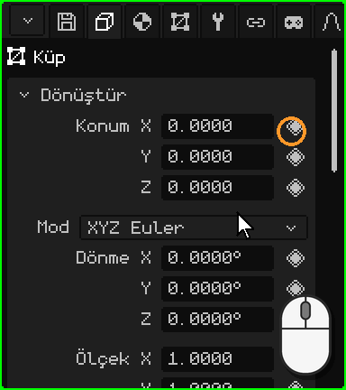

 Nokia N95'te, satırdayken **sağ** ok tuşu eşkenar dörtgene geçer (beyaz bir kenarlık onu işaretler), <kbd>OK</kbd> keyframe'i koyar ya da kaldırır, **sol** da değere döner.

Animasyon sekmesinde **Etkin kamera** kartı, animasyonun her anında hangi kameranın kullanılacağını seçer: bir sahnenin kesmeleri. Onun eşkenar dörtgeninin bir rengi daha vardır, **daha açık bir yeşil**: seçili kamera, animasyonun bu karede söylediği kamera değildir; bu henüz kaydedilmemiş bir değişikliktir. Bir tık, kesmeyi geçerli kareye kaydeder.

Animasyonun ileride kendi eğitimi olacak.

Tüm sekmeler ve kartları kılavuzda: [Özellikler](propiedades.md). [Viewport'lar](viewports.md) eğitimine geri dön.

## Her sekmenin içeriği

| Sekme | İçeriği |
|---|---|
| Dosya / Render (disket) | **Dosya**: açma, kaydetme, farklı kaydetme, sürüm kaydetme, varlıkları çıkarma. **Render**: yol, boyut, ek geçişler, arka plan, **Işın İzleme** (ışınlar, örnekler, geçişler), Görüntü Render Al ve Animasyon Render Al. **Oyun**: platform (Windows, Symbian, Linux .deb, AppImage, WebGL, Android, Android 2.3), pencere, yönelim, simge, fizik, ses, ses düzeyi, **çözünürlük** (oyunun ekranın yüzde kaçında çizildiği: Android 2.3'te sistem görüntüyü esnetir ve o telefonlarda daha az piksel çizmek daha fazla kare verir) ve Oyunu derle (adb ile bağlı bir telefon varsa oyunu ona kurar ve açar). **Dışa Aktar**: OBJ, glTF, GLB, STL (yalnızca üçgenler; 3D baskı için ya da bir CAD programına aktarmak için). **Ayarlar**: dil, antialiasing, grafikler, tema, log'lar, ölçek, **Klavye Kısayolları...** ve Değişiklikleri kaydet. |
| Nesne | Konum, dönme (Euler, kuaterniyon ya da eksen-açı), ölçek, ad, görünür, render alınabilir; nesnenin animasyonları ve paleti. |
| Bağlamsal | Türe bağlıdır: örgü parçaları ve **malzeme** (doku, aydınlatma, köşe rengi, saydamlık, yansımalar, normal map, karıştırma, derinlik, doku katmanları, **Gelişmiş: özel shader** — bkz. [Yazılan shader'lar](../editor/shaders.md); ışın izleme ile Pürüzlülük, Metalik, Geçirgenlik ve IOR), ışık, kamera, sis, parçacıklar, fizik, hitbox, iskelet ve kemikler, 2D öğeler, prefab'lar, rutinler. |
| 3D Örgü | Kullanılan örgü (ve onu kaç nesnenin paylaştığı), UV haritaları, renk katmanları, köşe grupları, UV grupları. Kütüphane'de bir kaynak seçiliyken: onun verileri ve konumu (.w3d'nin içinde ya da dışında). |
| Değiştiriciler | [Değiştiriciler](../editor/objeto-malla.md#değiştiriciler-sekmesi) bölümüne bak. |
| Dönüştür | Yalnızca Düzenleme Modu'nda: seçimin ve UV'lerinin merkezi, düzenlenebilir. |
| 2D İskelet | Örgünün 2D iskeletleri ve kemikleri. |
| Kısıtlamalar | Copy Location, Copy Rotation, Billboard (kameraya bakma), Child Of. |
| Betikler | Nesnenin Lua script'leri ve özellikleri ([Lua belgesine](../lua/README.md) bak). |
| Animasyon | Etkin animasyon, karışım katmanları (Karıştır), seçili keyframe'in tam değerleri ve kamera kesmeleri. |

## Rutinler

Rutin, Özellikler'de kurulan bir çizim adımları listesidir (taşıma, döndürme, doku belirleme, bir örgü çizme, başka bir rutini çağırma, Lua çağır…). N95'te çizim yapmanın en hızlı yoludur.

| İşlev | Açıklama | Kısayol |
|---|---|---|
| Ekle / Kaldır (adım) | Konuya göre gruplanmış adımlar ekler ya da seçili olanı kaldırır. | Düğmeler; <kbd>X</kbd> ya da <kbd>Delete</kbd> kaldırır |
| Adımı tut | Adımı ok tuşlarıyla yeniden sıralar; <kbd>Enter</kbd> onaylar. | <kbd>G</kbd> |
| Anahtar Kare Ekle | Adımın değerlerini geçerli karede canlandırır. | <kbd>I</kbd> |
| Tekrarla | Listenin art arda kaç kez çalışacağı (rutin döngüsü). 1 = normal rutin. | Tekrarla alanı |
| Render modu / Kullan | Her gölgelendirme modu için ayrı bir liste ya da hepsi için aynı liste. | Açılır listeler |
