# Orijini değiştirme: bir kapı

Bu eğitimde bir kapının menteşesinden açılmasını sağlayacaksın. Bunun için kapının **orijinini** değiştirmen gerekir: nesnenin etrafında döndüğü nokta (Nesne Modu eğitimindeki [Orijin](modo-objeto.md#orijin) bölümüne bak).

Önceki eğitimdeki ([Bir kapı modelleme](modelar-puerta.md)) orijini ortada olan kapıdan başlıyoruz. Kapıyı bir yan yüzünü kaydırarak yaptıysan orijin de kaymış kaldı: **Nesne → Orijini Ayarla → Orijini Geometriye** onu yeniden ortaya getirir.

## Kapı yanlış dönüyor

Kapıyı döndürmeyi dene. Kapı menteşesinden değil, döner kapı gibi kendi merkezi etrafında döner:

 Gizmoyla: ortasına bir tık onu **Döndür** moduna geçirir, mavi halka da kapıyı dikey eksen etrafında döndürür.

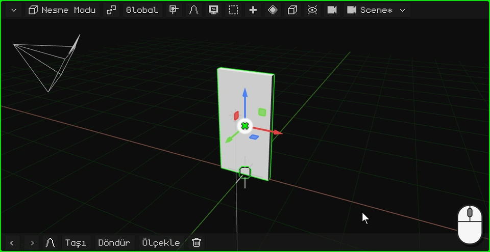

 Parmakla: gizmonun ortasına bir dokunuş onu **Döndür** moduna geçirir, sonra mavi halka sürüklenir.

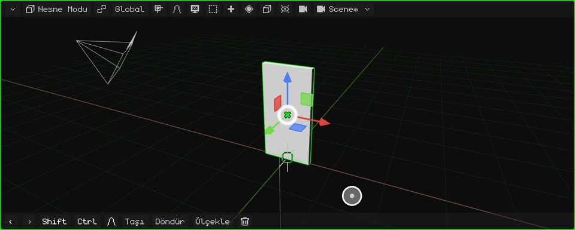

 Nokia N95'te gizmo kapalı gelir: <kbd>2</kbd> (döndürme), <kbd>3</kbd> (Z ekseni, yani dikey eksen) ve ok tuşları; <kbd>OK</kbd> onaylar.

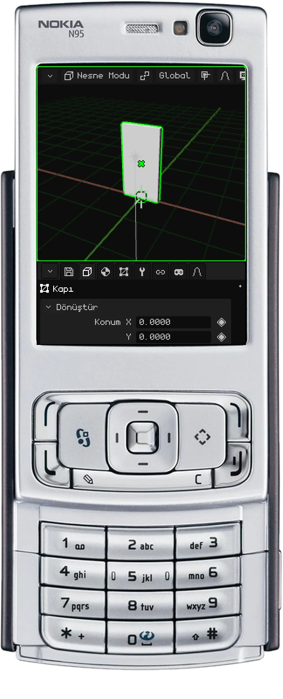

Yanlış dönüyor, çünkü orijini ortada. Onu menteşeye taşıyalım.

## Orijini menteşeye taşıma

1. **Düzenleme Modu'na geç.** Mod düğmesine, ardından **Düzenleme Modu**'na tıkla (PC'de <kbd>Tab</kbd> ile de olur).

   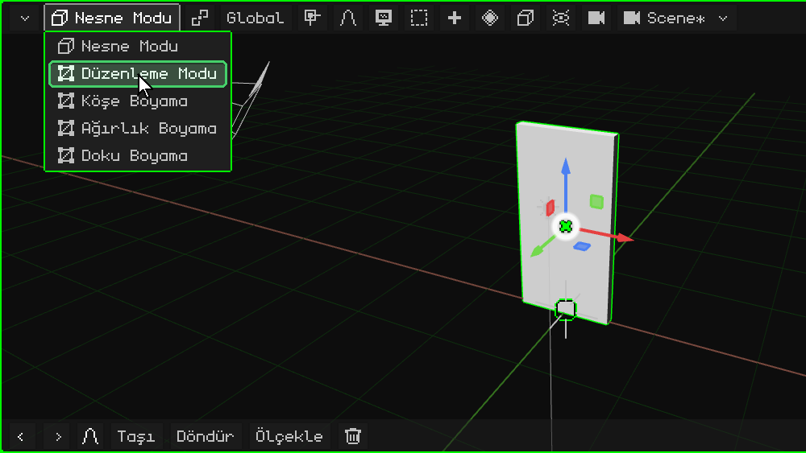

2. **Yüzleri seç.** Düzenleme Modu'nda **Köşe / Kenar / Yüz** düğmesi belirir: ona tıkla ve **Yüz**'ü seç.

   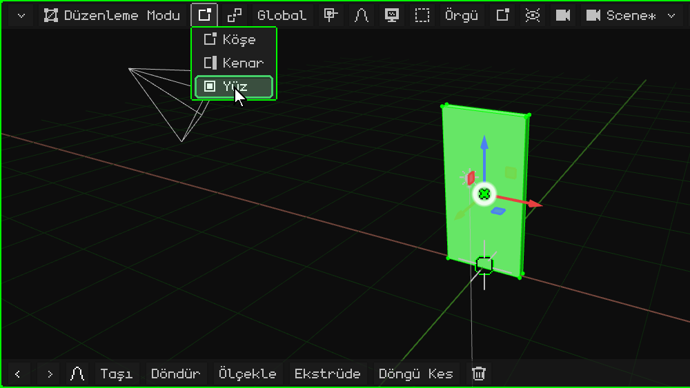

3. **Menteşe tarafındaki yüzü seç.** Kapının, menteşenin geleceği taraftaki dar yan yüzüne tıkla: yeşil olur.

   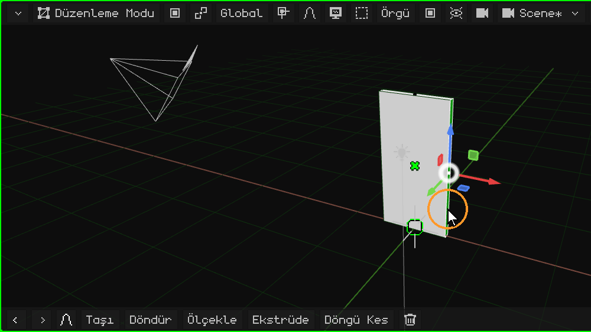

4. **3D imleci oraya taşı.** **Örgü** menüsünde **Mıknatıs** → **İmleç Seçilene**: 3D imleç menteşenin üzerine gelir.

   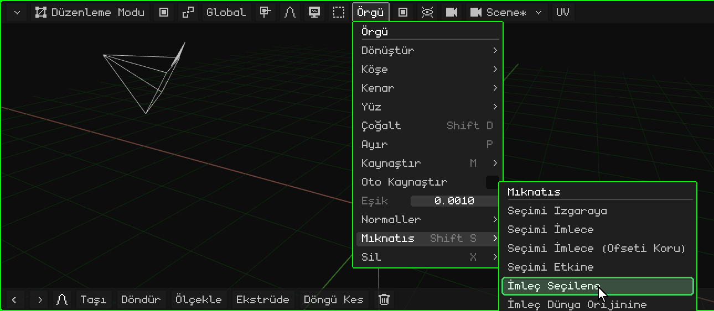

5. **Nesne Modu'na dön.** Mod düğmesine, ardından **Nesne Modu**'na tıkla (ya da <kbd>Tab</kbd>).

   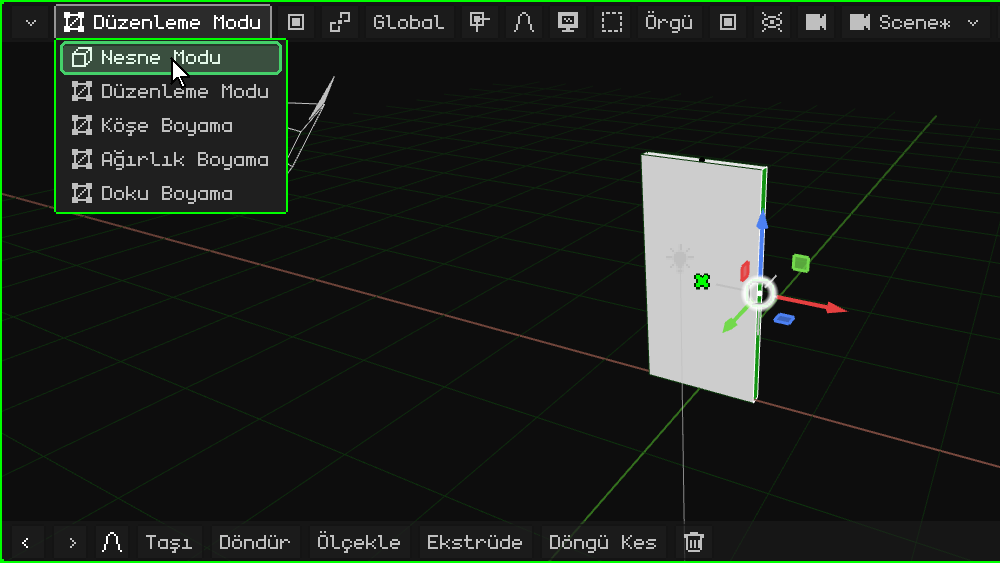

6. **Orijini 3D imlece taşı.** **Nesne** menüsünde **Orijini Ayarla** → **Orijini 3D İmlece**. Kapı yerinden oynamaz: hareket eden onun orijinidir, onunla birlikte de gizmo; gizmo artık menteşededir.

   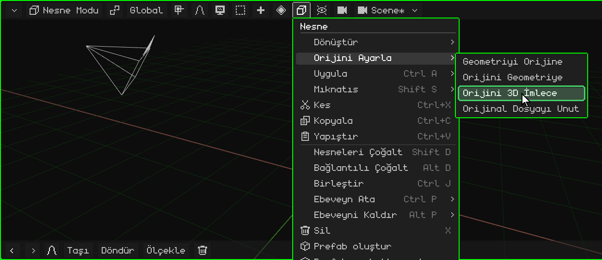

## Artık doğru dönüyor

Kapıyı gizmoyla yeniden döndür: artık menteşesinden açılıp kapanıyor.

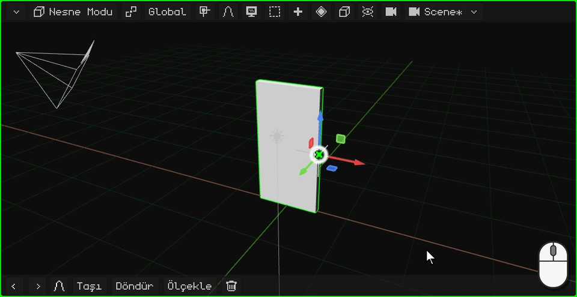

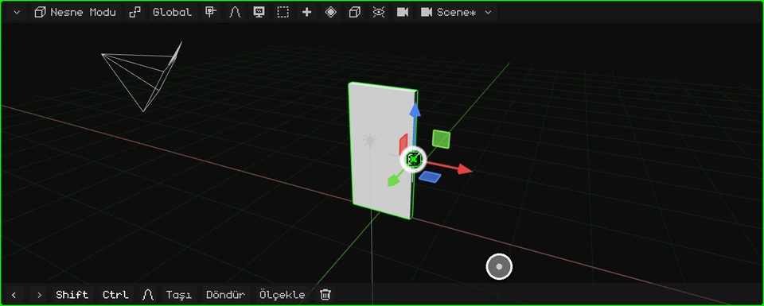

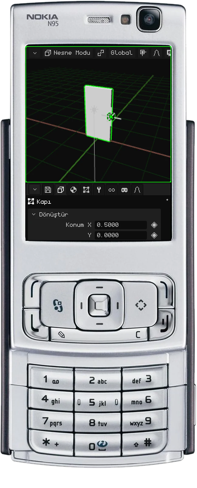

 Dokunmatik ekranda yukarıdaki adımlar aynıdır, tıklar yerine dokunuşlarla: menüler bir dokunuşla açılır ve seçilir.

 Nokia N95'te <kbd>OK</kbd> Nesne Modu'ndan Düzenleme Modu'na geçirir, menüler de sol seçim tuşuyla açılır.

## Orijini Ayarla seçenekleri

| Seçenek | Ne yapar |
|---|---|
| **Orijini Geometriye** | Orijini örgünün merkezine taşır. |
| **Orijini 3D İmlece** | Orijini 3D imlecin bulunduğu yere taşır. |
| **Geometriyi Orijine** | Tersini yapar: orijini yerinde bırakır ve örgüyü, merkezi orijine gelene kadar taşır. |

Sonraki eğitimde kapının kolunu yapıyoruz: [Kapı kolunu modelleme](modelar-picaporte.md).
