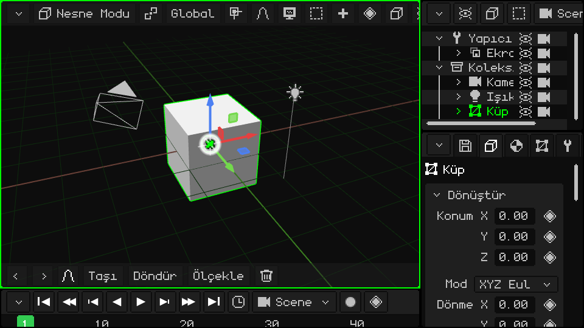
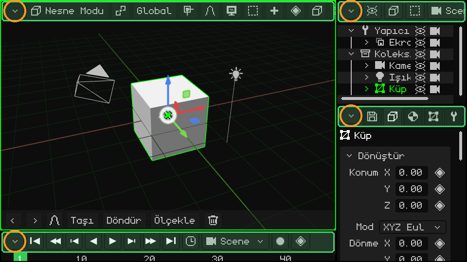
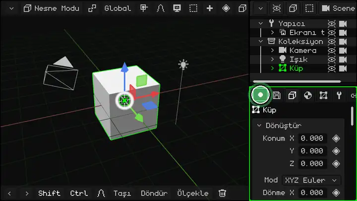
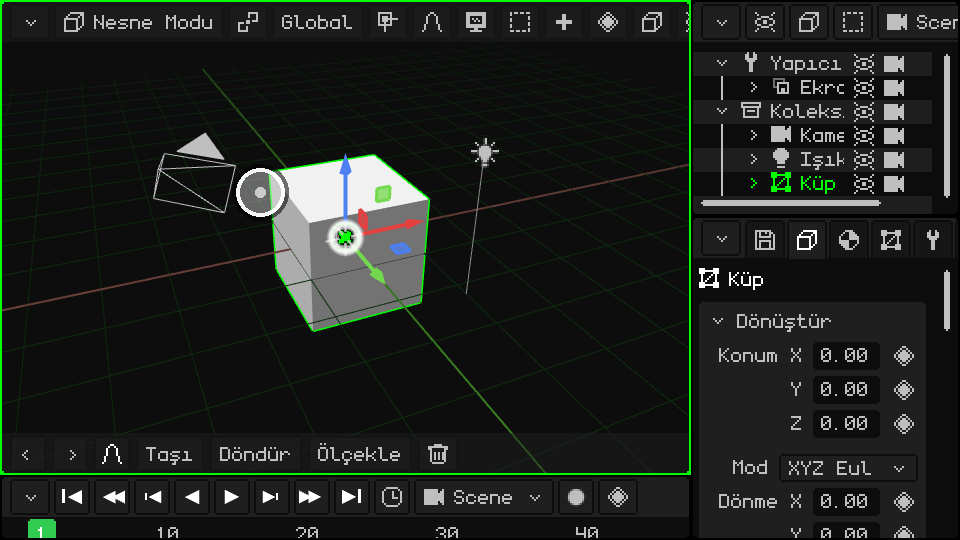
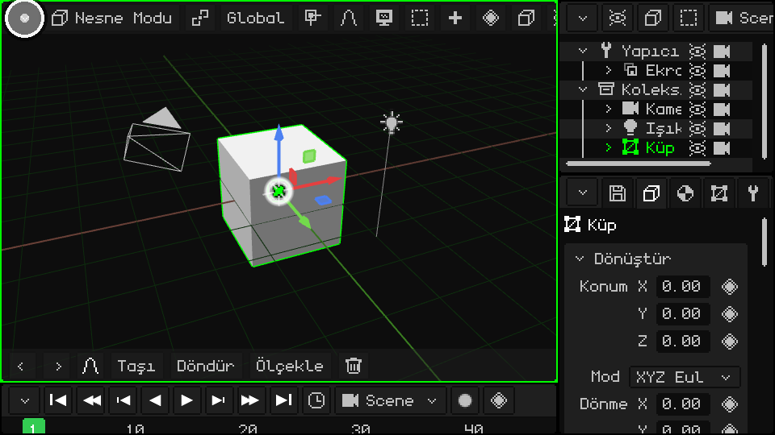
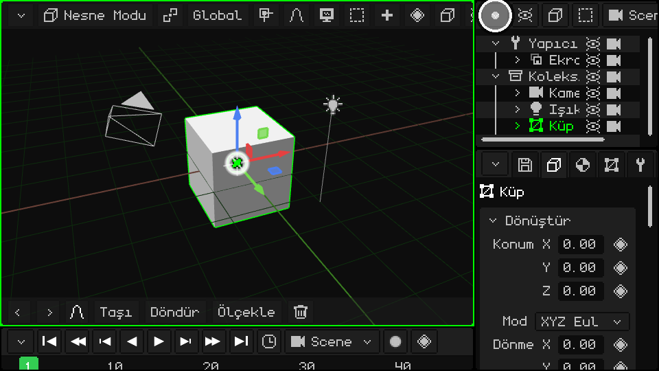
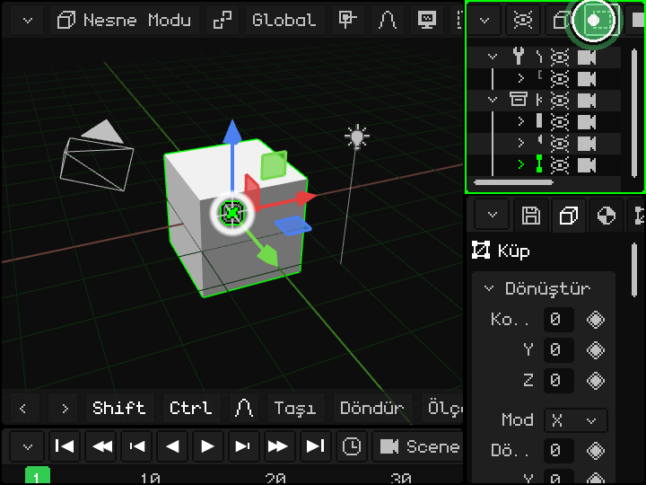
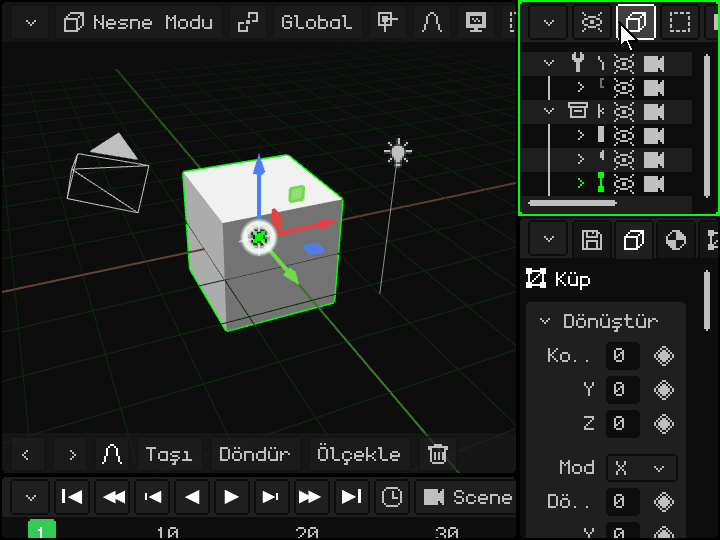
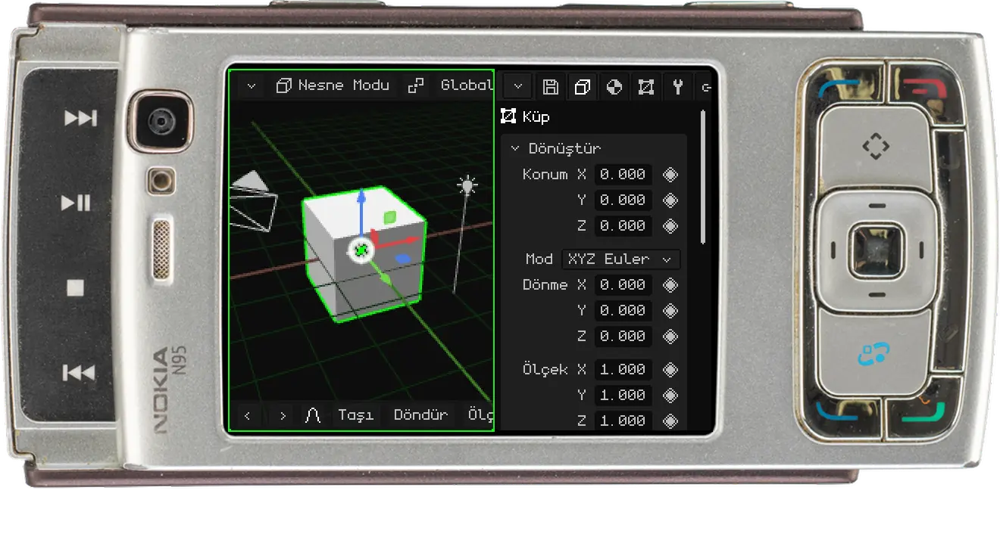

# Viewport'lar

> [!NOTE]
> Nokia N95 fare ve klavyeyi (Bluetooth ile) destekler. Bu eğitimin Nokia ile ilgili kısımları, onu fare ve klavye olmadan, yalnızca telefonun tuşlarıyla nasıl kullanacağını anlatır.

Whisk3D penceresi **viewport**'lara bölünür: her birinin kendi editörü olan paneller (3D Viewport, Outliner, Properties...). Onları bölebilir, boyutlarını değiştirebilir ve her birinin ne göstereceğini seçebilirsin. Fareyle, dokunmatik ekranda parmakla ve bir Nokia'nın tuş takımıyla aynı şekilde çalışır.

Program ilk kez açıldığında görünen ekran bu:

## Etkin viewport

Farenin altındaki viewport **etkin viewport**'tur ve yeşil bir kenarlıkla işaretlenir. Klavye komutlarını, oyun kumandalarını ve diğer tüm çevre birimlerini o alır. Fareyi bir viewport'tan diğerine götürdükçe yeşil kenarlık onu takip eder:

**Nokia N95'te:** yeşil **arama tuşuna**  her basışta bir sonraki viewport'a geçilir. N95'in ekranına iki viewport sığar: solda 3D Viewport, sağda Properties.

## Menü çubuğu ve köşe düğmesi

Her viewport'un üstünde, o editörün menülerini ve düğmelerini içeren bir **menü çubuğu** (görselde yeşil) vardır. Sol üstte her zaman **köşe düğmesi** (turuncu) bulunur: viewport'u değiştiren ya da düzenleyen düğme budur.

## Boyutu değiştirme

Boyutu değiştirmek için köşe düğmesini (parmağınla ya da fareyle) **basılı tut** ve sürükle: bu, o viewport'un sol ve üst kenarını hareket ettirir; yanındakiler de buna göre ayarlanır. Sürüklemeden **tek bir dokunuş** ise viewport'un seçeneklerini içeren açılır menüyü açar. Burada sağ alttaki viewport'un düğmesi daireler çizerek sürükleniyor ve üç viewport da boyut değiştiriyor:

**Nokia'da:** yeşil **arama tuşunu**  basılı tut ve bir ok tuşuna bas: etkin viewport'un (yeşil çerçeveli olanın) kenarı o yöne kayar, böylece viewport büyür ya da küçülür. Yeşil tuş tek başına, ok tuşu olmadan, bir sonraki viewport'a geçer.

## Viewport seçenekleri

Köşe düğmesine bir kez dokununca şu menü açılır:

Üstte **viewport türleri** vardır: birini seçmek viewport'u o editöre dönüştürür. Çizginin altında viewport'la yapılabilecekler bulunur:

| Seçenek | Ne yapar |
|---|---|
| Expand | Viewport yanındakinin yerini alır, yanındaki kapanır (yanındaki bölünmüşse o grubun tamamı kapanır). |
| Split in Columns | Onu yan yana iki parçaya böler. |
| Split in Rows | Onu üst üste iki parçaya böler. |
| Maximize | Onu tüm pencereyi kaplayacak şekilde büyütür. Büyütülmüşken menüde yalnızca **Minimize** vardır; o da viewport'u yerine geri döndürür. |

### Türü değiştirme

UV Editor'e dönüştürülen 3D Viewport:

### Split in Columns ve Split in Rows

### Expand

Outliner, Properties'in yerini alır:

### Maximize ve Minimize

## Çubuk sığmadığında

Viewport darsa çubuğu tamamen sığmaz. Aynı şey 3D Viewport'un alt çubuğunda da olur. Geri kalanını görmek için:

- **Parmakla:** çubuğu yana doğru sürükle.
- **Fareyle:** fare düğmesini çubuğun üzerinde basılı tutup sürükle ya da çubuğun üzerinde **tekerleği** çevir.
- **Klavyeyle:** PC'de <kbd>M</kbd> ya da Nokia'da **sol seçim tuşu**, etkin viewport'un çubuğuna girmeni sağlar. Sol ve sağ ok tuşlarıyla çubukta gezersin; her menü üzerine gelince açılır. Yukarı ve aşağı ile menüde hareket eder, OK ile (PC'de <kbd>Enter</kbd>) seçersin. Çubuk, nerede olduğunu göstermek için kendiliğinden kayar.

Bir Nokia N95'te: sol seçim tuşu çubuğa girer, ok tuşları da çubukta gezer.

## Viewport türleri

| Viewport | Ne işe yarar |
|---|---|
| [3D Viewport](../editor/vista-3d.md) | Sahnenin görüntülendiği ve düzenlendiği yer: modelleme, nesneleri taşıma, boyama, poz verme ve animasyon. |
| [Outliner](../editor/outliner.md) | Sahnedeki her şeyin listesi. |
| [Library](../editor/outliner.md#library-görünümü) | Projenin kaynakları: mesh'ler, materyaller, dokular, animasyonlar, sesler, script'ler ve daha fazlası. |
| [Properties](../editor/propiedades.md) | Etkin nesnenin verileri, sekmeler hâlinde. |
| [UV Editor](../editor/editor-uv.md) | Dokunun mesh'in üzerine nasıl oturduğu. |
| [Timeline](../editor/linea-de-tiempo.md) | Animasyon: keyframe'ler ve eğriler. |
| [2D Editor](../editor/editor-2d.md) | Oyun arayüzleri, HUD'lar ve 2D oyunlar. |
| [Console](../editor/consola.md) | Motorun log kayıtları: hatalar, uyarılar ve bilgiler. |
| [IDE](../editor/editor-de-scripts.md) | Lua script'leri ve shader'lar için editör. |

Her viewport'un daha ayrıntılı kendi eğitimi olacak. Şimdilik her birini [Whisk3D kılavuzu](../editor/README.md) anlatıyor.

Whisk3D büyümeye devam ediyor: zamanla yeni viewport'lar eklenecek, mevcut olanlar da değişebilir. Hepsi aynı şekilde çalışacak: üstte çubuk, köşede düğme.
